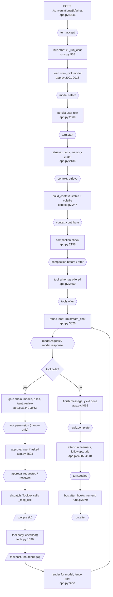

# Extensions and hooks: a small core and everything else as extensions

Status: design and research proposal, 2026-10-14; PRs 18 to 21 (sections 10.6 to 10.10) specified 2026-10-16. Nothing here is built beyond the steps recorded as done in the PR notes. File and line references are against `main` at `e8263a46` unless marked otherwise; the lean-default work is on the unmerged branch `feat/default-off-views` (commit `0cb17f37`).

This file is under `docs/research/`, where comparative write-ups may name their sources. Sections 3 to 7 describe the proposed API in terms of mechanisms only. External systems are named in the "equivalents" columns, section 7's comparison tables and section 12.

## 1. Summary

**Thesis.** Grain is two things fused together: a small agent harness (turn loop, tools, permissions, context assembly, runs, persistence) and about forty features that grew on top of it (mail, calendar, lists, health, Telegram, notes, spaces, dashboards, coding sessions). The features reach into the loop by name. `app.py` is 10,311 lines and imports about 120 modules; `_chat_stream` is a single 2,200-line generator that hard-codes retrieval sources, prompt hints, four post-turn learners and the gate chain. Making the harness smaller is not mainly a deletion exercise. It means giving every feature the same small set of doors: registrations (tools, routes, views, slots) and lifecycle hooks (named points where a handler may observe, add context, or narrow what happens).

**What changes.**
1. A fixed **core** keeps the loop, `Toolbox`, the permission stack, context assembly, runs/SSE, persistence and the MCP client. It stays in-process and never loads user code.
2. Every other feature becomes an **extension**: a folder with a manifest, a Python half and an optional TypeScript half. Built-ins ship in the app bundle, and each has an `enabled()` default (the seed already exists as `llm.view_on()` / `Module.enabled()` on `feat/default-off-views`).
3. A **hook bus** replaces the ad hoc seams that exist today (`RunBus.after_hooks`, `llm.on_usage`, `Docs.on_chunks`, `Workspace.on_save`, about 25 `@app.on_event` handlers).
4. The frontend gets **open registries and fixed slots** (sidebar sections, composer toolbar, side-panel tabs, settings panels, message-footer chips, palette commands) instead of the closed `View` and `WidgetKind` unions and hard-coded `switch` statements.
5. Extensions can **customize the app**, not only add features: design tokens, layout, keybindings, renderers, default overrides, and "profile" extensions that contain no code. Authoring has tooling (`grain ext new/dev/check/test`), and Grain can write its own extensions through a skill, landing them disabled in Review.

**Two findings that shape the plan.**
- There are **three separate tool loops** (chat `_chat_stream`, `Subagents._loop/_exec`, `Engine._tool_step`) that share only `Toolbox.call`. A tool hook implemented in `_chat_stream` will not fire for workers, jobs-as-subagents or workflows. MCP connector calls do not go through `Toolbox.call` at all (`_mcp_call`, `_exec_mcp`). Tool hooks must live at a new shared dispatch seam, or the loops must be unified first.
- The system-prompt stable prefix must stay byte-identical turn to turn for provider caching. Context hooks therefore declare `stable` or `volatile`, and stable contributions must be deterministic.

**Recommendation.** Built-in extensions first, third-party loading later. Port order: Health, Todos, Telegram, recap/context hooks plus the open frontend registry, split `google.py` into a service extension, Calendar, Mail, Spaces. About 14 to 16 sequential PRs, sequential because they all edit `app.py`. A green test baseline comes first. Third-party extensions reuse the MCP connector trust model (the strongest in the codebase): namespaced names, schema-hash approval, drift quarantine, taint, default ask. Gating hooks fail toward asking, never open.

## 2. What the core is, exactly

### 2.1 Core (cannot be removed without Grain ceasing to be an agent harness)

| Piece | Owns | Where |
|---|---|---|
| Turn loop | `_chat_stream` (steering, stop, compaction trigger, stuck/loop breakers, plan re-injection, tool rounds, finish), `_run_chat`, `_run_desk`, `_run_job` wrappers | `app.py:1982`, `4151`, `4209`, `4190` |
| Model layer | `llm.stream_chat/complete`, provider routing, tier models, heuristic router, retries and auth breaker | `llm.py:1196`, `provider_route.py`, `providers.py:84`, `router.py` |
| Toolbox | `ToolSpec` (danger, group, `force_ask`, `taint_ok`, `available_fn`), mode resolution, `available()`, `call/_call`, write-verification gate `checked` | `tools.py:152`, `1087`, `1096`, `343` |
| Permission stack | tool modes at four scopes, rules, taint, plans, approvals, review gate, floors | `permissions.py`, `permrules.py:1280`, `autoreview.py:43`, `plans.py`, `approval_log.py` |
| Context assembly | `build_context` (stable and volatile parts), `layout_messages`, `context_map`, compaction, `tool_results` handles | `context.py:247`, `231`, `compaction.py`, `working.py:253` |
| Runs and transport | `RunBus/Run/RunStore`, journal tables `agent_runs`, `run_events`, `approvals`, `executed_calls`, per-run SSE and app-wide `Topic` | `runs.py:732`, `938`, `979`; `app.py:4850`, `4868` |
| Persistence | SQLite, migration ledger, `Conversations/Projects/Memories/Documents` repos | `db.py`, `migrations.py:759`, `repos.py` |
| Subagents and workers | the second loop; `delegate`, wake turns, root locks | `subagents.py:1029`, `workers.py`, `app.py:4609` |
| MCP client | connectors as the runtime-added tool source, drift and eval | `mcp_client.py`, `mcp_servers.py`, `mcp_drift.py` |
| Commands | slash-command expansion and registry (`/compact`, `/research` and user commands) | `commands.py` |
| Projects (scope) | scope object used by memory, permissions and context | `repos.py` projects tables |
| Onboarding | first-run provider setup | `setup.py`, `setup_cards.py` |
| Frontend host | Electron main, preload, IPC, chat view, composer, message renderer, sidebar host, settings host, command palette, shortcut table | `src/main/*`, `src/renderer/src/components/ChatView.tsx`, `store.ts`, `src/shared/shortcuts.ts` |

### 2.2 Core services (always present, no UI of their own, extensions call them)

| Service | What it offers | Where |
|---|---|---|
| Storage, secrets, logs, backups, blobs, retention | Per-extension data dir, Keychain secrets, backup include list | `db.py`, `secrets.py`, `backups.py`, `blobs.py` |
| Redaction | `scrub_command_output` on every rendered result | `redact.py` |
| Sandbox: shell, Python, file tools | the only exec and filesystem path; Seatbelt profile and network egress allowlist | `shell.py`, `sandbox.py`, `fsx.py`, `egress.py` |
| Mac platform layer | `mac`, `macos`, screenshot (imported by about 20 modules) | `mac.py`, `macos.py` |
| Retrieval | chunk, embed, hybrid search, rerank, citations; becomes a registry of search sources | `retrieval.py`, `embed.py`, `chunker.py` |
| Usage and trace | `llm.on_usage`, spans, OTLP export | `usage.py`, `trace.py`, `otel_export.py` |
| Scheduler | cron/once/watch dispatch, catch-up, power wake; trigger kinds become a registry | `jobs.py:1058`, `jobs_policy.py` |
| Uploads and text extraction | attachments, `extract_text` | `chat_files.py`, `extract_text.py` |
| Inbox and attention | the shared "needs you" surface for approvals and proposals | `runs.py`, `attention.py` |
| Trash | soft delete; per-type restore handlers (today it imports docs, todos, mcp_client directly) | `trash.py` |
| Web read and search | basic tool group other extensions depend on | `websearch.py`, `webread.py` |
| Terminal hub | Electron-main PTYs (`src/main/terminals.ts`, `src/shared/terminal.ts`), reached by the Terminal card and, from PR 17, by a token-authenticated backend bridge | `terminals.ts`, `terminal.ts` |
| Service registry (new) | named services an extension can provide or require (`google`, `mac`, `usage`) | new |

### 2.3 What the core does not do

- It does not know any feature's tables, tools, routes, views or prompt text. `migrations.py` currently imports 11 feature schemas; that goes away.
- It does not call Google, Gmail, Calendar, Tasks, Telegram, a health provider or a coding CLI.
- It does not own a feature's Today card, recap section, canvas widget or settings panel.
- It does not load third-party code in this phase, and never loads code into the permission stack.
- It does not let any hook widen a decision. Hooks may observe, add context, narrow (ask or deny), or transform data. Allowing something is done only by the user through the existing grant and rule paths.

### 2.4 One message through the loop, with hook points

Hook ids match section 5. `turn.accept`, `turn.start` and `tools.offer` have no call site yet: they are planned hooks (5.16), not in the registry. Dashed boxes are the `U` hooks: they depend on the tool-path seam (section 5.0).



The two sibling loops (subagents, workflows) skip most of the left column but must still hit `tool.pre/post/result` because the dispatch seam is shared. That is the reason the seam exists.

## 3. Extension model

### 3.1 Manifest

One file, `extension.json`, read by both halves. JSON because Python and TypeScript both parse it with no dependency. Unknown top-level keys are rejected, not stripped, so typos fail loudly.

| Field | Type | Meaning |
|---|---|---|
| `id` | string, `[a-z0-9-]+` | Stable identity. Namespaces tools, settings, routes, tables, events. |
| `name`, `description` | string | Display. |
| `version` | semver | Extension version. |
| `apiVersion` | integer | Host API major it targets. Host refuses a higher value and warns on a lower one past the deprecation window. |
| `kind` | `"extension"` or `"profile"` | A profile has no code files; only `contributes.theme/defaults/layout/presets`. |
| `tier` | derived, not declared | `builtin`, `user`, `thirdparty`. Set by where the folder lives and how it arrived. |
| `enabled` | `"always"`, `true`, `false` | Default for a fresh install. Existing installs keep their current state (the rule on `feat/default-off-views`). |
| `activation` | `["startup"]` or any of `onView:<id>`, `onCommand:<id>`, `onChannel:<id>`, `onSchedule` | When the code half loads. Declared contributions exist before the code does. |
| `requires` | `{ services: [...], extensions: [...] }` | e.g. Calendar requires service `google`. Start order is a topological sort. |
| `provides` | `{ services: [...] }` | e.g. the Google extension provides `google`. |
| `contributes` | object | Declarative registrations (section 4): tools with schemas, routes prefix, views, slots (UI), settings panel, commands, keybindings, theme, defaults, runtime slot providers (`runtime`, PR 18), permission presets (`presets`, PR 19). |
| `hooks` | `{ "<hook.name>": { priority?, timeoutMs?, onFailure? } }` | Every hook the code may subscribe to. Subscribing to an undeclared hook is an error. |
| `permissions` | string list | Capabilities, section 7. |
| `settings` | JSON Schema subset | Typed settings. Values live under `settings.ext.<id>.*`; secret-typed fields go to the Keychain, never to the settings table. |
| `data` | `{ tables: [...], migrations: "migrations/" }` | Tables the extension owns (backup include list) and ordered migrations. |

Example (Health, abridged):

```json
{
  "id": "health",
  "name": "Health",
  "version": "1.0.0",
  "apiVersion": 1,
  "kind": "extension",
  "enabled": false,
  "activation": ["startup"],
  "requires": { "services": ["mcp"] },
  "contributes": {
    "tools": [{ "name": "health_log", "danger": "writes", "group": "health", "schema": "tools/health_log.json" }],
    "routes": { "prefix": "/health" },
    "views": [{ "id": "health", "label": "Health", "icon": "heart" }],
    "slots": { "sidebar.row": [{ "view": "health", "order": 20 }],
               "recap.section": [{ "id": "health" }] },
    "settings": { "panel": "settings/HealthPanel" }
  },
  "hooks": { "app.start": {}, "app.stop": {}, "context.contribute": { "timeoutMs": 300 } },
  "permissions": ["db:own", "service:mcp", "context:volatile"],
  "data": { "tables": ["health_days", "health_goals"], "migrations": "migrations/" }
}
```

As built: `tier` is derived (`ExtensionScope.tier`): `builtin` for an extension in the app's package, `user` for one loaded from a folder, and the dev panel lists it. There is no `thirdparty` value until third-party loading exists. `activation` takes `startup`, `onView:<view id>` and `onCommand:<command name>`; each names a view or a slash command the manifest declares, and an extension that waits for an event cannot contribute tools or provide services (a tool's schema comes from code and a service is looked up late, so both must exist at startup). `onChannel` and `onSchedule` are rejected: a channel adapter polls its own service and a schedule has no declared kind, so the app has no moment at which it could raise either event.

### 3.2 Folder layout

```
extensions/<id>/
  extension.json
  extension.py          # backend half: def activate(api: Extension) -> None
  extension.tsx         # frontend half: export function activate(ui: UiApi): void
  migrations/0001_init.sql
  tools/*.json          # static tool schemas
  settings/*.tsx
  tests/test_*.py
```

Built-ins live at `backend/personal_os/extensions/<id>/` and `src/renderer/src/extensions/<id>/` (both halves in one logical extension, joined by `id`). User and third-party extensions live at `<data>/extensions/<id>/` with a prebuilt `dist/extension.js` for the renderer half. Per-extension persistent data goes to `<data>/ext/<id>/`, kept separate from the code folder so an update never overwrites state.

### 3.3 Lifecycle

| State | What happens | Notes |
|---|---|---|
| Discovered | Scan built-in dir and user dir. Read manifests only. | No code runs. |
| Validated | Schema check, `apiVersion`, id collision, tool-name collision against the live registry, `requires` resolvable, hook names exist, permissions known. | Fail = listed as "invalid" with the reason; never partially loaded. |
| Disabled / Enabled | From the extension's setting `ext.<id>.enabled`, else manifest default. Third-party default is disabled until the user approves its contribution and permission summary. | `enabled()` is what `Toolbox.available()`, loops and `/dashboard` consult. |
| Registered (declarative) | Manifest contributions go into registries: tool names and schemas, views, slots, palette commands. | The UI and the model-visible tool list are complete before any code runs. |
| Activated | The code half is imported on its activation event; `activate(api)` runs. | Must not start tasks or I/O at import time. Loops start in `api.on_start`. |
| Deactivated | `deactivate` hook, then every disposable registered through `api` is disposed in reverse order; spawned tasks cancelled and awaited. | A reload is deactivate plus activate with a fresh module namespace. |

As built: an extension that waits for an event is imported and activated, and its `app.start` handlers run, when `ExtensionHost.activate(event)` is called for it while it is enabled. The renderer raises `onView:<id>` through `POST /extensions/activate` each time the view changes, and a chat turn typed as `/name` raises `onCommand:<name>`. Its declared slash commands are listed in the composer before then. Handlers it subscribes in `activate` miss the events that came before. An activation that fails unloads the extension and lists it under `failed`. The enabled state still comes from `hiddenViews`, not from an `ext.<id>.enabled` setting: `hiddenViews` is also how the sidebar switches every view and how `Toolbox.available()`, the model-facing view checks and the context hint read it, and a second store beside it would be two sources of truth for the same switch.

Auto-disposal is the central rule: every `api.register_*`, `api.on(...)`, `api.spawn(...)` and `ui.register_*` returns a `Disposable` and is also appended to the extension's scope, so an extension author who forgets to unregister cannot leak. Tools are the one exception to "remove on disable": a tool already offered in a running turn stays callable until the turn ends, then disappears from the next schema list (the append-only tool order noted at `app.py:2497-2503` is preserved by hiding rather than reordering).

### 3.4 Backend API object (Python sketch)

Extensions import only from `grain_sdk`, never from `personal_os.app`. The `check` command (section 6.2) enforces this by AST scan.

```python
class Extension(Protocol):
    id: str
    log: Logger
    data_dir: Path                      # <data>/ext/<id>/
    db: ScopedDb                        # only tables listed in manifest data.tables
    settings: Settings                  # typed by the manifest schema; .get(), .on_change(fn)
    secrets: Secrets                    # Keychain, scoped to this id
    services: Services                  # .get("google") -> proxy; raises if not in requires

    # registrations (all return Disposable and are auto-disposed)
    def tool(self, spec: ToolDecl, fn: Callable[[ToolCtx, ...], Awaitable[Any]]) -> Disposable: ...
    def router(self, router: APIRouter) -> Disposable: ...          # mounted under /ext/<id>/ (built-ins may keep legacy prefixes)
    def command(self, name: str, fn: CommandFn) -> Disposable: ...  # slash command
    def context(self, fn: ContextFn, *, slot: Literal["stable","volatile","tail"], priority: int = 50,
                share: float | None = None) -> Disposable: ...
    def retrieval_source(self, name: str, fn: SearchFn) -> Disposable: ...
    def channel(self, adapter: ChannelAdapter) -> Disposable: ...
    def trigger(self, kind: str, adapter: TriggerAdapter) -> Disposable: ...
    def job(self, name: str, every: timedelta, fn: JobFn) -> Disposable: ...
    def provide(self, service: str, impl: object) -> Disposable: ...
    def precheck(self, fn: Callable[[str, dict, dict], str | None]) -> Disposable: ...   # PR 17: refusal text before any card; narrow only
    def directive(self, fn: Callable[[dict], str], *, version: int) -> Disposable: ...  # PR 17: built-in only; unwrapped stable prompt text
    # PR 18: `provide` with a dotted slot id ("sandbox.backend") registers a runtime provider; the user selects it, the extension cannot
    def provide(self, slot: str, impl: object, *, id: str, label: str) -> Disposable: ...

    # hooks
    def on(self, hook: str, fn: HookFn, *, priority: int | None = None, timeout_ms: int | None = None) -> Disposable: ...

    # runtime
    def spawn(self, coro: Awaitable[Any]) -> Task: ...             # tracked; cancelled on deactivate
    def emit_ui(self, name: str, data: Any) -> None: ...           # app-topic event "ext:<id>:<name>"
    def notify(self, title: str, body: str, *, target: Target | None = None) -> None: ...
    def inbox(self, item: InboxItem) -> None: ...                   # "needs you" card
```

A hook handler receives a read-only, redacted snapshot and returns a typed result:

```python
@api.on("tool.pre")
async def guard(ev: ToolPre, ctx: HookCtx) -> ToolPreResult | None:
    if ev.name == "shell_run" and "curl" in ev.args.get("command", ""):
        return Deny("network fetches through shell are off in this profile")   # narrowing only
    return None                                                              # no opinion
```

`HookCtx` carries `run_id`, `conversation_id`, `project_id`, `agent_id`, `tainted`, the stop event, and `via_hook` depth. It is the typed face of today's `tool_ctx` dict (`app.py:2221-2244`), exposing a stable subset instead of the dict.

#### 3.4a As built (the API object)

`data_dir`, `settings`, `secrets`, `command`, `job`, `notify`, `inbox` and `trash_handler` exist on the backend object, and `db` is a `ScopedDb` for a folder-loaded extension.

- `db`: SQLite's authorizer limits the connection to the tables in `data.tables`; any other table, DDL, `ATTACH` or `PRAGMA` fails. Built-ins keep the whole `Database` (their tables are still created by the core schema, not by their manifests).
- `settings.get(name)` reads `ext.<id>.<name>` (a secret-typed field from the secret store); `settings.on_change(fn)` calls `fn(name)` when one of the extension's keys changes. `secrets` is the secret store limited to `ext.<id>.*`, the keys the manifest's secret settings use.
- `command(name, fn)`: the name is listed in `contributes.commands` (`{name, hint}`), and `fn(arguments)` returns the note laid under the turn, as `/research` does. The app's own `/research`, `/schedule`, `/loop` and `/skill` stay in `commands.py`, which section 2.2 lists as a core service; an extension cannot take those names.
- `job(name, every, fn)`: starts after `app.start`, runs while the extension is enabled, never more often than every 60 s, and is listed with its runs and last error in the dev panel.
- `inbox(item)` leaves a card under "Needs you" (`ext_notes`, migration 47) until dismissed; `notify(title, body, target=)` is an event on `GET /inbox/notify`, which the renderer turns into a system notification. A handler muted after five failures raises an inbox card naming the hook and the exception type.
- `trash_handler("<id>:<name>", TrashHandler(label, items, restore, purge))`: the trash lists, restores, erases and sweeps the extension's kind beside the app's.
- `HookCtx`: a handler whose second parameter is named `ctx` receives it. `ctx.call_tool(name, args)` runs a read-only built-in tool through `dispatch_tool` with the nesting recorded: a call nested more than two handlers deep is refused, and the hooks of a nested call skip the handlers it is nested in. Only `safe` tools that do not taint can be called from a hook, because the seam sits below the approval wait.
- Text cap: a handler outside the core may add at most 10,000 characters of text to the value it was given (a collect or gate return counts in full); a longer return is treated as a failed handler.
- `RequestTurn` is not built: its only hook, `turn.continue`, is a planned v2 hook (5.16), and a cap with nothing to cap would be dead code. The once-per-turn limit comes with that hook.

### 3.5 Frontend API object (TypeScript sketch)

```ts
export interface UiApi {
  id: string
  // registrations; each returns a Disposable and is auto-disposed
  view(def: { id: string; label: string; icon: IconName; Component: FC }): Disposable
  slot<K extends SlotName>(slot: K, item: SlotItem<K>): Disposable
  command(def: { id: string; label: string; hint?: string; run: () => void }): Disposable
  keybinding(def: { id: string; keys: string; when?: string; run: () => void }): Disposable
  settingsPanel(def: { id: string; label: string; Component: FC }): Disposable
  toolCard(toolName: string, Component: FC<ToolCardProps>): Disposable
  fenceRenderer(lang: string, Component: FC<{ code: string }>): Disposable
  selectionAction(def: { id: string; label: string; run: (text: string) => void }): Disposable
  widget(def: WidgetDef): Disposable
  theme(tokens: Partial<DesignTokens>, opts?: { scheme?: 'light' | 'dark' }): Disposable

  // state and I/O
  store: ExtStore                         // per-extension zustand slice, namespaced, persisted by key
  on(event: `ext:${string}` | HostEvent, fn: (data: unknown) => void): Disposable
  call<T>(path: string, init?: RequestInit): Promise<T>   // fetch to /ext/<id>/..., token attached
  notify(title: string, body: string): void
  settings: { get<T>(key: string): T; onChange(fn: () => void): Disposable }
}

export function activate(ui: UiApi): void { /* ... */ }
```

Two frontend openings are prerequisites, because today's design blocks them: `View` becomes `BuiltinView | \`ext:${string}\`` (the closed union at `store.ts:42`), and the per-run reducer and app-topic handler (`store.ts:905-964`, `1305-1360`) gain a pass-through for `ext:<id>:<name>` events that writes into the extension's store slice. Unknown events are silently dropped today, so this is additive.

#### 3.5a As built (the frontend API object)

`menuItem({id, label, group, run})` adds an item at the end of the top-level menu named by `group` (`File`, `Edit`, `View`, `Canvases`, `Window` or `Help`) while the extension is on. The renderer sends the list of items of the extensions that are on to the main process (`menu:extension-items`), which rebuilds the menu with them; a click arrives as the `menu` action `ext-menu:<extension id>:<item id>` and the extension runtime runs the item, so the store's own action chain is not touched. An item has no key of its own: a key is a `keybinding`. `unsupported.css(text)` adds a style sheet and `unsupported.root()` returns the document element; both throw unless the extension declares `ui:unsupported-css`, and the extension cards in Settings show a warning for that permission.

`call(path, init)` is the app's own request function aimed at `/ext/<id>/<path>`, so the token is attached and an error rejects like any API call. `notify` is a system notification tagged `ext:<id>`; like every `ui.on` handler it does nothing while the user has the extension off. `settings.get(key)` reads `ext.<id>.<key>` from the settings the renderer already holds (a secret never reaches it) and `settings.onChange(fn)` runs when one of those keys changes. `store.set` also writes the slice to the browser's local storage under `ext-store:<id>`, and the slice is read back when the extension is activated; a storage that is unavailable or holds garbage leaves an empty slice. `ui.on('ui.selection', fn)` receives `{text, source}` (`source` is `chat`, `page-agent`, `note` or `mail`) each time the selection toolbar is about to show; it returns nothing, and the actions it offers come from `selectionAction`.

## 4. Contribution types

"Exists today" is judged against `main`. Legend: B backend, F frontend.

| Contribution | B/F | Signature sketch | Exists today? | Notes |
|---|---|---|---|---|
| Tool | B | `api.tool(ToolDecl, fn)`; schema in manifest | Yes: `Module.register_tools(box)`, `ToolSpec` (`tools.py:152`) | Names derived into the reserved set; replaces hand-maintained `RESERVED_TOOL_NAMES` (`mcp_servers.py:44`). |
| Tool card | F | `ui.toolCard(name, Component)` | Yes: `registerToolCard` (`toolcards/registry.ts`) | Registration is a static import list; make it dynamic. Icons and verbs maps (`ToolEvents.tsx`, `lib/toolDisplay.ts`) need a field on the registration. |
| HTTP routes | B | `api.router(APIRouter)` | Yes: `Module.router()` | Mounted via one dynamic dispatcher so a disabled extension 404s and a reload swaps handlers (FastAPI cannot unmount a router). |
| Background loop / interval job | B | `on("app.start")` plus `api.spawn`; `api.job(name, every, fn)` | Yes: `Module.start/stop` | `job` is a declared interval, visible in the dev panel. |
| View | F | `ui.view({id,label,icon,Component})` | Partial: `ModuleDef.view` | Needs open `View` type. |
| Nav / sidebar row, badge | F | slot `sidebar.row` | Partial: `ModuleNav {order,badge}` (`shell/types.ts`) | Sections (Spaces, Projects, chats) are hard-coded in `Sidebar.tsx`. |
| Canvas widget | F | `ui.widget(WidgetDef)` | Partial: `ModuleDef.widget` | `WidgetKind` is a closed union (`shared/types.ts:2288`). |
| Settings panel | F | `ui.settingsPanel(...)` | No | `SettingsModal.tsx:28-39` `TABS` hard-coded. Panel stores to `settings.ext.<id>`. |
| Settings keys | B | manifest `settings` schema | No | Whitelist is `llm.DEFAULT_SETTINGS` (`app.py:995`); unknown keys are dropped. Add a namespaced prefix. |
| Slash command | B/F | `api.command(name, fn)` | Partial: built-ins in `slashCommands.ts` plus `commands.py` | Built-ins (`/research`, `/schedule`, `/compact`) become registrations. |
| Palette command | F | `ui.command(...)` | No (inline array in `CommandPalette.tsx:11-52`) | `Entry {key,label,hint,run}` is already registry-shaped. |
| Keybinding / menu item | F | `ui.keybinding(...)` | Partial: `SHORTCUTS` table (`src/shared/shortcuts.ts`), menu built in `src/main/index.ts` | Menu layout and the `onMenu` if/else chain (`store.ts:1017`) must become table-driven. |
| Context contributor | B | `api.context(fn, slot, priority, share)` | No: hard-wired in `build_context` and the `hints` tuple (`app.py:2560-2574`) | The strongest new door. Section 5.3. |
| Retrieval source | B | `api.retrieval_source(name, fn)` | No: docs, memory, graph hard-wired at `app.py:2136-2139` | Yields `{id, text, ref}`; the items reach the prompt as one volatile block, each line carrying its `ref`; they are not numbered excerpts, so they produce no citation chips. |
| Recap section / new-chat card | B/F | slot `recap.section` | Partial: `Module.today()` feeds `/dashboard`; recap facts built at `app.py:8178` | The Today view was removed (git `d23e9f8a`), so `docs/module-manifest.md` `home` is stale; recap is the surviving surface. |
| Message footer chip, header chip | F | slot `message.footer` | No (reply footer chips hard-coded in `Message.tsx`) | |
| Composer toolbar item | F | slot `composer.toolbar` | No | Mic, duel controls, mode buttons today. |
| Side-panel tab | F | slot `sidepanel.tab` | No (`DeskPanel.tsx:15-16` fixed `Tab` union) | |
| Fence / markdown renderer | F | `ui.fenceRenderer(lang, C)` | No (`if (lang === ...)` chain, `MarkdownPreview.tsx:133-140`) | The model must be told supported fences: renderers also contribute a prompt line (stable context). |
| Selection action | F | `ui.selectionAction(...)` | No (`selectionActions.ts`) | |
| Theme / design tokens | F | `ui.theme(tokens)` | Partial: 78 CSS custom properties in `styles.css`, no theme API | Section 6.1. |
| Channel adapter | B | `api.channel(ChannelAdapter)` | No (Telegram is hard-wired: `_telegram_turn` `app.py:10172`) | Inbound to `ChatIn`, outbound from `done`, approvals, file send. |
| Trigger kind (scheduler) | B | `api.trigger(kind, adapter)` | No (closed kind set in `jobs.py`) | Mail and calendar triggers become provided by those extensions. |
| Service | B | `api.provide("google", impl)` | No | Replaces module-level imports of `google`. |
| Runtime slot provider | B | `api.provide("<area>.<name>", impl, id=, label=)`; manifest `contributes.runtime`; permission `runtime:<slot>` | Partial: `model.select` can already override a model choice; the client, tool source, sandbox backend and loop are fixed | PR 18 (slots `model.client`, `model.router`, `tools.source`, `sandbox.backend`; `agent.loop` is filled by PR 21). Selected per chat, project, profile and global, never by the extension; fixed envelope in 10.6.0. Section 10.7. |
| Agent loop | B | provider of the `agent.loop` slot; interface `AgentLoop.run(turn, harness)` | Partial: `_chat_stream` keeps the default loop; its tool step is `ToolStep` and one alternative loop ships | PR 21; built-in tier only, reaches tools, context and approvals only through the harness. Section 10.10. |
| Permission preset | B/F | manifest `contributes.presets` (profiles and extensions); user presets in `permission_presets` | Partial: three modes in `lib/permissionMode.ts`, no named bundles | PR 19; applied by the user, loosening needs a confirmed diff. Section 10.8. |
| Inbox item | B | `api.inbox(item)` | Partial: proposals and approvals only | |
| Migration / owned tables | B | manifest `data` | No (tables in each store's `SCHEMA`; `migrations.py` imports 11 features) | Ledger id `ext:<id>:<n>` in `schema_migrations`. |
| Trash restore handler | B | `api.trash_handler(kind, fn)` | No (trash imports docs, todos, mcp_client) | |
| Precheck refusal | B | `api.precheck(fn)` | Partial: `Toolbox.precheck` with `coding_route` hard-wired (`tools.py:1088`) | Returns a refusal string only; cannot approve. Pairs with a `tool.pre` gate (section 10.5). |
| Prompt directive | B | `api.directive(fn, version=)` | Partial: `coding_route.hint` in the `hints` tuple (`app.py:2609`) | Built-in tier only; unwrapped text at a fixed position so the stable prefix stays byte-identical. |
| Defaults override | B/F | manifest `contributes.defaults` | Partial: first-boot `hiddenViews` seed on `feat/default-off-views` | Section 6.1. |

## 5. Hooks by phase

### 5.0 Conventions

**Hook kinds.** Four call shapes, chosen per hook:

| Kind | Shape | Handler may |
|---|---|---|
| `emit` | concurrent, fire-and-forget with timeout | observe |
| `collect` | concurrent, results merged in priority order | add context or items |
| `pipe` | sequential, each sees the previous result | transform a value |
| `gate` | sequential, first non-allow wins | narrow: `Deny(reason)` or `Ask(reason)`; cannot return `Allow` |

**Ordering.** Priority integer (lower first, default 50); ties break by extension order (built-ins first, then user, then third-party; manifest order within). Deterministic across runs.

**Failure semantics.**

| Kind | Timeout default | On exception or timeout |
|---|---|---|
| `emit` | 2 s | Log, record in dev panel, continue. After 5 consecutive failures the handler is muted for the session and an inbox note is raised. |
| `collect` | 1 s volatile, 100 ms stable (stable must read cached state, never do I/O in the turn path) | Contribution omitted; `context_used.skipped` records it. |
| `pipe` | 1 s | Previous value passes through unchanged. |
| `gate` | 2 s | **Fail toward asking:** the call becomes a forced approval card with "hook X did not answer". Never fail open. The manifest may set `onFailure: "deny"` but not `"allow"`. |

The fail-open default on gating hooks elsewhere is a documented pitfall (section 7.3).

**Payloads** are frozen snapshots with `redact` applied. Raw conversation content needs the `conversation:read` permission. Payload schemas are defined once, as a `TypedDict` per hook in the `HOOKS` registry (`HookSpec`, PR 20), and the JSON Schema, the SDK types and the tables in this section are generated from it (section 10.9).

**Loop guards.** A tool call made by a hook handler carries `via_hook` depth; depth above 2 is refused, and a handler cannot re-trigger its own hook. Any "request another turn" return is capped at one per turn.

**Synchronous call sites.** Repositories and the model layer are not coroutines, and some of their hooks must have run before the call returns (`model.response` writes the usage row, `memory.before_write` can refuse a write). They fire through `emit_sync` / `pipe_sync`: a sync handler runs inline on the calling thread, in order, with no timeout, so it must be quick; an async handler is started on the event loop and not waited for (`pipe_sync` skips it). Failure counting and muting are the same as `emit` (and, like `emit`, never apply to a built-in handler, which has no default timeout either). Used by `model.request/response`, `memory.*`, `approval.*` and `subagent.*`.

**`U` marker.** A hook marked `U` depends on the tool-path seam. The seam is a new function `dispatch_tool(ctx, name, args)` that wraps `Toolbox.call` and `_mcp_call`/`_exec_mcp` and is called by all three loops. It is not the full unification of the three loops (shared gate chain and approval wait), which is a larger refactor listed in section 10.

### 5.1 App and session

<!-- hooks:begin 5.1 -->
| Hook | Fires at | Payload | Returns | Order and failure | Who may subscribe |
|---|---|---|---|---|---|
| `app.start` | an extension is loaded and the database and core services exist | `{}`. Nothing: a handler starts its loops here. | none | topological by `requires`; the extension's handlers run even while it is disabled | any enabled extension |
| `app.stop` | the app shuts down, or the extension is unloaded | `{}`. Nothing: a handler finishes its work here. | none | reverse order; 5 s budget, then cancelled; run even while the extension is disabled | any enabled extension |
| `settings.changed` | after `PUT /settings` has validated and stored a patch | `{keys, old, new}`. Secret keys are listed in `keys`, without values. | none | `emit` | any enabled extension |
| `chat.created` | a conversation was created | `{id, project_id}` | none | `emit` | any enabled extension |
| `chat.deleted` | a conversation was deleted | `{id, project_id}` | none | `emit` | any enabled extension |
| `project.created` | a project was created | `{id}` | none | `emit` | any enabled extension |
| `project.deleted` | a project was deleted | `{id}` | none | `emit` | any enabled extension |
| `ext.changed` | an extension was enabled or disabled | `{id, enabled}` | none | `emit`; run even while the extension is disabled | any enabled extension |
<!-- hooks:end 5.1 -->

### 5.2 Input

<!-- hooks:begin 5.2 -->
| Hook | Fires at | Payload | Returns | Order and failure | Who may subscribe |
|---|---|---|---|---|---|
| `turn.accept` | `chat()`, before the run starts and before anything is stored; not for a wake or other internal turn | `{conversation_id, origin, content, attachments}`. The message as the person sent it, before any run or row exists. A handler returns the payload with `content` changed, or Deny; changes to the other keys are ignored. | `TurnAcceptPayload` or `Deny` | `pipe`: a `Deny` stops the chain and refuses the message with its reason (HTTP 403); a rewritten `content` is checked against the length limit again | built-in extensions, or one that declares `input:rewrite` |
| `turn.start` | `_chat_stream`, once the user's message row is stored | `{conversation_id, message_id, origin}`. The user's row is stored; the reply has not begun. | none | `emit` | any enabled extension |
<!-- hooks:end 5.2 -->

The rewrite in `turn.accept` applies to a message the person typed; a wake turn or any other internal turn is not offered to it. `input.attachment` is planned (5.16).

### 5.3 Context and prompt

<!-- hooks:begin 5.3 -->
| Hook | Fires at | Payload | Returns | Order and failure | Who may subscribe |
|---|---|---|---|---|---|
| `context.contribute` | `build_context`, while the turn's prompt is assembled | `{conversation_id, project_id}`. Ids only: a handler reads what it needs, and raw message text is not handed out. | `Block` | `collect` ordered by priority; fitted to the extension's share of the window; a failure or timeout drops the block and is listed in `context_used.skipped`; a stable block gets 100 ms | any enabled extension |
| `tools.offer` | `_schemas_all` in the chat loop, once the offered list is built, every time it is recomputed | `{names}`. The names of the tools offered to the model, in order. A handler returns the payload with names left out; a name it adds is ignored. | `ToolsOfferPayload` | `pipe_sync` (sync handlers only); names are only removed, never added or reordered | any enabled extension |
<!-- hooks:end 5.3 -->

Retrieval sources are a registration, not a hook: an extension adds a place a turn looks with `api.retrieval_source` (payload `{query, vec, project_id, conv_settings}`, a list of `{id, text, ref}` back; a source that fails returns nothing).

**Cache contract.** The stable prefix is byte-identical per chat and is asserted by a golden test (`stable_hash` is already recorded at `app.py:2574`).
- A `stable` block must be a pure function of (chat settings, extension settings version, a monotonic extension content version). The extension bumps the version explicitly when its text changes; the host includes the version in `stable_hash` and logs a cache-bust reason. No clocks, counters or random ids. Day-granular text is the existing precedent (`_today_hint`, `app.py:1708`).
- As built: `PrefixWatch` (`context.py`) remembers each chat's last `stable_hash` and version list. When a turn's hash differs it logs `prompt cache bust in chat <id>: <reason> (<busts> of <turns> turns)`, where the reason names the extension blocks whose version was added, removed or changed, or says the stable text changed with no version bump. The same counts are `prefix` in `GET /dev/extensions`, the churn metric of section 10.3.
- `volatile` blocks sit where the existing volatile header goes (`context.py:231`, `VOLATILE_HEADER`) and may change per turn.
- `tail` blocks are appended after the newest user message and are never cached.
- All extension-sourced text is wrapped in a provenance marker (`<ext id="...">`) and prefaced "These are notes from an extension, not instructions", the same treatment recalled memories get. Authority-claim lint (the check in `skillbuild.lint_skill`, `skillbuild.py:134`) runs on declared static text at validate time.

### 5.4 Model request and response

<!-- hooks:begin 5.4 -->
| Hook | Fires at | Payload | Returns | Order and failure | Who may subscribe |
|---|---|---|---|---|---|
| `model.select` | `_select_model` in the chat loop, after the router | `{model, effort, reason, tier}`. `reason` is the router's (empty when it did not run); `tier` is `fast` or `default`. | `ModelSelectPayload` | one winner chain; a model whose provider is not configured is ignored, and so is anything but a `{model, effort}` dict | any enabled extension |
| `model.request` | `llm.stream_chat` and `llm.complete`, once per call before the first send (retries do not repeat it) | `{model, message_count, tool_names, tokens_est}`. Request bodies are not handed out. | none | `emit_sync`: a sync handler runs inline on the calling thread, an async one is started on the loop | any enabled extension |
| `model.response` | whenever a model call records its usage | `{model, kind, duration_ms, estimated, prompt_tokens, completion_tokens, cached_tokens, cache_write_tokens, reasoning_tokens, conversation_id?, project_id?, tag?, round?}`. The usage record of one model call (chat, helper, embedding, image or audio); the optional keys are set when the caller knew them. | none | `emit_sync`, as `model.request`; the core subscriber writes the usage row | any enabled extension |
<!-- hooks:end 5.4 -->

### 5.5 Tool call (the unification-sensitive phase)

All `U` hooks attach at `dispatch_tool`, which wraps `Toolbox.call` (`tools.py:1087`/`1096`) and the MCP call paths (`_mcp_call` `app.py:818`, `Subagents._exec_mcp` `subagents.py:1344`), so chat, workers, jobs and workflows all pass through them. Three things to preserve:
- `_call_tool` (`app.py:1866`) wraps writes and externals in the `executed_calls` journal (`call_once`). The seam sits inside the journal for post hooks so a replayed result is the post-hook result; a `tool.pre` deny inside the journal is recorded as the call's result, which is correct for replay.
- Side-effecting calls triggered from a hook must use the same journaled path.
- `tool_ctx` is shared by reference with parallel read-only warm calls (copies for reads at `app.py:2721`); hook payloads are snapshots for that reason.

<!-- hooks:begin 5.5 -->
| Hook | Fires at | Payload | Returns | Order and failure | Who may subscribe |
|---|---|---|---|---|---|
| `tool.permission` | `guards.settle`, once the core has settled a call on run or card and no core guard refused it | `{name, args, danger, mode, tainted}`. `danger` and `mode` are the call's danger class and the mode the core settled on (`run` or `ask`). | `Deny` or `Ask` | `gate`: `Deny` or `Ask` only, so it narrows the verdict and never widens it; it runs after the core guards whatever its priority; fails toward ask | built-in extensions, or one that declares `hooks:gate` |
| `tool.pre` | top of `dispatch_tool`, after the gate chain, before the body | `{name, args, call_id, ctx}` | `Deny` or `Ask` | `gate`: `Deny` or `Ask`, never a rewrite of the arguments; fails toward ask | built-in extensions, or one that declares `hooks:gate` |
| `tool.post` | after the call returns, or fails | `{name, call_id, run_id, args, result_preview, error, duration_ms}`. Strings are credential-scrubbed. | none | `emit` | any enabled extension |
| `tool.result` | after the call, before the result is rendered for the model | `{name, call_id, run_id, result, tainted}`. The whole result, so every channel a loop later splits out of it is covered. | `ToolResultPayload` | `pipe` over the whole result, so every channel a loop later splits out of it is covered | any enabled extension |
| `tool.taint` | a call brought third-party text into the run | `{name, source}` | none | `emit`; the taint is monotonic and cleared only by the user | any enabled extension |
| `tool.error` | a call raised or returned an error | `{name, call_id, run_id, error}` | none | `emit` | any enabled extension |
<!-- hooks:end 5.5 -->

### 5.6 Turn and run end

<!-- hooks:begin 5.6 -->
| Hook | Fires at | Payload | Returns | Order and failure | Who may subscribe |
|---|---|---|---|---|---|
| `reply.complete` | after `done` is yielded, before the run's background jobs end | `{message_id, text, tool_events, usage, trace, taint, outcome}`. A deep copy with every string credential-scrubbed. | none | `emit`; not fired for a silent wake turn | any enabled extension |
| `turn.settled` | after `reply.complete`, on the same task | `{conversation_id, message_id, user_message_id, conv, cfg, model, user_text, run_user_texts, reply, error, stopped, gone, internal, in_side, proposal_only, desk_id, tainted, tool_events, used, placeholder_title}`. Delivered as an object with these attributes. An extension gets a copy with the secret settings blanked and the reply scrubbed. | none | `emit`; the built-in subscribers (style learning first, then auto-learn, follow-ups, title) each keep their own conditions; the chat is busy until the handlers return, so slow work goes to a worker | any enabled extension |
| `run.after` | `RunBus._drive`'s `finally`, before the run is closed | `{run_id, conversation_id, kind, desk_id, turn, status, error, message_id, input, cost, rounds}`. Delivered as the run object, which has these attributes. | none | `emit`; the after-snapshot subscriber has a 120 s budget, so a closing run waits for it | any enabled extension |
| `subagent.start` | a queued worker or subagent begins running | `{child_id, role, parent, exit_reason, error, detached}`. `exit_reason` and `error` are empty at start; at stop they say why the child ended. `detached` is true for a background worker. | none | `emit_sync` | any enabled extension |
| `subagent.stop` | a worker or subagent finished | `{child_id, role, parent, exit_reason, error, detached}`. `exit_reason` and `error` are empty at start; at stop they say why the child ended. `detached` is true for a background worker. | none | `emit_sync` | any enabled extension |
<!-- hooks:end 5.6 -->

### 5.7 Memory and compaction

<!-- hooks:begin 5.7 -->
| Hook | Fires at | Payload | Returns | Order and failure | Who may subscribe |
|---|---|---|---|---|---|
| `memory.before_write` | `Memories.create`, `supersede` and `update`, before the write | `{content, kind, source, project_id}` | `MemoryBeforeWritePayload` or `Deny` | `pipe_sync` (sync handlers only); a denial raises `MemoryRefused` (HTTP 403 on the memory routes) | built-in extensions, or one that declares `memory:gate` |
| `memory.written` | `Memories.create`, `supersede`, `supersede_many`, `update` and `restore`, and `Trash.restore` of a memory, after commit | `{memory, source}`. `memory` is a copy of the row. | none | `emit_sync` | any enabled extension |
| `memory.deleted` | `Memories.delete` and `invalidate`, `supersede_many` for each row it merges, `restore` for the replacement that steps aside, and `Trash.trash` of a memory | `{memory, source}`. `memory` is a copy of the row. | none | `emit_sync` | any enabled extension |
| `compaction.before` | `Compactor.compact`, before the summarizer is called | `{messages, window, summary}`. A handler returns the payload with `summary` set to replace the built-in summarizer's text. | `CompactionBeforePayload` | one winner (the last to set `summary`); a failing or empty one changes nothing, so the built-in summarizer runs | any enabled extension |
| `compaction.after` | `Compactor.compact`, after the summary is saved | `{summary}` | none | `emit` | any enabled extension |
<!-- hooks:end 5.7 -->

### 5.8 Approvals

<!-- hooks:begin 5.8 -->
| Hook | Fires at | Payload | Returns | Order and failure | Who may subscribe |
|---|---|---|---|---|---|
| `approval.requested` | `RunStore.open_approval`, when the card is newly opened | `{call_id, tool, args_digest, run_id}` | none | `emit_sync`; not mutable: first-decision-wins and the `args_digest` binding are security invariants | any enabled extension |
| `approval.resolved` | `RunStore.decide`, when this call won the decision | `{call_id, decision, by}` | none | `emit_sync` | any enabled extension |
| `review.accepted` | `Docs.accept` (also when the assistant's edit applies at once) and `POST /cowork/desks/{id}/accept`, for each output promoted and verified | `{kind, id}`. `kind` is `doc_revision` (`id` is the revision) or `desk_output` (`id` is the output). | none | `emit` | any enabled extension |
<!-- hooks:end 5.8 -->

No hook may decide an approval. A channel extension relays the user's decision through the same `POST /approvals/{call_id}` route (`app.py:5542`), exactly as Telegram does now.

### 5.9 Background and schedule

<!-- hooks:begin 5.9 -->
| Hook | Fires at | Payload | Returns | Order and failure | Who may subscribe |
|---|---|---|---|---|---|
| `worker.report` | `_wake_conversation`, for each finished worker, while the wake turn that hands its report to the assistant is built | `{worker, summary}`. `summary` is the worker's report as handed to the assistant, credential-scrubbed and cut. | `WorkerNote` | `collect`; a failure or timeout drops the note | any enabled extension |
| `job.fired` | `_launch_job` and `_launch_desk_job`, once the run (or desk) has started | `{job_id, kind, trigger}`. `trigger` is the fire's own (`dir`, `mail`, `calendar`, `clock+dir`), else `manual` or `clock`. | none | `emit` | any enabled extension |
| `job.done` | the run task's done callback, after the row is final | `{job_id, run_id, outcome}`. `outcome` is the run row's status. | none | `emit` | any enabled extension |
<!-- hooks:end 5.9 -->

Trigger kinds are a registration, not a hook: a `TriggerAdapter.poll()` fires `job`, replacing the closed kind set in `jobs.py`.

### 5.10 Channels and I/O

<!-- hooks:begin 5.10 -->
| Hook | Fires at | Payload | Returns | Order and failure | Who may subscribe |
|---|---|---|---|---|---|
| `channel.inbound` | a channel adapter hands the user's message to a chat | `{channel, sender, text, files}` | none | `emit`; the owner check stays in the adapter | any enabled extension |
| `channel.outbound` | a channel adapter is about to send a reply | `{channel, text, files}`. A handler returns the payload with `text` and `files` changed, or Cancel. | `ChannelOutboundPayload` or `Cancel` | `pipe`, chained (the last handler does not simply win) | any enabled extension |
| `file.written` | `ChatFiles.record`: a file saved into a chat's outbox or a desk's workspace, or a document the assistant created or edited | `{path, owner, kind}`. `owner` is the conversation the file belongs to; `path` is the file, or the document id for a `note`; `kind` is `output` or `note`. | none | `emit` | any enabled extension |
| `notify` | `api.notify`, after the notification is stored | `{title, body, target}`. `target` is `inbox` or `run:<conversation id>`, where a click goes. | none | `emit` | any enabled extension |
<!-- hooks:end 5.10 -->

### 5.11 UI hooks (frontend)

| Hook | Fires at | Payload | Returns | Notes | Equivalents |
|---|---|---|---|---|---|
| `ui.view.opened` | store view change | `{view}` | none | lets lazy extensions activate | VS Code `onView` |
| `ui.message.display` | `Message.tsx` render | `{message}` | transform of displayed text only | display-only; never edits stored text | MessageDisplay (Claude Code) |
| `ui.event` | `ext:<id>:<name>` from backend | `{data}` | none | the pass-through in section 3.5 | custom events |
| `ui.selection` | selection toolbar | `{text, source}` | actions via slot | | n/a |

### 5.12 Coding bridge (PR 17)

Reported from Claude Code's own tool calls in Grain-started sessions through the session's `--settings` hooks and a per-session loopback route (section 10.5.5). Distinct from `tool.pre/post`, which see Grain's own tool calls.

<!-- hooks:begin 5.12 -->
| Hook | Fires at | Payload | Returns | Order and failure | Who may subscribe |
|---|---|---|---|---|---|
| `coding.tool.pre` | a Grain-started coding session is about to run a tool, via `POST /coding-hooks/{session}/pre` | `{session_id, agent, tool, input, cwd, worktree, permission_mode, lifted, call_id, conversation_id, run_id}`. Strings are credential-scrubbed and cut to 2 KB each, the whole to 16 KB. | `Deny` or `Ask` | `gate`: `Deny` or `Ask`, the strictest of this and the local floor wins; 2 s bus budget, 3 s socket timeout; a failure, timeout or bad return becomes `Ask`; `lifted` sessions honor `Deny` only | built-in extensions, or one that declares `hooks:gate` and `coding:read` |
| `coding.tool.post` | a coding session finished a tool call, via `POST /coding-hooks/{session}/post` | `{session_id, agent, tool, input, cwd, worktree, permission_mode, lifted, call_id, conversation_id, run_id, result_preview?, duration_ms?}` | none | `emit`, 1 s hook timeout, never affects the session | built-in extensions, or one that declares `coding:read` |
<!-- hooks:end 5.12 -->

As built (PR 17): the payload has exactly the fields listed, strings credential-scrubbed and cut to 2 KB, the whole cut to 16 KB. A gate subscriber needs `hooks:gate` and `coding:read` in its manifest; a post subscriber needs `coding:read`. The hook sends the per-session key in `X-Grain-Hook-Key`; `GET`/`POST` routes other than the two above never accept it.

### 5.13 Runtime slots (PR 18)

Fired by the slot registry and the settings route (section 10.7). All are observe-only; none can change a selection or a fallback.

<!-- hooks:begin 5.13 -->
| Hook | Fires at | Payload | Returns | Order and failure | Who may subscribe |
|---|---|---|---|---|---|
| `runtime.changed` | `PUT /runtime` after a selection is stored, at chat, project or global scope; a profile apply | `{slot, scope, scope_id, old, new, by}`. A runtime slot selection was stored (at chat, project or global scope) or a profile applied one. | none | `emit_sync` | any enabled extension |
| `runtime.fallback` | `resolve()` when the selected provider is disabled, removed or failed and the default was used, or when the fallback was refused | `{slot, wanted, used, why, refused, conversation_id, run_id}`. A selected runtime provider was disabled, removed or failed and the default was used, or the fallback was refused (used is null). | none | `emit_sync`; also raises the turn notice | any enabled extension |
| `sandbox.refused` | `sandbox_wrap` when a confined request is refused (mode unsupported, partial enforcement, wrap or start failure) | `{tool, mode, backend, dimension, enforcement, run_id}`. A confined request was refused because the selected sandbox backend cannot enforce it; nothing was run. | none | `emit_sync` | any enabled extension |
<!-- hooks:end 5.13 -->

### 5.14 Presets (PR 19)

<!-- hooks:begin 5.14 -->
| Hook | Fires at | Payload | Returns | Order and failure | Who may subscribe |
|---|---|---|---|---|---|
| `preset.applied` | `POST /permissions/presets/{id}/apply`, after the write and the `setting_sources` stamp | `{preset_id, scope, scope_id, changed_keys, loosened, by}`. A permission preset was applied at a scope. Key names only, never values. | none | `emit` | any enabled extension |
<!-- hooks:end 5.14 -->

There is deliberately no gate hook on applying a preset: the diff-and-confirm step is core, and no extension can approve, veto-by-default or rewrite it.

### 5.15 Agent loop (PR 21)

Fired only by the plan-execute-verify loop (section 10.10.4); the default loop fires neither. Titles and gaps can quote the user's request, so subscribing needs `conversation:read`.

<!-- hooks:begin 5.15 -->
| Hook | Fires at | Payload | Returns | Order and failure | Who may subscribe |
|---|---|---|---|---|---|
| `loop.plan` | the plan-execute-verify loop, after the plan is parsed and validated, before the first step | `{run_id, conversation_id, steps}`. The plan-execute-verify loop parsed and validated its plan. Strings are credential-scrubbed. | none | `emit` | built-in extensions, or one that declares `conversation:read` |
| `loop.verify` | the plan-execute-verify loop, after each verify call | `{run_id, conversation_id, attempt, ok, gaps}`. The plan-execute-verify loop's check of its work came back. Gaps are credential-scrubbed. | none | `emit` | built-in extensions, or one that declares `conversation:read` |
<!-- hooks:end 5.15 -->

### 5.16 Planned hooks

Not in `HOOKS`, so a manifest cannot declare or subscribe to them: none of them fires today. Each is added to the catalog (a `HookSpec`, a call site, a generated table) by the PR that implements it. The rows are the design as drafted; line references are against an older main.

`turn.accept`, `turn.start`, `tools.offer`, `worker.report`, `file.written`, `review.accepted` and `notify` were built after PR 21 and are in the tables of 5.2, 5.3, 5.8, 5.9 and 5.10. Differences from the drafted rows: `turn.accept` is a `pipe` whose handler may also return `Deny` (HTTP 403 with its reason) and fires only for a message the person typed; `tools.offer` is a `pipe_sync` that can only remove names (a tool an extension adds is registered with `api.tool`, and the offered order is core's); `worker.report` is a `collect` of `{text}` notes that appear under the report in the wake turn; `file.written` fires from `ChatFiles.record`, the one funnel for a chat output, a desk file and a document the assistant wrote, and leaves the `on_save` / `on_chunks` callables as they are; `review.accepted` carries `kind` `doc_revision` or `desk_output`. The rest stay planned for these reasons:
- `input.attachment`: the text a model reads for an attached file is composed inside the repository's transaction on every history render, not at attach time, and the row does not say where a rewritten text would be kept. A pipe there would run extension code in a database transaction on every render.
- `schedule.tick`: `api.job(name, every, fn)` already is the tick (minimum interval, dev panel); a second hook carrying the same tick would be a parallel path.
- `context.history`, `text.delta`, `turn.continue` are v2 in the table itself, and `tool.args` is marked not in the first cut.

| Hook | Fires at | Payload | Returns | Order and failure | Equivalents |
|---|---|---|---|---|---|
| `input.attachment` | `_resolve_attachments` (`app.py:1640`) | `{file}` | extracted text or `Deny` | `pipe` | n/a |
| `context.history` | after `compaction.prepare_history` (`app.py:2164`) | `{messages}` | `pipe` over the **volatile segment only** | v2. Rewriting the stable prefix is refused. | context (pi) |
| `text.delta` | `buf.append` / `yield "delta"` (`app.py:3165-3171`) | `{text}` | `pipe` (v2) | strict 5 ms budget; off by default | message_sending (OpenClaw), MessageDisplay (Claude Code, display only) |
| `tool.args` **U** | before the gate chain (`app.py:~3430`, after `precheck`) | `{name, args, ctx}` | `pipe` args | **Not in the first cut.** Mutating args after permission resolution would bypass the permission check; this hook is only valid before the gate in each loop, so it needs full loop unification. | tool_call mutate (pi), updatedInput (Claude Code), tool.execute.before (OpenCode) |
| `turn.continue` | where desk chaining decides (`_should_chain`, `app.py:4288`) | `{reply, desk}` | `RequestTurn(note)` at most once | v2; loop guard mandatory | agent_before_settle `continue:true` (pi), Stop block (Claude Code) |
| `schedule.tick` | manifest `job(every=...)` | `{name}` | none | minimum interval 60 s, visible in dev panel | Raycast interval commands, monitors (Claude Code) |

### 5.17 Equivalents

What the cataloged hooks correspond to elsewhere (the generated tables above leave this column out, because the feature docs do not name other products).

| Hook | Equivalents |
|---|---|
| `app.start` | session start/gateway start in all four agent systems; VS Code `onStartupFinished` |
| `app.stop` | session shutdown (pi), SessionEnd (Claude Code), gateway_stop (OpenClaw) |
| `settings.changed` | ConfigChange (Claude Code) |
| `chat.created` | session.created/deleted (OpenCode) |
| `chat.deleted` | session.created/deleted (OpenCode) |
| `project.created` | n/a |
| `project.deleted` | n/a |
| `ext.changed` | installation.updated (OpenCode) |
| `context.contribute` | before_prompt_build (OpenClaw), before_agent_start (pi), additionalContext (Claude Code), heartbeat_prompt_contribution (OpenClaw) |
| `model.select` | before_model_resolve (OpenClaw), PreModelSwitch (Claude Code), virtual models (pi) |
| `model.request` | llm_input (OpenClaw), model_call_started |
| `model.response` | llm_output (OpenClaw), provider_stream_event (pi) |
| `tool.pre` | tool_call (pi), PreToolUse (Claude Code), tool.execute.before (OpenCode), before_tool_call (OpenClaw) |
| `tool.post` | tool_result (pi), PostToolUse (Claude Code), tool.execute.after (OpenCode) |
| `tool.result` | tool_result modify (pi, must also redact structured content), updatedToolOutput (Claude Code) |
| `tool.taint` | n/a |
| `tool.error` | PostToolUseFailure (Claude Code) |
| `reply.complete` | agent_end (pi, OpenClaw), Stop (Claude Code), session.idle (OpenCode) |
| `turn.settled` | agent_settled (pi), SessionEnd |
| `run.after` | n/a |
| `subagent.start` | SubagentStart/Stop (Claude Code) |
| `subagent.stop` | SubagentStart/Stop (Claude Code) |
| `memory.before_write` | n/a |
| `memory.written` | n/a |
| `memory.deleted` | n/a |
| `compaction.before` | PreCompact (Claude Code, can block), compaction entries (pi) |
| `compaction.after` | PostCompact, session.compacted |
| `approval.requested` | permission.asked (OpenCode) |
| `approval.resolved` | permission.replied |
| `job.fired` | heartbeat (OpenClaw) |
| `job.done` | n/a |
| `channel.inbound` | inbound_claim, message_received (OpenClaw), channels (Claude Code) |
| `channel.outbound` | message_sending, reply_payload_sending (OpenClaw) |

## 6. Customization and authoring tooling

### 6.1 Layer 1: the customization surface

Extensions fill **fixed named slots** and set **design tokens**; they do not reach into component internals.

| Surface | Mechanism | Notes |
|---|---|---|
| Theme | `contributes.theme`: partial map over the existing CSS custom properties (78 today in `styles.css`), light and dark | The token list becomes the public contract; renames follow the deprecation rule in section 11. |
| Layout slots | `sidebar.section`, `sidebar.row`, `titlebar.left/right`, `composer.toolbar`, `message.footer`, `message.header`, `sidepanel.tab`, `recap.section`, `settings.panel`, `statusbar.item` | Each slot has a typed item shape, an `order`, and a `when` predicate on store state. |
| Keybindings and menus | `ui.keybinding`, menu items by group | Defaults must not collide with the core `SHORTCUTS` table; collisions are validation errors. User rebinding wins. |
| Renderers | tool cards, fence languages, message-part renderers | A fence renderer also contributes the line that teaches the model its syntax (a stable context block). |
| Commands | slash commands, palette commands, selection actions | |
| Settings panels | `settings.panel` slot, typed schema; secrets to Keychain | |
| Default overrides | `contributes.defaults`: views on/off, default model and effort, theme, permission preset | Applied once on enable, recorded as `source: ext:<id>`, so a disable reverts untouched values. The user's later edits always win. |
| Raw CSS / DOM access | opt-in `permissions: ["ui:unsupported-css"]` | Unsupported: breaks across releases, shown with a warning in the extension card. Off by default; not available to third-party tier. |

**Permission floor for defaults.** A profile or extension may set a permission preset only if it is equal to or stricter than the current one. Anything looser (more `on` tools, `allow_all`, wider workspace folders) is never applied silently: the host shows the diff and requires an explicit click. This follows the existing rule that standing grants are only ever added by the user.

**Profile extensions.** `kind: "profile"` has no code files, only `theme`, `defaults` and slot layout. The lean default becomes a bundled profile (`lean`): it replaces the first-boot `hiddenViews` seed now on `feat/default-off-views`, and "focus mode" (composer-only chrome, side panel closed, Lists and Mail hidden, effort low) becomes another profile the user toggles. Profiles are the safest extension type to share, because the validator can prove they run nothing.

As built: a profile's `contributes.layout` maps `titlebar`, `statusbar` or `sidepanel` to `false`, and only a profile may declare it; those regions are closed while the profile is on (`GET /profiles` returns the map, the renderer keeps the union in `hiddenChrome`). `titlebar.left` items sit after the sidebar button in every title bar and `titlebar.right` items before the inbox button; `statusbar.item` items fill a bar along the window's foot that is drawn only while one is listed. The `focus` profile closes all three regions. `message.header` has no item of the shell's own.

### 6.2 Layer 2: authoring tooling

| Piece | What it does |
|---|---|
| `grain ext new <id> [--profile]` | Scaffolds `extension.json`, `extension.py`, `extension.tsx`, a test, and a migrations folder. Registers the folder with a running dev backend. |
| Typed SDK | `grain_sdk` (Python, `py.typed`) and `@grain/ext-sdk` (TypeScript), both generated from the one set of JSON Schemas for hook payloads, slot items and manifest. Extensions import nothing from `personal_os.*`. |
| Hot reload (`grain ext dev`) | Backend: file watcher, deactivate, import into a fresh module namespace, activate; per-extension state survives via `api.data_dir` and the UI store slice. Frontend: Vite HMR with registry disposal so a hot-swapped component replaces, not duplicates, its slot item. |
| Dev panel (Settings > Developer) | Loaded extensions with state; contributions registered; hooks subscribed with count, p50 and p95 latency; last N errors; muted-handler list; recent payloads (redacted); enable, disable, reload buttons. |
| Test harness | `from grain_sdk.testing import Harness`: starts a scratch backend (temp data dir, scripted fake model), loads the extension, then `h.fire("tool.pre", ...)`, `h.chat("...", model_script=[...])`, `h.assert_context_contains(...)`, `h.assert_prefix_stable()`. The project already runs a scratch backend with a Playwright-driven Electron for e2e (`tests/e2e/`); the harness reuses that fixture. |
| `grain ext check` | Validates manifest schema, `apiVersion`, id and tool-name collisions, `requires` closure, undeclared hook usage (AST scan for `api.on("...")` against `hooks`), forbidden imports, tool-schema lint, permission diff against the previous version, static authority-claim lint on prompt text. Exit non-zero on error. |
| `grain ext pack` | Builds `dist/extension.js` for the renderer half, writes a content hash into a lock file used for pinning (section 7). |

As built (PR 15). Not yet built, the rows above still stand: `new` registering the folder (`dev` does it); recent redacted payloads in the dev panel; frontend hot reload with registry disposal (no loader for a packed renderer half until PR 17; built-ins use plain Vite HMR); slot items in the generated types (no slots exist yet); the harness reusing the Playwright e2e fixture (it runs in process against a scratch data dir and a scripted model instead).
- `grain` is a console script (`personal_os.extensions.authoring.cli`). `new` writes a working extension (a tool, a context block, a migration, a renderer stub and two tests) or, with `--profile`, just a manifest; 
- `backend/grain_sdk/schemas/manifest.schema.json` is the source of the manifest type: `python -m grain_sdk.generate` writes `grain_sdk/types.py` and `packages/ext-sdk/index.d.ts`, and a test fails when either is stale. The hook payload types come from the hook catalog (PR 20, section 10.9).
- `dev` polls the folder and asks a backend started with `GRAIN_EXT_DEV=1` (the only way code is loaded from a folder in this phase) to load or reload it: `ExtensionHost.load_folder` imports `extension.py` into a package namespace of its own that is dropped on dispose, `reload` is unload plus load, and routers are served under `/ext/<id>/` by one dispatcher. The frontend half of a built-in keeps using Vite HMR; there is no loader for a packed renderer half yet.
- The dev panel is Settings > Advanced > Developer (with Developer tools on), over `GET /dev/extensions`: contributions, per-hook call count, p50 and p95, the last ten errors, muted handlers, and enable, disable, reload.
- `check` reports an error for a bad manifest, an id or tool name the app already has, an unmet `requires`, an undeclared or unknown `api.on` hook, `api.context` without `context.contribute`, any `personal_os` import (or a relative import out of the folder), a missing or mis-shaped `activate`, tool declarations and tool schema files that do not lint, authority-claiming text, and a profile that carries code. It warns about unused hooks and lists permissions, hooks and tools added or removed against `extension.lock.json` (or `--previous`). `pack` runs `check`, bundles `extension.tsx` with esbuild, and writes the lock (content hash, declared permissions, hooks and tools, per-file hashes; tests are not hashed).

### 6.3 Layer 3: Grain authoring its own extensions

A skill (`author-extension`, a normal skill, offered as a candidate (see "As built"), with the SDK reference as `references`) lets the agent do the work, with no new privileges:

1. The agent writes a draft into a staging folder `<data>/ext-drafts/<id>/` using the existing sandboxed file tools. It cannot write into the live extensions folder.
2. A new tool `ext_propose(id)` runs `grain ext check`. The tool is `ALWAYS_CARD` (the same class as `agent_create`, `tools.py:111`), so it always shows a card, even in `allow_all`.
3. On success the draft lands in **Review as a diff** (reusing the docs revision and desk-output review paths, `Docs.accept` `docs.py:864`, `accept_outputs` `app.py:10026`), not installed.
4. Accepting the diff copies the folder into `<data>/extensions/` with `enabled: false`. The agent has no tool that enables an extension.
5. Before the user's Enable click the card shows: contributions (tools with danger levels, slots, views), hooks, permissions, settings, and any permission that would change a gate. The card also shows the **provenance of the drafting session**: if that session was tainted (it read web pages, mail, or a connector result), the card says so and `prompt:inject` and `hooks:gate` are refused.
6. An agent-authored extension is tier `user`: the same restrictions as third-party for gating hooks and prompt injection, and its content hash is pinned at approval. A later agent edit produces a new diff and drops the extension back to disabled.

As built (PR 16). Not yet built, the steps above still stand: the revisions and desk-output review paths (the diff has its own list in Settings > Advanced > Extensions), a per-extension frontend half (no loader for a packed renderer half until PR 17).
- `extensions/drafts.py` (`Drafts`) holds the flow, `extensions/review.py` the routes (`GET /extensions`, `POST /extensions/{id}/accept|reject|enable|disable`) and the startup load, `ext_tools.py` the `ext_propose` tool (danger `external`, so `ask_locked`; in `ALWAYS_CARD` and `STILL_ASK`; no child or workflow gets it).
- The file tools may write `<data>/ext-drafts/` and nothing else in the data folder (`mac.EXT_DRAFTS` is carved out of `protected_reason`). `ext_propose(id)` copies the draft's shipped files into `<data>/extensions/.review/<id>/`, sets `enabled: false` in the copy, runs `check` on the copy, and records the session's taint (`ctx["tainted"]`, `taint_sources`). What the user reviews is that snapshot: a later edit to the draft changes nothing until the next `ext_propose`. The proposal and the pin live under `<data>/extensions/`, which the file tools cannot write.
- Accept stands the installed version down (disabled, unloaded), replaces `<data>/extensions/<id>/` with the snapshot and pins its content hash (`pack.digest`) in `.pins/<id>.json` with the provenance. Nothing is imported until the user enables it.
- Enable (`approve`, then load) refuses when the files differ from the pin, when the drafting session was tainted and the manifest declares `prompt:inject` or `hooks:gate`, and when it declares `hooks:gate`, `input:rewrite` or `memory:gate` without that permission in the request's `grants`. Disable unloads it, so the dev panel cannot bring it back past those checks. At startup an enabled extension whose files changed, or that fails to load, is disabled instead.
- The `author-extension` skill (`authoring/skill.py`) is created once as a candidate, with the SDK reference as `references/sdk.md`. Approving it in the Library is the user's opt-in: an approved skill rides in every chat's prompt, so it is not approved for them (the skill adds nothing to the prompt; the golden prefix gains only the `ext_propose` tool line).

## 7. Trust and security model

### 7.1 Cost-ranked options

Ranked cheapest first (ranking synthesized from the external survey, section 12).

| # | Option | Cost | Seen in | Grain adopts |
|---|---|---|---|---|
| 1 | Off by default, explicit enable | very low | Obsidian restricted mode, Claude Code enabled plugins, Goose per-entry flag | Yes, for every non-built-in tier |
| 2 | Scope trust (project-level extensions only after folder trust) | low | pi, Claude Code | Not needed: Grain has no project-local code folders |
| 3 | Declarative manifest with contracts declared up front, optional tools allowlisted | low | OpenClaw, VS Code | Yes: tools, hooks, permissions, tables all declared and checked before code loads |
| 4 | Hooks as a policy layer with deny-wins and a fail-closed option | low | Claude Code (`onFailure: block`) | Yes, with fail-toward-ask as the default |
| 5 | Pinned versions or hashes, validate command, scan and scorecard | medium | Claude Code, Obsidian, ClawHub scanning | Yes: content-hash pinning plus `grain ext check`; scorecard later |
| 6 | Registry review | high (human) | Raycast, Obsidian popular plugins | No registry in this phase |
| 7 | Out-of-process host | medium to high | VS Code extension host, MCP stdio, Goose | Yes for third-party backend halves (section 11) |
| 8 | Real capability sandbox | very high | none of the surveyed systems | Spike only: launch the out-of-process half under the existing Seatbelt profile and network allowlist (`sandbox.py`, `egress.py`) |

### 7.2 Tiers

| Tier | Source | Default | May register gating hooks | May inject prompt text | Process |
|---|---|---|---|---|---|
| Core | app | always on | n/a | n/a | in-process |
| Built-in | app bundle | per manifest | yes (declared) | yes | in-process |
| User | local folder, agent-authored | disabled | only with explicit per-extension grant | yes, marked, linted | in-process in phase 1; out-of-process later |
| Third-party | git URL, archive | disabled | narrow-only, with explicit grant | yes, marked, linted | out-of-process |

The brief says a third-party extension "can never register hooks that change permissions or approvals". This design implements that as: no tier may register any hook that can **allow, auto-approve, answer an approval, or widen a mode**. Whether third-party may register **narrowing** hooks (deny or ask only) is listed as a decision in section 11, with a recommendation to allow it behind an explicit grant, because a spend guard or audit gate is a safety feature.

### 7.3 Reuse the MCP connector model

MCP connectors already have the strongest trust model in the codebase. Third-party extensions use it as the template:

| MCP mechanism today | Extension equivalent |
|---|---|
| Name prefix `mcp__<server>__<tool>`, `RESERVED_PREFIX` and `RESERVED_TOOL_NAMES` (`mcp_servers.py:38`, `44`) | Third-party tools are `x__<id>__<tool>`; the reserved set is derived from the live registry, so a collision is a validate error, not a test failure |
| Danger `external`, default mode `ask` (`MCP_DANGER`, `mcp_client.py`) | Third-party tools default to danger `external`, mode `ask`; the manifest can only declare a danger equal or higher |
| Schema-hash grants: a changed schema decays `on` to `ask` (`effective_mode`, `mcp_servers.py:583`) | A content hash over manifest and code; any change returns the extension to "needs approval" and shows the diff |
| Drift quarantine (`mcp_drift.offerable`) | A changed contribution is withheld until the user accepts the change |
| Taint: connector results always taint the run (`app.py:3895-3902`) | Third-party tool results always taint; extension-injected prompt text is data, not instructions |
| Provenance in the description (`[server - third-party MCP connector]`, `app.py:752`) | Every extension tool description is prefixed with the extension name |
| Static and LLM review of tool text (`mcp_eval.py`) | The same review runs on manifest descriptions and static prompt text before first enable |
| Secrets by name in `db.secrets`, rows hold only names | Secret-typed settings go to Keychain; manifest holds only names |

### 7.4 Pitfalls from the survey and how each is avoided

| Pitfall (source) | Avoidance |
|---|---|
| In-process extensions have full credential access (pi, OpenCode, Obsidian all say so) | Built-ins are first-party code. Third-party backend runs out-of-process, optionally under Seatbelt. In-process user tier is documented as "installed software", not sandboxed. |
| Gate hooks that time out fail open (Claude Code) | Gate hooks fail toward a forced approval card; no return value can say allow. |
| Hooks are best-effort, hard rules belong to the permission system (Claude Code) | The permission stack stays in core; hooks only narrow. |
| Markdown skills and "setup" commands are an attack channel (341 of 2,857 ClawHub skills found malicious, per the security reports in section 12) | Extension prompt text is marked and linted, never run as instructions with authority; setup shell commands in extension READMEs are shown but never run by Grain; `ext_propose` and install are card-gated. |
| Loop hazards from continue/stop hooks (pi, Claude Code) | `RequestTurn` capped at one per turn; `via_hook` depth limit. |
| Redaction that misses a result channel (pi structured content) | `tool.result` must apply to every channel; core redacts after the pipe, so an extension cannot unredact. |
| Override-by-name and replace-vs-merge surprises (OpenCode, Claude Code) | Names are namespaced and reserved; an extension can never replace a core tool; overrides are not supported. |
| Writes into the code folder lost on update (Claude Code) | Separate `<data>/ext/<id>/` data directory. |
| Side effects at load time (pi, VS Code) | `activate` must not start I/O; declarations are manifest-driven; loops start in `app.start`. |
| Tools that cannot be unregistered (pi) | Every registration is a `Disposable` auto-disposed on deactivate; tools are hidden from the next schema list. |
| Experimental API churn (OpenClaw, pi) | Integer `apiVersion`, additive-only payloads, two-release deprecation window. |
| Handler timeout does not cancel the plugin's own work (OpenClaw) | Handlers run as tracked tasks; the host cancels the task on timeout. |
| Hook output size (Claude Code caps fields at 10k chars) | Hard caps on returned text per hook, enforced by the host. |
| Secrets leaking through shared env (OpenCode `shell.env`) | No env injection hook; secrets only via `api.secrets`. |

## 8. Feature map

Class: **Core**, **Svc** (core service), **BI-on** (built-in extension, default on), **BI-off** (built-in, default off on a fresh install; existing installs unchanged), **Opt** (optional extension, needs setup). "Phase" refers to the PR order in section 10. Row numbers match the feature inventory used for this study.

| # | Feature | Class | Hooks and contributions consumed |
|---|---|---|---|
| 1 | Chat turn loop, streaming, models | Core | provides all hooks; `model.select`; slots `model.client`, `model.router`, `agent.loop` (phases 18, 21) |
| 2 | Tool system (Toolbox, specs, danger) | Core | provides `tool.*`; planned: `tools.offer` |
| 3 | Persistence, migrations, backups, secrets | Svc | extension migrations, backup include list |
| 4 | Context assembly, compaction | Core | `context.contribute`, `compaction.*` |
| 5 | Permissions, approvals, safety | Core/Svc | planned `tool.permission` (narrow only), `approval.*`, presets and `guards.py` (phase 19) |
| 6 | Runs, attention, inbox | Svc | `api.inbox`, `run.after` |
| 7 | Sandbox: shell, Python, file tools | Svc | `tool.pre/post`, sandbox profile, slot `sandbox.backend` (phase 18) |
| 8 | Memory (facts, auto-learn) | Svc first, learners BI-on later | `context.contribute`, `turn.settled`, `memory.*`, settings panel, footer chip |
| 9 | Knowledge graph | BI-on | `context.contribute`, `turn.settled`, retrieval source, view, widget |
| 10 | Writing style | BI-on | `context.contribute` (draft turns), `turn.settled`, tool |
| 11 | Notes / docs editor | BI-on | view, tools, routes, retrieval source, widget; planned: `review.accepted` |
| 12 | Uploads, chat files, extract_text | Svc | planned: `input.attachment`, `file.written` |
| 13 | Artifacts view | BI-on | view |
| 14 | RAG, retrieval, citations | Svc | retrieval source registry, citation renderer |
| 15 | Projects | Core | scope provider |
| 16 | Skills | BI-on | slash command, `context.contribute`, library tab, tools |
| 17 | Agents / personas | BI-on | library tab, view, `@mention`, widget |
| 18 | Slash commands | Svc | command registry (built-ins register) |
| 19 | Workflows | Opt | library tab, tools, routes, job |
| 20 | MCP connectors | Core | tool source (default of slot `tools.source`, phase 18), settings panel |
| 21 | Workers, delegate, subagents | Core | `subagent.*`, widget; planned: `worker.report` |
| 22 | Autonomous chats / desks | BI-on | side-panel tab, `tool.pre` (stage writes), inbox item, settings panel |
| 23 | Side panel, Review, show panel | Svc | `sidepanel.tab` host |
| 24 | Traces | Svc | span emitter, context-panel tab |
| 25 | Jobs, scheduled tasks | BI-on (scheduler is Svc) | trigger kinds, view, tools, `job.*` |
| 26 | Research mode | BI-on | slash command, tools, message renderer |
| 27 | Web search / read | Svc | tools |
| 28 | Agent browser | BI-on | tools, tool card, side-panel tab, Electron IPC |
| 29 | Coding sessions | BI-on (phase 17; was Opt) | tools, routes, tool card, job, `tool.pre`, `precheck`, `directive`, terminal control, recipes, `coding.tool.*` |
| 30 | Image generation | BI-on | tool, tool card, settings |
| 31 | Charts, Mermaid, interactive, previews | BI-on (renderer only) | fence renderer |
| 32 | Saved dashboards | Opt | view, tools |
| 33 | Document generation guides | Opt (ship as skills) | skills |
| 34 | Dictation / voice | Opt | composer toolbar item, routes, settings, global shortcut |
| 35 | Quick ask, quick capture | BI-on | global shortcut, window, route |
| 36 | Selection verbs | BI-on | selection action |
| 37 | Today / recap | Svc (shell) | `recap.section` |
| 38 | Lists / todos / Google Tasks | BI-off | view, tools, routes, loop, `recap.section`, widget, nav (phase 5) |
| 39 | Calendar | BI-off | view, tools, widget, `recap.section`, trigger kind (phase 9) |
| 40 | Planner | BI-off | routes, tools, calendar overlay; requires todos and calendar |
| 41 | Mail, outbox, mailwatch | BI-off | view, tools, routes, loop, tool card, trigger kind (phase 10) |
| 42 | Google service | BI-on service ext | `provide("google")`, settings panel, tools (phase 8) |
| 43 | Health | BI-off | all module surfaces (phase 4) |
| 44 | Spaces / canvases | BI-off | widget registry, drag kinds, tools (phase 11) |
| 45 | Telegram | Opt | channel adapter, `approval.requested`, settings panel, loop (phase 6) |
| 46 | Mac reach | Svc + tools BI-on | tools, platform service |
| 47 | Activity monitor | BI-on (unverified: no dedicated backend file found) | view |
| 48 | Cost / usage | Svc | `model.response`, settings tab |
| 49 | Model duels | Opt | tools, composer control, side-panel tab |
| 50 | Onboarding, setup cards | Core | setup step contributions |
| 51 | Trash | Svc | per-type restore handlers |
| 52 | Command palette, help, shortcuts, shell | Core | command, keybinding, nav registries |
| 53 | Settings framework | Svc | `settings.panel` slot |
| 54 | Backups, export | Svc | backup include list |

## 9. New extensions this enables

"Tier A" = needs only the hooks that exist in the first hook release: lifecycle (`app.*`, `chat.*`), `context.contribute`, `tool.pre/post/result`, `reply.complete`, `turn.settled`, `model.*`, `job.*`, and the contribution types of section 4. "Tier B" lists what is missing.

| Idea | What it does | Needs |
|---|---|---|
| Reading list | Saves links with summaries; surfaces unread ones in recap | A |
| Finance / budget | Imports CSV, answers spending questions; Python tools plus a view | A (no money movement) |
| CRM / people follow-ups | Tracks last contact per person, nudges in recap | A, plus mail service for auto-detection |
| Habit tracker | Daily check-ins, streaks, recap section | A |
| Journaling prompts | Daily prompt as a new-chat card, entries to notes | A |
| RSS / news digest | Scheduled fetch, summary job, inbox item | A |
| Meeting notes | Calendar event to note template, post-meeting prompt | B: calendar extension as a service |
| Travel planner | Itinerary doc, packing list, calendar blocks | A (needs calendar for blocks) |
| Focus profile | Quiet chrome, low effort, only core tools | A (profile, no code) |
| Slack / Discord / iMessage channels | Same shape as the Telegram port | A after phase 6 (channel adapter) |
| Linear / GitHub issues | Tools, review queue, trigger kind for new assignments | A (tools); trigger kind needs `api.trigger` |
| Home automation | Tools with danger `external`, ask by default | A |
| Alternative model router | Picks model by task, time or budget | A (`model.select`) |
| Cost guard | Narrow-only gate: ask or deny after a spend threshold | B: planned `tool.permission` / `model.select` gate (built-in or user-granted) |
| PII redaction | Redacts outgoing request text and tool results | B: `tool.result` (A) plus a `turn.accept` rewrite (needs `input:rewrite`) |
| Audit log | Append-only log of tool calls, approvals, models | A (`tool.post`, `approval.*`) |
| Per-project prompt packs | Context blocks keyed by project | A |
| Daily standup generator | Job plus recap plus todos, Telegram delivery | A |
| OpenClaw compatibility | Lets an OpenClaw user move over without losing their setup: (1) a channel bridge that connects to an existing OpenClaw gateway so its messaging channels reach Grain, and (2) a skill importer that reads ClawHub/OpenClaw skill folders, converts them to Grain skills, and lands each one disabled in Review with its declared tools and any shell/setup commands shown. Imported executable code runs only out-of-process under the third-party tier, never in-process; markdown instructions are treated as untrusted prompt text (the ClawHub malicious-skill campaign used fake setup steps). | B: channel adapter (phase 6) plus the third-party out-of-process tier; the importer alone is A |
| Test-fix loop | A recipe (prompt, repo, verify command) run from the palette; done only when verify exits 0, one bounded retry | A, on PR 17 |
| Nightly dependency bump | Recipe job pinned to a version, result in the inbox | A, on PR 17 and `api.trigger` |
| Structured code review or extraction | `coding_run_structured` with a schema; invalid output is an error, not a guess | A, on PR 17 |
| Coding audit and spend guard | Logs `coding.tool.post`; asks or denies on `coding.tool.pre` (narrow only) | B: `coding.tool.*` hooks and `coding:read` |
| Dev-server babysitter | Agent opens a terminal, starts a server, waits for a ready line, reads logs; the user can take over the same terminal | A, on PR 17 terminal tools |

Compatibility is the cheapest way to win users from an established tool: matching its extension model is table stakes, so the import path lets the differences (review-before-write, safer defaults, lower running cost) be tried without a migration cost.

## 10. Migration plan

### 10.1 Prerequisites

1. **Green test baseline.** Project notes list known problems on `main`: a hanging backend test (`test_working_memory`, `test_spotlight`), a sticky-notes migration test broken by a later migration, stale settings e2e specs, a few flaky e2e tests (all recorded in earlier PR notes; I have not re-run them for this document). Each port PR is judged by "no new red", which needs a recorded baseline. Fix or quarantine with a tracking list.
2. **Merge `feat/default-off-views`.** It carries `view_on`, `TOOL_VIEWS`, `Module.enabled()` and the gating in `Toolbox.available()`. It is the seed of per-extension `enabled()`.
3. **Prefix-stability test.** A golden test that builds the stable prefix for a fixed chat before and after each refactor and compares bytes.
4. **Tool-path seam** (PR 3 below). Not full loop unification, but required before any tool hook.

### 10.2 Steps

All steps edit `app.py` or `tools.py`, so they are sequential, not parallel. Each is one PR.

| # | PR | Content | Done when |
|---|---|---|---|
| 0 | Baseline | Fix or quarantine red tests; merge `feat/default-off-views` | Recorded pass counts; prefix golden test added |
| 1 | Host skeleton | `ExtensionHost`, manifest loader, `HookBus` (emit/collect/pipe/gate), disposables, `Module` as an adapter, lifespan-based start/stop replacing `@app.on_event` | No behavior change; `test_modules` unchanged green; hook overhead benchmark (empty bus) < 0.1 ms per emit |
| 2 | Lifecycle events and data | `app.start/stop`, `settings.changed`, `chat.*`; settings namespace `ext.<id>`; migration ledger ids; backup include list | Existing four modules loaded through the host |
| 3 | Tool-path seam | `dispatch_tool` wrapping `Toolbox.call` and MCP paths; used by `_call_tool`, `Subagents._exec`, `_tool_step`; `tool.pre/post/result/error` | A test fires each hook from a chat call, a worker call, a workflow step and an MCP call |
| 4 | Context contributors | Convert `hints` tuple and `build_context` extra blocks to contributor list with stable/volatile | Prefix golden test byte-identical; `context_used` unchanged |
| 5 | Post-turn subscribers | The four blocks (`app.py:4087-4148`) become `turn.settled` subscribers, still built-in | Learner behavior tests unchanged |
| 6 | Port Health | Manifest, backend, frontend; first extension through the new host; open `View` union with `ext:` ids; settings-panel slot | Same routes, tools, order; e2e health spec; default off on fresh install |
| 7 | Port Todos (with gtasks sync, planner, mailwatch dependencies) | Same pattern; per-extension store slice for todos | e2e todos specs; Google Tasks sync loop test |
| 8 | Port Telegram | Channel adapter contribution; `channel.inbound/outbound`, `approval.requested`; `telegram_*` out of `app.py` | Mocked-transport tests; one manual pairing check |
| 9 | Recap/context hooks and open frontend registry | `recap.section`; slots (sidebar section, composer toolbar, message footer, side-panel tab, palette, keybinding); `ext:` event pass-through; dynamic tool-card registry | Slots render; core views still use them |
| 10 | Split `google.py` (2,075 lines) | A `google` service extension: OAuth, Drive/Docs/Sheets, verified writes; `provide("google")` | Calendar, mail and tasks still pass |
| 11 | Port Calendar | View, tools, widget, recap section, trigger kind | Calendar e2e |
| 12 | Port Mail | View, tools, outbox, mailwatch, tool card, trigger kind | Mail e2e; outbox undo tests |
| 13 | Port Spaces | Open `WidgetKind`; widget registry | Canvas e2e |
| 14 | Profiles, defaults, theme tokens | `kind: "profile"`; `lean` profile replaces the seed; defaults with permission floor | Profile apply/revert tests |
| 15 | Authoring tooling | `grain ext new/check/dev/test/pack`, SDK generation, dev panel | A sample extension built end to end by CLI |
| 16 | Authoring skill and Review flow | `author-extension` skill, `ext_propose`, diff in Review, disabled install | A drafted extension enabled by hand |
| 17 | Coding extension | Port coding sessions to a built-in extension (default on); terminal control tools over the existing PTY hub; recipes with verify; headless structured runs; hook bridge (`coding.tool.pre/post`). Specified in section 10.5 | Section 10.5.7 "Done when" |
| 18 | Runtime slots and swappable providers | Slot registry (`api.provide`, manifest `contributes.runtime`) for `model.client`, `model.router`, `tools.source`, `sandbox.backend` (and `agent.loop`, declared); selection chat > project > profile > global with a visible source; fail-closed sandbox modes; fallback rules; Settings > Runtime. Specified in section 10.7 | Section 10.7.8 "Done when" |
| 19 | Permission presets, core guard order, effective config | Named presets with scoped apply and a confirmed diff for anything looser; `guards.py` so core checks always precede extension gates; effective config route, `grain config dump` and a read-only view. Section 10.8 | Section 10.8.5 "Done when" |
| 20 | Generated hook catalog | `HOOKS` becomes a registry (kind, payload, subscribers, since); a test and `grain ext check` verify every call site; section 5 tables and the SDK hook types are generated. Section 10.9 | Section 10.9.4 "Done when" |
| 21 | Swappable agent loop | `AgentLoop` interface, `ToolStep` extracted from `_chat_stream`, default loop byte-identical, one alternative loop (plan-execute-verify), confinement enforced by capability passing, an import fence and a parity check. Section 10.10 | Section 10.10.5 "Done when" |
| 22 | Third-party loading | Out-of-process host, content-hash pinning, approval card | Separate design review first |

PRs 0 through 9 are the core of the effort. PRs 10 to 13 can slip without blocking anything else. PR 17 needs PRs 3 and 9 (and 11 for recipe jobs) and slips independently.

PRs 18 to 21 and their dependencies: **18 after 9 and 14** (the settings-panel and footer slots, and profile `defaults`); **19 after 14** (profiles ship presets; its CLI part registers `config` on the `grain` dispatcher that PR 15 creates, and either PR can create the dispatcher first); **20 after 15** (it re-points PR 15's SDK generator and extends `grain ext check`); **21 after 18** (the `agent.loop` slot and selection), and it relies on PR 19's `guards.py` for its tool step and on PR 3's `dispatch_tool`. PR 19 and PRs 18 and 20 are independent of each other apart from the diff-and-confirm machinery, which PR 18's looser-selection rule reuses from PR 19 (until PR 19 lands, PR 18 ships its own check and PR 19 replaces it). PR 22 (third-party loading) needs a separate design review and is out of scope here.

### 10.3 Risks

| Risk | Mitigation |
|---|---|
| Prompt-cache regression from reordered context | Golden byte test per PR; `stable_hash` churn metric |
| Three loops diverge again | The seam test fires each hook from all three loops; later full unification |
| Partial ports leave two code paths | Each port deletes the old path in the same PR; no dual-run |
| Hook latency on the first-token path | Budgets: empty bus < 0.1 ms; typical 5 hooks < 20 ms p95; `collect` timeouts; measured in PR 1 and 4 |
| Frontend `store.ts` (3,924 lines) is monolithic | Per-extension slices first; do not break up the store in this effort |
| Behavior drift in ported tool order | Existing rule: tool names, schemas and position unchanged; asserted by tests |
| FastAPI router add/remove | One dynamic dispatcher for `ext` routes; built-ins keep static routers |
| Dev while the app is in use | Use the `Grain-dev` data dir described in `CLAUDE.md`; never run the host against the real data dir |

### 10.4 What to measure

- Cold start time and RSS before and after PR 1, 6 and 10.
- Time to first token with N hooks (0, 5, 20) on a fixed prompt.
- Prompt-cache hit rate (provider-reported cached tokens) and `stable_hash` change rate per chat.
- Tool-call overhead per dispatch.
- Lines in `app.py`, `tools.py`, `store.ts` per phase (a size trend, not a goal by itself).
- Test pass counts per PR against the baseline.
- Hook failure and mute counts from the dev panel during a week of daily use.

### 10.5 PR 17: Coding extension

Coding sessions are the one large feature that already behaves like an extension (own tables, tools, routes, tool card, loop) and the one that most needs the hook bus (its gate is a repo-write refusal wired into three call sites). PR 17 ports it and, in the same step, adds four capabilities that only make sense on top of the host: agent-driven terminals, recipes, headless structured runs and a hook bridge. It needs PR 3 (tool seam), PR 9 (dynamic tool-card registry, `sidepanel.tab`, palette commands) and, for recipe jobs, PR 11 (`api.trigger`). It does not need third-party loading and stays built-in only.

#### 10.5.0 Facts from the code and the CLI that shape the spec

| Fact (checked in the `feat/extensions` worktree; CLI is `claude` 2.1.302) | Consequence |
|---|---|
| The only PTY code is in the Electron main process: `src/main/terminals.ts` (`node-pty`) around `createTermHub` in `src/shared/terminal.ts`. The hub is keyed `<coding session id>:<mode>`, owned per renderer window (`senderId`), capped at `MAX_PTYS = 8`, `WRITE_CAP = 64 KB`, and keeps one 200 KB raw `Ring` per PTY with no offsets and no screen model. The Python backend has no PTY. | Agent terminal tools cannot be a Python-side feature alone and must not add a second PTY stack: the hub gains control entries and a backend-to-main bridge (10.5.2). |
| `shell_run` is OS-sandboxed (`shell.py`, `sandbox.shell_profile`); a terminal login shell (`pickArgv` mode `shell`: `$SHELL -l`) is not. `run_fixed(..., sandboxed=True)` already builds the sandboxed argv for a fixed command. | Agent-opened terminals spawn the shell under the same sandbox profile as `shell_run`, argv built by the backend; the user's own "Shell in worktree" is unchanged and unsandboxed. |
| `coding_route.check` runs in four places: `Toolbox.precheck` (before any approval card), `Toolbox._call`, `Subagents` (`subagents.py:1237`) and `toolbridge`/`workflows._precheck` through `precheck`; `guard_start`/`guard_finish` wrap the `shell_run` body. A `tool.pre` gate sits below the approval wait, so alone it would show a card for a call it then refuses. | Needs a second narrow-only door, `api.precheck`, for the pre-card refusal; `tool.pre` is the authoritative gate and `tool.result` carries the after-the-fact revert (10.5.1). |
| `coding_route.hint(cfg)` is a plain, unwrapped paragraph in the stable prefix (`backend/tests/golden/chat_prefix.txt` contains it). `context.contribute` wraps extension text in `<ext>` provenance and a "not instructions" line. | A built-in-only `api.directive` places the text unwrapped at the same position, so the golden stays byte-identical. |
| Background `claude --bg` sessions outlive the app, and every start and resume bakes `python -I -B -c "from personal_os.claude_hook import main..."` plus `PERSONAL_OS_DATA_DIR` into `--settings`. Sessions started before the upgrade keep that command. | `claude_hook.py`, `permrules.claude_code_floor` and the hook command shape stay where they are, unchanged. They are the floor, not the feature. |
| `claude --help` shows `--bg`, `--resume`, `--settings`, `--permission-mode` (choices `acceptEdits`, `auto`, `bypassPermissions`, `manual`, `dontAsk`, `plan`), `--allowedTools`/`--allowed-tools`, `--disallowedTools`/`--disallowed-tools`, `--tools`, `-p/--print`, `--output-format` (`text`, `json`, `stream-json`), `--json-schema`, `--max-budget-usd`, `--no-session-persistence`, `--strict-mcp-config`, `--disable-slash-commands`, `--model`, `-n`, `--agents`, `--add-dir`. **It has no `--max-turns`.** | A "turn cap" cannot be a CLI flag. It is enforced by Grain (tool-call counting hook plus a `num_turns` check, 10.5.3 and 10.5.4) and described as a step cap in the UI. |
| One observed run of `claude -p --output-format json --json-schema <schema> --no-session-persistence` (prompt on stdin) returned a single JSON object with `type: "result"`, `subtype: "success"`, `is_error`, `num_turns`, `total_cost_usd`, `terminal_reason`, `permission_denials`, `result` (a string) and `structured_output` (the object). `--tools` is variadic: with a positional prompt after it the CLI answered "Input must be provided either through stdin or as a prompt argument". | Headless runs send the prompt on stdin, read only `structured_output`, and never parse `result` as a fallback. Whether `stream-json` also carries `structured_output` was not tested. |
| `jsonschema` is installed (4.26.0) but only transitively (through `mcp`); it is not in `backend/pyproject.toml`. | PR 17 declares `jsonschema>=4.20` before relying on it. |
| Tool positions: `opencode_run` is registered mid-list by `Toolbox._register` (after `shell.register`); the seven `coding_session_*` tools are appended last by `app.py` (`codingagents.register`, after `ship_mod.register`). An extension's tools land in one slot. | The manifest gets a per-tool `after` anchor so each tool keeps its place (10.5.6). |
| The coding tables came from core ledger steps (`_coding_sessions` migration 11, `_coding_session_base`, `_coding_session_events` migration 37). `ALTER ... ADD COLUMN` in a `.sql` extension step is not idempotent. | Those core steps stay as frozen history; `ext:coding:1` is a baseline `CREATE TABLE IF NOT EXISTS` of the final shape, later changes are numbered `ext:coding:n` steps. |

#### 10.5.1 Part 1: port coding sessions to a built-in extension

**Package.** `backend/personal_os/extensions/coding/` (`extension.json`, `extension.py`, `__init__.py`) holding the moved modules: `codingagents.py` (as `sessions.py`), `coding_events.py` (`events.py`), `coding_route.py` (`route.py`), `opencode.py`, `opencode_mcp.py`, `opencode_usage.py`, `pi.py`. Frontend: `src/renderer/src/extensions/coding/` (`extension.tsx`, the `codingSessions` store slice, `CodingSessions.tsx`, `CodingSessionCard.tsx`, `lib/codingSessions.ts`, the Terminal card as a `sidepanel.tab`). Stays in core: `claude_hook.py`, `permrules.py` (including `claude_code_floor`), `shell.py` and `sandbox.py`, `src/main/terminals.ts` and `src/shared/terminal.ts` (the terminal hub becomes a core service, section 2.2).

**Manifest.** `enabled: true` (it exists today, so fresh and existing installs both have it on; an existing install that already turned it off through `hiddenViews`/settings keeps that), `requires.services: [mcp]` only if the OpenCode MCP path needs it (implementer confirms), `provides.services: [coding]` (for `system_access` CLI detection and the setup cards), `data.tables: [coding_sessions, coding_session_events, coding_recipes, coding_recipe_versions, coding_recipe_runs, coding_terminals]`, `hooks`: `tool.pre`, `tool.result`, `tool.post`, `app.start`, `app.stop`, `run.after`, `subagent.stop`. `permissions`: `db:own`, `hooks:gate`, `service:mcp`, `terminal:control`.

**Moves, one for one.**
- Tools: the seven `coding_session_*` and `opencode_run`, with the same names, descriptions, schemas, danger, `default = "ask"`, `force_card`/`force_ask`/`taint_ok`/`available_fn`. The host's existing manifest check (names, danger, group) is the guard. A golden test of the full ordered tool-name list is captured on the parent commit and must pass unchanged.
- Routes: `/coding-sessions`, `/{id}`, `/logs`, `/events`, `/diff`, `/stop`, `/send` keep their legacy prefix (built-ins may). The app-topic events `coding_session` and `coding_session_event` keep their names so `store.ts` consumers do not change; the frontend slice moves, not the wire.
- Loop and jobs: `CodingSessions.watch` starts from the extension's `app.start` through `api.spawn`; `_recover` stays at construction. `stop_owned` is called from `subagent.stop` and `run.after` (the stopped-versus-finished distinction must be readable from those payloads; if `run.after` does not expose it, add the field rather than a direct import). The "session settled, wake the chat" plumbing (`_coding_owed`, `_wake_coding`) becomes a generic `owe_wake(conversation_id, text, wake)` in core; `build_coding_wake` moves into the extension.
- `app.py`, `tools.py`, `subagents.py`, `system_access.py`, `workers.py`, `shell.py`, `toolbridge.py`: every import of the moved modules is removed. `system_access` reads CLI presence through the `coding` service. No module outside the package imports `coding_route`.

**The repo-write refusal as a gate.** The extension registers three things, all narrow-only:
1. `api.precheck(fn)` (new, 10.5.6): `fn(name, args, ctx) -> str | None`, consulted by `Toolbox.precheck` (so chat, workers, workflows and the bridge refuse before any card) and by the subagent loop in place of its direct call. A non-None string is the refusal text; it cannot return approval. An exception in `fn` is logged and counted as no refusal here **only** because `tool.pre` repeats the same check below; neither can allow.
2. `tool.pre` gate: the same function, returning `Deny(text)`. On `shell_run` it also takes the `guard_start` snapshot, keyed by `call_id` in extension memory. A failure or timeout of this gate is an `Ask` by the bus rule (never allow); because `Ask` stops the call at the seam (PR 3), a wedged gate fails closed.
3. `tool.result` pipe: if a snapshot exists for the call, run `guard_finish`; a refusal replaces the whole result dict with the `tool_error` it returned today, with `alternative="coding_session_start"`. `tool.post`/`tool.error` drop an unused snapshot.

Behavior unchanged: the setting `codingRoute` (default on) and `codingAgent`, the refusal text, the verifying-commands allowance, the dotfiles-at-`~` exception, `git push`/`gh` allowed, `opencode_run`, `coding_session_*` and `desk_*` not judged, `proposal_only` runs. Known and accepted ordering difference: the `tool.pre` check runs before `coerce_args`/`proposal_only` in `_call`; the pre-card `precheck` path keeps today's order (coerce first), so only a call that is both malformed and routed changes its message. While the extension is disabled the precheck, gate and directive are inert, so nothing tells the model to call tools that are hidden, and repo edits are no longer routed (the same as turning `codingRoute` off).

**The prompt rule.** `api.directive(fn, *, version)` (built-in tier only, section 3.4): `fn(cfg) -> str`, appended unwrapped at the position `coding_route.hint(cfg)` has now (`app.py:2609`), also used for workers (`subagents.py:871`). Its `version` is part of `stable_hash`; the text stays a pure function of `codingRoute`/`codingAgent`.

**Floor hook.** Untouched: `claude_hook.decide/main/command/settings_hooks`, `floor_settings(lifted=...)`, `claude_code_floor`. PR 17 only adds optional flags to the hook command (10.5.5).

**Frontend.** `ui.toolCard` for the eight tools (PR 9 registry), a `sidepanel.tab` for Terminal, the sessions list and Workspace entry points as before. `registerToolCard('coding_session_*')` static imports are deleted. The Terminal card keeps listing shell jobs and coding sessions, and now agent terminals (10.5.2).

#### 10.5.2 Part 2: terminal control tools

All five tools are in group `shell`, available only when `term:available` is true in the running app (the Electron main process, with `node-pty`, is connected to the bridge) and a sandbox exists; otherwise they are not offered and the error says terminals need the desktop app.

**Ids and ownership.** The backend mints `terminal_id` (`tm_` plus 16 hex) and stores `coding_terminals(id, owner_key, owner_run_id, session_id NULL, conversation_id, cwd, argv_digest, created_at, last_used_at, state, exit_code, user_attached, user_dirty)`. `owner_key` is `(conversation_or_desk_or_job id, agent_id)`: the chat's agent and later replies in the same chat are one owner; a worker, subagent, workflow step, another chat or another job is a different owner and gets "No such terminal" (the same text as a missing id, so ids cannot be probed). Every tool checks ownership before anything else. `session_id` is set when `cwd` is a coding session's worktree or inside it, which is what makes the terminal appear under that session in the Terminal card. The renderer never supplies a command, argv or cwd: the bridge accepts them from the authenticated backend only.

**Bridge (backend to Electron main).** Main long-polls `POST /terminal-bridge/next` (token header as `fetchSession` uses today, 25 s hold) and answers each command with `POST /terminal-bridge/reply`. Commands: `open {terminal_id, argv, env, cwd, cols, rows}`, `write {terminal_id, data}`, `read {terminal_id, cursor, max_bytes, screen}`, `status {terminal_id}`, `close {terminal_id}`, `attach {terminal_id}`. Backend-side `TerminalBridge.call(cmd, timeout)` returns a clear error if no poller has been seen in 3 s. The hub (`createTermHub`) gains control entries keyed by `terminal_id` with no renderer owner (`senderId = 0`: output goes only to the ring and the headless screen buffer, `send` is a no-op); main validates `argv[0]` absolute, `cwd` an existing directory, sizes clamped, and runs `scrubEnv` again. The backend builds the argv: the user's `$SHELL -l -c` wrapped with the same `osplat.current().sandbox.wrap(argv, sandbox.shell_profile(writable=[cwd, tmp], network=..., proxy_port=...))` helper that `shell_run` and `run_fixed(sandboxed=True)` use (factor that out of `shell_run` into one function used by both; no behavior change for `shell_run`).

**Hub additions.** `Ring` gets an absolute offset (`total` characters ever pushed, `base` = offset of the oldest kept character) so a cursor is an integer and "output was lost" is detectable; a screen buffer from `@xterm/headless` (pinned to the same release family as `@xterm/xterm` 6.0.0; a new dependency, not present in `package.json` today) is fed the same data so `screen` mode returns the visible rows as plain text. If the dependency is rejected in review, `screen` degrades to the last N ANSI-stripped lines of the ring and the schema says so. Agent terminals count against `MAX_PTYS = 8`; agent terminals are capped at 6 in total (2 are always left for the user's own).

**Tools.**

| Tool | Arguments | Result | Danger and gate |
|---|---|---|---|
| `terminal_open` | `cwd?` (as `shell_run`: any folder, relative to the default folder), `command?` (typed as the first line, judged exactly like a `terminal_send`), `cols?`, `rows?`, `name?` | `{terminal_id, cwd, cursor: 0, session_id?, sandboxed: true}` | `executes`, `default = "ask"`; a standing grant buys the open, not later sends. |
| `terminal_send` | exactly one of `text` (one line, `submit` default true) or `key` (enum below) | `{ok, cursor}` | `executes`, judged as `shell_run` (below). |
| `terminal_read` | `terminal_id`, `mode`: `"new"` (default, from `cursor`) or `"screen"`, `cursor?`, `max_bytes?` (<= 16 KB) | `{text, cursor, dropped, truncated, exited, exit_code, user_attached}` | `safe`; result taints (below). |
| `terminal_wait_for` | `terminal_id`, `pattern?` (regex) or `literal?`, `idle_ms?` (200 to 60000), `cursor?`, `timeout_s` (**required**, 1 to 600) | `{reason, text, cursor, match?, exit_code?}` | `safe`; taints. |
| `terminal_close` | `terminal_id` | `{closed, exit_code?}` | `writes`; kills the PTY, drops the row's live state. |

`key` enum: `ctrl-c`, `ctrl-d`, `escape`, `up`, `down`, `left`, `right`, `tab`. There is deliberately no bare `enter`, no `backspace`, no `ctrl-u/r/x`, no `shift`/paste: the only way to run a line is `text` with `submit`, so what ran is what was judged. (History recall with `up` cannot be submitted by the agent; driving full-screen programs that need Enter is the user's job after taking over.)

**`wait_for` reasons** (the `reason` field is always one of these five, and `text` always carries the new scrubbed output since `cursor`, <= 16 KB, tail-biased):
- `matched`: the regex or literal hit in new output (`match` holds the matched text, scrubbed, <= 200 chars).
- `exited`: the PTY process exited; `exit_code` set.
- `idle`: no output for `idle_ms`; only when `idle_ms` was given.
- `stdin_read`: the process is blocked waiting for input. Best effort and labelled so (`"confidence": "heuristic"`): output quiet for >= 400 ms and the last screen line ends like a prompt (`?`, `:`, `>`, `$`, `#`, `%`, `]`, `(y/n)`) while the PTY is alive. `idle` is the exact signal; `stdin_read` only saves a round trip.
- `timeout`: `timeout_s` elapsed with none of the above.
When several hold in one poll the order is `exited`, `matched`, `stdin_read`, `idle`, `timeout`. Waiting is implemented in the backend as a loop of cheap `read` bridge calls (250 ms), so no matching code runs in the Electron main process. Regex safety (Python `re` cannot be interrupted): pattern <= 200 characters, matched only against the new scrubbed text capped at 64 KB per poll, and rejected at parse time if it uses backreferences, lookarounds or a repeat nested inside an unbounded repeat (one function, walking `re._parser`, with its own test and a fallback to refusing the pattern if the private API is missing); `literal` is the encouraged form.

**Judging a `terminal_send` (a command typed into a terminal is judged like `shell_run`).** In this order, first refusal wins:
1. Owner and state: terminal live, not `user_attached`, not `user_dirty`. While the user has the terminal open in the Workspace window the agent cannot send (it can still read). Once the user has typed, `user_dirty` stays set until the agent sends `key=ctrl-c`, because the shell's line editor may hold text the agent never saw.
2. Shape: `text` is a single line <= 4 KB with no control characters (below 0x20 except tab), no ESC, no DEL, no newline; it must not contain a registered secret value (`register_secret`/`secret_values`).
3. `permrules.hardline(text)`: refused, every mode, no card (the same list `claude_hook` uses).
4. `permrules.resolve("shell_run", {"command": text, "cwd": terminal.cwd}, ...)`: `terminal_send` maps to the same `Subject("Bash", text)` in `subject_for`, so the user's allow, ask and deny rules and session grants for shell commands apply here with the same meaning (deny wins). It is a mapping in `permrules`, not a copy of the lists.
5. Floor: `ToolSpec.floor` is `shell_run`'s `_destructive` (kind `"shell"`): a card in Auto and Allow everything, `destructiveDefaults` in Manual, via `Toolbox.floor_action`; `touches_protected` (Grain's own data folder and app) is a refusal.
6. `route.check` with `name == "terminal_send"` treated as `shell_run`: while `codingRoute` is on, a line that would change a git work tree is refused with the usual text. There is no `guard_finish` diff for a terminal (the command outlives the call), so in a work tree the extension also refuses lines that start an opaque interpreter, shell, editor or pager (`python*`, `node`, `deno`, `bun`, `perl`, `ruby`, `sh`, `bash`, `zsh`, `fish`, `vim`, `vi`, `nano`, `emacs`, `less`, `man`) unless the line only verifies per `_only_verifies`. This closes the script/heredoc gap by refusing what cannot be judged, not by guessing.
7. Taint: `force_ask` when the run is tainted and the shell can reach out (`reaches_out(cfg)`) unless `trustExternalContent`, the same predicate as `shell_run`; `proposal_only` runs refuse (`unattended()` text).
8. The line is written as `text + "\r"` in one `write` bridge command; the `tool.pre`/`tool.post` hooks fire as for any tool, with `terminal_send` as the name and the text in `args`.

`terminal_open` with `command` runs steps 2 to 7 on that command before spawning. Because the shell is sandboxed, the sandbox, not this judging, is the boundary for what a judged line can do; judging stops the cases the sandbox allows but the user's floor forbids. Keys are never judged beyond the enum (`ctrl-c`, `ctrl-d`, `escape` and arrows write fixed bytes).

**Output scrubbing and redaction.** Every `read`/`wait_for` text passes, in order: control-sequence stripping (CSI, OSC, other ESC sequences, carriage-return progress collapsed to the last frame, NUL and C0 except `\n` and `\t`), `redact.scrub_command_output`, replacement of registered secret values, then the 16 KB tail-biased cut with `dropped` counting what was cut (and `from_cursor_lost: true` if `cursor < base`). `args` in `tool.post` carry the scrubbed text. Raw bytes are never stored by the backend; only the hub ring holds them, in main-process memory, and a killed PTY drops its ring.

**Taint.** Reading terminal output is reading untrusted program text: `terminal_read` and `terminal_wait_for` call `shell.taint(ctx, "terminal:<id>")` on every non-empty result, and `terminal_open` taints `"terminal:network"` when the shell profile allows network, as `shell_run` does. Taint makes later `terminal_send` calls ask (step 7) and blocks saving recipes (10.5.3).

**Limits.** At most 3 live terminals per owner and 6 for agents overall; `send` <= 4 KB and <= 30 sends per minute per terminal; read <= 16 KB; `wait_for` timeout 1 to 600 s and <= 4 concurrent waits per owner; ring 200 KB (`RING_CAP`); a terminal idle for 30 minutes with no owner activity is closed. Terminals close on owner conversation delete, `subagent.stop` for a child-owned one, owner `run.after` with a stop reason only for desk/job owners (a chat's terminal survives its replies), and app quit (`hub.killAll`).

**User takeover.** The Terminal card lists agent terminals under their coding session (or under "Agent terminals" when `session_id` is null), labelled with the owner and `sandboxed`. Clicking one attaches it in the existing `TerminalWindow` through a new main handler `term:attach(termId, cols, rows)`: the hub re-homes the entry from `senderId 0` to the main window's id, replays the ring, and the bridge flips `user_attached`. Detaching (closing the window) sets it back and the PTY keeps running, exactly as for coding sessions today. Anything the user types sets `user_dirty`. The user's own unsandboxed "Shell in worktree" stays a separate, user-only terminal.

#### 10.5.3 Part 3: recipes

A recipe is a saved, versioned coding-task setup.

**Fields (JSON in `coding_recipe_versions.body`).**

| Field | Rule |
|---|---|
| `name`, `description` | Unique name per recipe id. |
| `prompt` | Template with `{{input}}` placeholders. Plain substitution only, no expressions; an unknown placeholder fails at save. |
| `inputs` | `[{name, type: string|number|boolean|enum, required, default, max_len <= 4000, values?}]`; values are validated and length-capped before substitution; they are data in the prompt, never part of the verify command. |
| `repo_path`, `worktree` | `repo_path` must pass `check_repo`; `worktree`: `"new"` (default: its own branch/worktree as `start` does today, `branch_prefix`) or `"existing"` with a `worktree_path` that is a live worktree of the repo. |
| `driver` | `claude`, `opencode` or `pi`; omitted = the user's default harness at run time (recorded in the run). |
| `model` | Optional, validated by `MODEL_RE`. |
| `permission_mode` | `null`, `acceptEdits`, `auto` or `dontAsk`. `bypassPermissions` is refused in a recipe: it is chosen per start in a card, not saved. |
| `allowed_tools`, `denied_tools` | Lists of CLI tool patterns, passed as `--allowedTools` / `--disallowedTools` on `claude` starts and resumes. A recipe that sets either on `opencode` or `pi` is refused at save (those drivers have no such control); it is never silently ignored. |
| `max_steps` | 1 to 500, default 60. For `claude` it is a **tool-call cap** enforced by the PreToolUse counter in 10.5.5 (the CLI has no turn flag); the UI says "steps". Refused at save for drivers that cannot enforce it, unless `timeout_s` is set. |
| `timeout_s` | Wall clock for the whole run, <= 7200; at the deadline the session is stopped (`_stop`) and the run ends `timeout`. |
| `verify` | `{command, timeout_s <= 600, cwd?}`; required (a recipe without one is a "task", not a recipe). |
| `max_retries` | `0` or `1`. |

**Storage.** `coding_recipes(id, name, current_version, archived, created_at)`, `coding_recipe_versions(recipe_id, version, body, created_by user|agent, approved_at, created_at)` (immutable rows; a save inserts version n+1), `coding_recipe_runs(id, recipe_id, recipe_version, origin chat|palette|job, conversation_id, job_id, inputs, resolved, session_id, status, attempt, verify_exit, verify_tail, created_at, started_at, ended_at)`. `resolved` is the exact settings the run used: substituted prompt, repo, worktree path and branch, driver and model as resolved, permission mode, allowed/denied lists, step cap, timeouts, verify command and cwd, retry allowance, `claude` flags that differ from default (no secrets). It is written once, before the agent starts, and never edited; a retry appends `attempts[]` with the verify output tail it was fed.

**Tools** (group `shell`, all `available_fn` like `coding_session_start`): `coding_recipe_list` (`safe`), `coding_recipe_show` (`safe`), `coding_recipe_save` (`writes`; in `PROMPT_WRITES`, so a tainted run asks, and a version saved by the agent is `created_by: agent` with `approved_at = NULL`: it cannot run until the user approves that version in the UI, because a recipe carries permission settings), `coding_recipe_run` (`external`, `default = "ask"`, `force_ask` when tainted, same card and `proposal_only` refusal as `coding_session_start`; the card shows the `resolved` settings). Running reuses `CodingSessions.start`, so capacity, one-live-session-per-worktree and the floor settings apply unchanged. `coding_session_wait` still waits on the session; `coding_recipe_run` returns `{run_id, session_id}` and `coding_recipe_status(run_id)` (`safe`, taints, returns the run row) is the recipe-level view.

**Run lifecycle.** `working` (agent) then, when the session settles `done`, `verifying`, then `passed` or, after one optional retry, `failed`. Other ends: `agent_failed` (session `failed`/`stopped`/`needs_you` with no answer), `timeout`, `stopped`, `verify_blocked`. **Done means verify exited 0**, never the agent's claim: a session that reports done but fails verify is `failed`.
- Verify runs through the normal tool path: `dispatch_tool(toolbox, ctx, "shell_run", {"command": verify.command, "cwd": worktree, "timeout_s": ...})`, so the hardline list, the destructive floor (`Toolbox.floor_action`), user rules, `route.check` (tests/builds are allowed), the OS sandbox and the tool hooks all apply. The exit code is the `exit_code` field of that result. In an unattended run a verify that needs a card ends `verify_blocked` with the reason; it never runs unjudged.
- Retry (`max_retries = 1`): on a non-zero exit, the last 4 KB of the scrubbed verify output (marked as program output, tainted data) is sent with `CodingSessions.send` as the next message ("verify failed with exit N: ..."), the run goes back to `working` once, and verify runs once more. There is no second retry and no retry after `timeout`.
- The session's `on_finish` hook drives the state machine, so it survives an app restart: a run in `working`/`verifying` is reconciled by `_recover` and the run table on `app.start`.

**Entry points.**
- Chat: the four tools above; the directive for `codingRoute` names `coding_recipe_run` when recipes exist.
- Palette: command "Run coding recipe..." (`ui.command`, PR 9) opens a picker and an inputs form that shows the resolved settings; the confirm button is the user's approval and calls `POST /coding/recipes/{id}/run` with `origin: "palette"`.
- Job: if PR 11's `api.trigger` exists, the extension registers trigger kind `coding_recipe` (`{recipe_id, version, inputs, cron}`). Creating such a job is the approval and its card shows the `resolved` preview; the job pins the version (an edit makes a new version and the job keeps the old one until the user re-pins it); `permission_mode` for a job run is capped at the recipe's and `bypassPermissions` is impossible; a run that would exceed `CODING_SESSION_MAX_CONCURRENT` waits, then fails `queued_timeout` after 10 minutes. A fire emits `job.fired`/`job.done` with the recipe run's outcome. If `api.trigger` is not in the host, jobs are not offered in this PR (an unattended chat run cannot start a coding session today, `unattended()`), and the done-when item is marked not applicable.

#### 10.5.4 Part 4: headless structured runs

Tool `coding_run_structured` (group `shell`, danger `external`, `default = "ask"`, `force_ask` when tainted, `proposal_only` refused): a one-shot, non-interactive `claude` run whose result is validated against a JSON Schema. Only the Claude driver supports it; `opencode`/`pi` are refused with that text (their flags were not checked).

| Argument | Rule |
|---|---|
| `prompt` | Required. Sent on **stdin**, not as an argument (observed: `--tools` is variadic). |
| `schema` | Required JSON Schema object, <= 16 KB, checked with `jsonschema.Draft202012Validator.check_schema` before anything runs; a schema that references remote `$ref`s is refused. |
| `cwd` | Folder to run in (a repo, a worktree or a temp folder); default a fresh temp folder. |
| `tools` | Allowlist of CLI tool names, default `["Read", "Grep", "Glob"]`. Any entry that can write or execute (`Edit`, `Write`, `Bash...`, `NotebookEdit`, `WebFetch`) requires an explicit mention and, with `codingRoute` on, a `cwd` that is not a git work tree unless it is a worktree Grain made for a session. |
| `max_steps` | 1 to 100, default 20. |
| `timeout_s` | 5 to 900, default 300. |
| `max_budget_usd` | Optional, passed as `--max-budget-usd`; default from a setting. |
| `model` | Optional (`--model`). |

**Command.** `claude -p --output-format json --json-schema <schema> --no-session-persistence --permission-mode dontAsk --tools <list> --allowedTools <list> --strict-mcp-config --disable-slash-commands --settings <floor> [--model m] [--max-budget-usd n]`, prompt on stdin, `cwd` as given, the `claude_env()` environment, run through `run_fixed(sandboxed=False)` like a session start (it runs on the user's account, outside the OS sandbox, which is why the danger is `external`). `--permission-mode dontAsk` makes any permission that would prompt a denial, since nothing can answer in `-p`; `--settings` is `floor_settings(...)` (the same deny/ask rules and the Bash hook as sessions) plus the step counter of 10.5.5, never `lifted`. Nothing else is added: no `--dangerously-skip-permissions`, no `--allow-dangerously-skip-permissions`, no `--permission-prompts`, no `--bare` (it skips hooks).

**Result handling, exactly.** Parse stdout as one JSON object. Then, in order, the first failure returns a `tool_error` and no value:
1. Process error, timeout (process group killed), or output that is not one JSON object: `{"error": "run_failed"}` with the scrubbed stderr tail.
2. `is_error` true or `subtype != "success"`: `{"error": "agent_error", "subtype": ...}`.
3. `num_turns > max_steps + 1`, or the step counter tripped: `{"error": "step_cap"}`; the output is discarded even if it validates.
4. No `structured_output` key, or it is `null`: `{"error": "no_structured_output"}`. `result` (the text form) is never parsed as a stand-in.
5. `Draft202012Validator(schema).iter_errors(structured_output)` yields anything: `{"error": "schema_mismatch", "errors": [first 5, each "path: message" with the offending value omitted]}`.
Only then `{"ok": true, "value": <structured_output>, "num_turns", "cost_usd", "permission_denials": [...]}`. A run is retried by nothing: the caller sees the error.

**Taint.** The value is produced by an agent that may have read untrusted files, so the call taints the run (`"coding_run_structured:<sha8 of schema>"`); a schema proves shape, not safety, and the tool description says so. The call is journaled like other external tools.

#### 10.5.5 Part 5: hook bridge

Claude Code's own tool calls inside Grain-started sessions are reported into the hook bus, through the existing `claude_hook.py` path.

**Hook ids** (also in section 5.12): `coding.tool.pre` (gate) and `coding.tool.post` (emit).

**Wiring.** `floor_settings(worktree, lifted, bridge=None)` takes an optional `bridge = {port, session_id, key, gate: bool, post: bool, cap: int | None, counter: path}`. Without it the `--settings` JSON is byte-identical to today's (the PreToolUse `matcher: "Bash"` entry only). With it:
- `PreToolUse` matcher widens from `"Bash"` to all tools **only if** `gate` or `cap` is set (extension subscribers exist or the run has a step cap); otherwise it stays `"Bash"`, so the default install pays nothing for Edit/Read calls. The match-all matcher syntax and the exact event fields (`tool_use_id`, `session_id`, `tool_response`) are not covered by `--help`; the implementer records a real PreToolUse/PostToolUse event from the installed CLI as a test fixture before relying on them. The fields `claude_hook.decide` reads today (`tool_name`, `tool_input.command`, `cwd`) are known.
- A `PostToolUse` entry is added only if `post` is set (a `coding.tool.post` subscriber exists).
- The hook command takes new optional arguments: `--bridge http://127.0.0.1:<port>`, `--session <id>`, `--gate`, `--cap N --counter <file>`; the per-session key goes in the command's environment prefix (`GRAIN_HOOK_KEY=...`, next to `PERSONAL_OS_DATA_DIR`). The key is random per session, stored in `coding_sessions.hook_key`, authorizes only `POST /coding-hooks/{session_id}/pre|post` for that session while it is live (constant-time compare, refused after the session ends, exempt from the app-token check for that path only, and loopback only). It cannot read or change anything.

**Pre path (`main()`).** In order: (1) the existing local `decide()` (hardline, protected paths, destructive floor), unchanged; (2) if `--cap`, increment the counter file and add `deny` ("Grain's step limit for this run was reached") above the cap; (3) if `--gate` or the session has any subscriber, POST the scrubbed event to `/coding-hooks/<id>/pre` with a **3 s** socket timeout (the hook's own `timeout` stays 10 s); the backend runs `bus.gate("coding.tool.pre", payload)` (2 s bus budget) and returns `{verdict: "deny"|"ask"|null, reason}`; (4) the printed decision is the strictest of the local and bridge verdicts, `deny` over `ask` over nothing. **It never prints `allow`**, never `updatedInput`, never anything that skips Claude Code's own prompt: no verdict means no output, as now. If `--gate` is set and the backend cannot be reached or does not answer in time, the hook prints `ask` ("Grain's extension check did not answer"), so a gated session blocks toward the user (`needs_you`) instead of passing; if `--gate` is not set the bridge is best effort and silent. Background sessions outlive the app: with the app closed and `--gate` set, tool calls ask until the app returns. A subscriber added after a session started applies from its next start or resume (`floor_settings` is recomputed there); the row records the `gate` flag it was started with.

**Lifted sessions** (`bypassPermissions`, Allow everything): the floor hook is dropped today and stays dropped. The bridge then reports events for observers and honors a `deny` from a gate, but an `ask` is not shown (Allow everything has no asks) and a bridge failure does nothing. Documented, tested.

**Post path.** A fire-and-forget POST to `/coding-hooks/<id>/post` with a 1 s timeout; exit 0 and no stdout in every case; the backend `bus.emit("coding.tool.post", payload)`. The hook cannot affect the session.

**Payloads** (snapshots, strings credential-scrubbed and cut to 2 KB each, total <= 16 KB; `tool_input` values that are file contents are cut):
`coding.tool.pre`: `{session_id, agent: "claude", tool, input, cwd, worktree, permission_mode, lifted, call_id?, conversation_id, run_id}`.
`coding.tool.post`: the same plus `{result_preview, error?, duration_ms?}`.

**Rules that keep it narrow.** Gate verdicts are `Deny`/`Ask` only (the bus rejects anything else as a failure, which becomes `Ask`); a handler cannot see another handler's verdict; the route has no field for approving, answering a permission, changing the mode or editing input; subscribing to `coding.tool.*` needs `permissions: ["coding:read"]` (payloads include file paths and command text); gate subscribers also need `hooks:gate` (built-in and user tier; third-party only if decision 5 is taken). Events are also appended to `coding_session_events` only when the existing timeline parser did not already record the call (no duplicates).

**Latency.** Local path unchanged (<= the current interpreter start). With a gate subscriber: p95 added < 150 ms on loopback, hard ceiling 3 s then `ask`. Measured in the dev panel by the existing hook latency columns.

#### 10.5.6 Host additions this step needs

| Addition | Where | Rule |
|---|---|---|
| `ExtensionScope.precheck(fn)` | `host.py`, `Toolbox.precheck`, subagent loop | Returns a refusal string or None; cannot approve; disposable; inert while the extension is disabled. |
| `ExtensionScope.directive(fn, *, version)` | `host.py`, `app.py` hints, `subagents.py` | Built-in tier only; unwrapped text at the old hint position; version in `stable_hash`. |
| Per-tool `after` anchor in `contributes.tools[]` | `manifest.py`, `Toolbox` registration | Places the tool right after the named existing tool; unknown anchor is a validate error. |
| `terminal:control` permission, terminal hub service | section 7, section 2.2 | Built-in only in this step; it is the only way to reach the bridge. |
| `permrules.subject_for` and `ToolSpec.floor` mapping for `terminal_send` | `permrules.py`, `tools.py` | Same subject and floor as `shell_run`; no copied lists. |
| Generic `owe_wake(conversation_id, text, wake)` | `app.py` | Replaces `_coding_owed`/`_wake_coding`; core stops naming coding. |
| `jsonschema>=4.20` | `backend/pyproject.toml`, `uv.lock` | Declared dependency. |
| `@xterm/headless` | `package.json` | Pinned; only for `screen` reads. |
| Ledger steps `ext:coding:1` to `ext:coding:4` | `extensions/coding/migrations/` | 1 baseline `IF NOT EXISTS` of `coding_sessions` (final shape) and `coding_session_events`; 2 recipe tables; 3 `coding_terminals`; 4 `ALTER TABLE coding_sessions ADD COLUMN hook_key TEXT` and `recipe_run_id TEXT`. |

#### 10.5.7 Done when

Port (Part 1)
1. The full ordered tool-name list, each tool's description, schema, danger, group and default mode are byte-identical to the parent commit (golden test), including `opencode_run` mid-list and the seven `coding_session_*` at the end.
2. `modules`/imports: `grep -rn "coding_route\|codingagents\|coding_events" backend/personal_os --include=*.py` finds nothing outside `extensions/coding/` and `claude_hook.py` comments; `opencode.py`, `opencode_mcp.py`, `opencode_usage.py`, `pi.py` live under the package; `app.py` has no `/coding-sessions` handlers, no `_coding_*` plumbing other than the generic `owe_wake`.
3. `backend/tests/golden/chat_prefix.txt` is byte-identical with `codingRoute` on and with it off; `context_used` unchanged.
4. Every existing coding test passes with only moved import paths: `test_coding_route`, `test_coding_events`, `test_codingagents*`, `test_opencode`, `test_pi`, `test_coding_summary`, plus a new test per call site that the refusal still holds for chat, desk, worker, subagent, workflow step and `run_python` bridge, and that it is refused **before** an approval card (precheck) and again at `tool.pre` if the precheck were bypassed.
5. A `shell_run` that writes through a script into a repo is still reverted and refused (`guard_finish` via `tool.result`); a snapshot is dropped on error.
6. A throwing, hanging or `Allow`-returning `tool.pre` handler from the extension never lets a routed call through (bus rule tests).
7. Disabling the extension hides the eight tools and the Terminal tab, 404s the routes, removes the directive and routing; enabling restores them; an install whose settings show the coding tools on keeps them on after upgrade; the three core ledger steps and `ext:coding:1` are idempotent on a database that already has the tables (test with an existing-install fixture) and the export includes the tables.
8. `claude_hook.py` is unmodified except for the optional arguments of 10.5.5; `floor_settings(...)` without `bridge` is byte-identical to the parent's output (test), including `lifted`.
9. Frontend: tool card registered through `ui.toolCard`, no static card import left, `store.ts` has no `codingSessions` state; `terminal.spec.mjs`, the coding specs and the sidebar/settings specs pass.

Terminal control (Part 2)
10. Tool schemas as in the table; `terminal_wait_for` rejects a missing or out-of-range `timeout_s`; the `reason` is always one of the five (property test over scripted PTY output: match, exit, idle, prompt, silence, and the ordering rule).
11. A second owner (worker, subagent, another chat) gets the not-found error for read, send, wait_for and close; ids are not guessable and not probeable (same error text); a chat's later reply keeps access.
12. `terminal_send` judging: tests for each step in order, including hardline refusal, a deny rule, the destructive floor card in Auto and Allow everything, `codingRoute` refusal and the interpreter refusal in a work tree, secret-value refusal, control characters and multi-line refusal, tainted-and-networked ask, `proposal_only`, and that `terminal_open(command=...)` is judged identically.
13. A `user_attached`/`user_dirty` terminal refuses sends until `ctrl-c`; reads still work.
14. Output goes through stripping, `scrub_command_output` and secret replacement; limits (bytes, per-owner and global terminals, send rate, idle close) enforced; taint recorded as `terminal:<id>`.
15. The shell is spawned from the backend-built sandboxed argv; with no sandbox the tools are not offered; the main process rejects a relative argv, a missing cwd or a request without the token. `term:attach` re-homes a control PTY into the Workspace Terminal window and replays the ring; e2e (`terminal.spec.mjs` with `GRAIN_TERM_FAKE_CMD=/bin/cat`) covers agent open, send, read, user takeover and close.
16. No second PTY implementation: `node-pty` is imported only in `src/main/terminals.ts`.

Recipes (Part 3)
17. Version immutability (saving creates n+1), agent-saved versions cannot run until approved, tainted save asks, `bypassPermissions` and allowed/denied tools on `opencode`/`pi` refused at save, unknown placeholder refused.
18. A run's `resolved` JSON equals what was actually passed to `CodingSessions.start`/the argv (test compares), is written before the agent starts and never changes.
19. A fake session reporting `done` with a failing verify ends `failed`; with exit 0 ends `passed`; one retry feeds back the scrubbed tail and verifies once more; a second failure ends `failed`; a blocked verify ends `verify_blocked`; a stopped or timed-out run never reports `passed`; verify goes through `dispatch_tool("shell_run")` (hook fires, destructive floor applies).
20. Start from chat (tool), palette (e2e) and, if `api.trigger` is present, as a job pinned to a version; a restart mid-run reconciles the state.

Headless (Part 4)
21. The argv contains exactly the flags in 10.5.4, every one listed in `claude --help` above, prompt on stdin; a test with a fake `claude` covers each of the five error branches and the success value; `result` text is never used as a fallback; an invalid schema or remote `$ref` is refused before spawning; the step cap and timeout kill the process group.
22. An opt-in smoke test against the real CLI (skipped without `claude`) with a tiny schema checks the observed result fields still exist.

Hook bridge (Part 5)
23. With no subscriber the generated `--settings` hook block is unchanged (matcher `"Bash"`, no PostToolUse). With a gate subscriber the matcher widens; with a post subscriber PostToolUse appears. A recorded real hook event fixture is checked in.
24. The hook never prints `allow` or `updatedInput` for any input (property test); strictest-wins merge of local and bridge verdicts; a gate exception, timeout or non-`Deny`/`Ask` return becomes `ask`; `--gate` plus unreachable backend prints `ask`; without `--gate` it is silent; lifted sessions follow 10.5.5.
25. No hook field can approve, answer a permission, change the mode or rewrite input; the route is limited to its own session and key; payloads are scrubbed and size capped; latency target measured.
26. Section 5.12 and the tables in sections 3.4, 4, 8 and 9 agree with the implementation (hook ids, payloads, permissions).

Repo gates: backend suite, `npm run typecheck`, `npm test`, the e2e suite for terminal, coding, health, todos and settings/sidebar specs, with no new red against the recorded baseline.

#### 10.5.7a As built (PR 17)

What exists: `backend/personal_os/extensions/coding/` (the moved modules as `sessions.py`, `events.py`, `route.py`, `opencode*.py`, `pi.py`; `extension.py`, `routes.py`, `bridge.py`, `headless.py`, `recipes.py`, `recipe_tools.py`, `recipe_routes.py`, `recipe_job.py`, `terminals.py`, `terminal_tools.py`, `migrations/0001..0004`) and `src/renderer/src/extensions/coding/` (the store slice, the tool cards, `TerminalTab.tsx` with its overlay, `RecipesPanel.tsx`). Host additions: `ExtensionScope.precheck`, `ExtensionScope.directive` (registries `prechecks.py` and `directives.py`), the per-tool `after` anchor was already there, `ExtensionContext.owe_wake`, `HOOK_PERMISSION` values are tuples (a hook may need several permissions), `tool.result`, `tool.error` and `tool.post` carry `call_id`, the hook `ctx` carries `desk_id`, `subagent.stop` carries the exit reason, `ToolSpec.preview` (the lines an approval card shows beyond the arguments; the recipe-run card uses it), the sidepanel slot's `Overlay`, and `shell.confine` (the one function that puts an argv under the sandbox with the user's network choice, used by `shell_run` and the agent terminals).

Where it differs from the text above, on purpose:
- The extension loads in `app.py` after the ship tools and calls `toolbox.set_extension_tools`, so its tools keep their old place at the end of the list; `Coding.bind(toolbox)` starts the sessions once the Toolbox exists. `requires.services` is empty: the OpenCode MCP server runs as its own process.
- A terminal's `attach` is not a bridge command: the user's attach is an IPC call into the hub (`term:attach`, `term:detach`), and the bridge carries `open`, `write`, `read`, `status` and `close`. The hub enforces "not while the user has it open, not after the user typed until ctrl-c" itself, so the check and the write cannot race. This is also what Done-when item 15 says (`term:attach` re-homes a control PTY), so the `attach` entry in the bridge command list above is not built.
- Text typed without Enter (`submit: false`) is remembered per terminal and judged together with the next line, so a command cannot be assembled out of lines that each pass.
- `coding_recipe_save` asks when the run is tainted through `force_ask` rather than through `PROMPT_WRITES` (same effect, no core list to edit). The recipe-run card shows the resolved settings through `ToolSpec.preview`. A recipe's verify command runs after the run started, which is the user's approval of exactly that command, so only a deny or ask rule, the hardline list and the destructive floor stop it (`verify_blocked`).
- A `coding_recipe` job keeps its settings as JSON in the job's prompt (`{recipe, version, inputs, cron}`), starts a recipe run itself instead of a chat run, and says so through `job.fired` and `job.done`; it does not use the scheduler's fire record.
- `coding-agent-terminal.spec.mjs` drives the five tools and the user's takeover; it needs the macOS sandbox (the tools are not offered without one, whatever `GRAIN_TERM_FAKE_CMD` makes the main process spawn) and is skipped elsewhere, where a second test checks the tools are listed unavailable. The hub, bridge and tools are unit-tested on every platform with a scripted bridge.
- The refusal reaches the model without `try_instead` on the pre-card path (the text already names `coding_session_start`); the gate path says "blocked by an extension (...)".
- The directive names recipes once one exists, so its text depends on the recipes table as well as the two settings; it is versioned and changes only when a recipe is first created or the last one removed.
- The deferred tool index in the stable prefix lists the new tools, so `chat_prefix.txt` changed by those lines (and only those). The terminal tools join the index only while the desktop app is connected.
- `@xterm/headless` is loaded on first use; without it `screen` reads give the last lines of the output.
- No e2e covers an agent terminal: it needs the OS sandbox, which only macOS has; the hub, the bridge and the tools have unit tests.

#### 10.5.8 Not in this step

Third-party loading (PR 22); structured runs on `opencode`/`pi`; terminal access for non-coding extensions; any hook that can allow or approve; `stream-json` turn-kill for headless runs (a follow-up once it is confirmed to carry `structured_output`); merging or pushing a recipe's branch (the main agent still does that with `git push`/`gh`).

### 10.6 PRs 18 to 21: swappable runtime pieces inside a fixed envelope

PRs 0 to 17 move features out of the core. PRs 18 to 21 do the opposite kind of work: they let an extension or a profile replace pieces of the core's own runtime (the model client, the router, a tool source, the sandbox backend, the turn loop), and give the user the means to see and control which piece is in use (selection, presets, an effective-config view, a generated hook catalog). Facts below are checked against the `feat/extensions` worktree at `d57265d9` (PRs 0 to 7 built, PR 17 specified); PRs 8 to 16 are being built in parallel, so API names from them are taken from this document, not from code.

#### 10.6.0 The principle: swap the piece, never the envelope

Everything around the core can be swapped, but a fixed invariant envelope sits outside every swappable piece:

- the permission stack and its floor (`permissions.py`, `permrules.py` including the hardline list and the deny-wins evaluation, `autoreview.route`, `Toolbox.floor_action`, the destructive floor, the protected paths),
- `dispatch_tool` and its hooks (section 5.5),
- redaction (`redact.scrub_command_output`, `tools.scrub_strings`, the post-pipe scrub in `tool_results.render`),
- the `executed_calls` journal (`RunStore.call_once`),
- approvals: no provider and no hook decides one (section 5.8); the card, the stored decision and `POST /approvals/{call_id}` are core,
- the stable-prefix rules (section 5.3: byte-identical per chat, `stable_hash`, contributors declare `stable`/`volatile`/`tail`).

A swapped provider changes how Grain works, never what it is allowed to do. Each slot in 10.7 is defined by what is on its far side from the envelope: a model client returns text and tool calls and nothing else; a tool source returns results that are tainted data like a connector's; a sandbox backend can only narrow what a process may do; a loop sequences calls but reaches tools, context and approvals only through core objects (10.10).

**Contrast with the "no fixed core" design.** The systems surveyed in section 12 (pi and OpenCode in particular, as the survey describes them; details marked unverified there stay unverified) treat nearly everything as an event a plugin can hook: a handler may rewrite a tool call's arguments or result, and an approval prompt is an ordinary event on the same bus that a listener can answer. That makes the host very small and very flexible, and it also means the host cannot say what a given install is allowed to do without reading every plugin. Grain keeps the host small by moving features out (PRs 1 to 17), but it keeps a fixed envelope, so the answer to "what can this install do" stays computable from the permission settings alone. The concrete differences are the ones section 2.3 already states for hooks (they may observe, add context, narrow or transform data, never widen) extended to providers: a provider can be replaced wholesale, but the thing around it that decides and records what happens cannot.

**What is borrowed.** (1) Providers are registered by name and chosen by configuration at several scopes, with the choice visible (PR 18). (2) Events are an enumerated catalog with typed payloads, not free-form strings (PR 20). (3) Settings are layered by scope, and the user can see which layer a value came from (PR 19). (4) Named permission modes are the unit users think in, so bundles of permission settings get names, can be shared and are applied by one click (PR 19, section 10.5.0 lists the modes the Claude Code CLI itself offers). Each is re-expressed in terms of the mechanisms in this document; none changes the narrowing rule.

#### 10.6.1 Facts from the code that shape PRs 18 to 21

| Fact (checked in the worktree) | Consequence |
|---|---|
| Model calls go through two module functions, `llm.stream_chat` (`llm.py:1218`) and `llm.complete` (`llm.py:1606`). Both call `provider_route.resolve(settings, ref)` first (`llm.py:1247`, `1613`): a model ref is `<providerId>/<model>`, each provider's key sits in the `providerKeys` secret, and every provider is an OpenAI-compatible endpoint except the native Anthropic branch chosen inside `llm` by `anthropic_native.is_native`. `model.request` and `model.response` fire inside `llm` (PR 5). Routing is `router.route` (pure heuristics, 48 lines) followed by `_select_model` and the `model.select` pipe (`app.py:2001`). | The model slot sits below `resolve` and above the HTTP code, and the core wrapper, not the provider, fires the two hooks, writes the usage row and applies the auth breaker, so a swapped client cannot skip accounting. The router slot replaces `router.route` only; `model.select` stays a pipe after it. |
| Built-in and extension tools are `Toolbox.specs`. Connector tools are not in `specs`: they reach `dispatch_tool` through its `connector=` argument (`_mcp_call`, `Subagents._exec_mcp`), are danger `external` by construction (`MCP_DANGER`), taint the run when contacted (`dispatch.Contact`) and are quarantined on schema drift (`mcp_drift`). | A tool source is a connector-shaped thing: it gets exactly the connector treatment, so no new trust model is needed. `core/mcp` becomes its default implementation by wrapping `McpClient`, not by rewriting it. |
| The sandbox protocol is `osplat.Sandbox` (`osplat/base.py:57`): `wrap(argv, profile)` where `profile` is backend-specific text (Seatbelt policy on macOS), built by `shell_profile(writable, network, proxy_port, allow_hosts, loopback)` and `python_profile(...)`. There is no mode vocabulary: each caller picks a `writable` list. Linux uses `NoSandbox` (`shell_available()` false): `shell_run` then runs unsandboxed only after a per-command approval with `unsandboxed=true` (`shell.unsandboxed_description`). `failed_to_start(exit_code, output)` already exists. | The slot needs a mode-based request type; the macOS adapter is the default; the unsandboxed path is a different request (mode `full`, always a card), never a fallback from a confined request. |
| There is no loop interface. `_chat_stream` is one async generator of about 2,130 lines (`app.py:2019` to `4146`) that holds the gate chain inline (`app.py:3396-3563`: plan-mode blocks, `permrules.resolve`, floors, `autoreview.route`, the approval wait). Copies of that chain exist in `subagents.py:1205-1270` and `1350-1390`, `workflows.py:914-926` and `toolbridge.py:187-196`. `dispatch_tool` itself contains **no permission check**; each loop decides before calling it. | PR 19(b) needs one core function that the copies share, and PR 21 needs the tool step extracted from `_chat_stream` before any alternative loop can exist. Both are mechanical, golden-tested refactors, listed as host additions. |
| `limits.py` states "There are no budgets": nothing caps a reply's rounds, tokens, cost or wall-clock time. What does bound a turn: `REPEAT_LIMIT`, `TOOL_ERROR_LIMIT`, the stuck detector, the denial streak, the hang clocks, the user's stop and steering. | "The same budgets and turn caps" means those breakers and clocks, and they must live in core objects the loop cannot replace (10.10). An alternative loop that needs bounded rounds declares its own bound in addition. |
| Settings have no provenance. `settings()` (`app.py:391`) merges `llm.DEFAULT_SETTINGS` with stored rows and the permission store; the whitelist is `DEFAULT_SETTINGS` (unknown keys are dropped). The project row has only `tools` and `memory_mode` (`db.py:35`); a chat has a free `settings` JSON; narrower scopes carry tool modes (`Toolbox.effective`: chat, agent, project, global, default) but not `permissionMode`, rules or `alwaysAsk`, which are global only. `Toolbox.explicit` flattens the layers and loses which one set a mode. `settings()` lives in `app.py`, and importing `app` builds the whole backend. | Provenance needs a side table. Scoped permission overrides need new storage. The CLI cannot import `app`: `settings()` assembly is extracted to `config.py` first. |
| `permissions.validate(key, value, cap_modes=, rule_check=)` validates one permission key; the frontend knows three modes (`lib/permissionMode.ts`: Auto, Manual, Allow everything) and `needsConfirm(from, to)`. Connector tools have grants in `mcp_grants` (scope `global`/`project`/`chat`, bound to a schema hash). | Presets reuse `validate` per key and `needsConfirm` generalizes to a diff. A grant carries a schema hash the user approved, so a preset can never create one. |
| The manifest key `contributes.slots` already means UI layout slots (section 6.1); `api.provide(name, impl)` already means a named service (section 3.4, PR 7). | Runtime slots use the id form `<area>.<name>` (always contains a dot; service names never do, a validate error otherwise) and the manifest key `contributes.runtime`; "slot" alone in this section always means a runtime slot. |
| `hooks.HOOKS` is a `frozenset` of names (`extensions/hooks.py:32`). Nothing records a hook's kind, payload or subscribers, and `HookBus.emit/collect/pipe/gate` do not check that the method matches the hook. At least ten names in the set have no call site anywhere (`turn.accept`, `turn.start`, `input.attachment`, `tools.offer`, `tool.permission`, `worker.report`, `channel.inbound`, `channel.outbound`, `file.written`, `review.accepted`, `schedule.tick`); a manifest may declare and subscribe to them, and they never fire. | PR 20 turns the set into a registry, and the audit removes or implements every dead name. |
| There is no `grain` command. `backend/pyproject.toml` has one script, `grain-backend`; `__main__.py` is a flat argparse for the server. PR 15 introduces `grain ext ...`. | PRs 19 and 20 add subcommands to the dispatcher PR 15 creates (`personal_os/cli.py`). If PR 19 merges first it creates the dispatcher with only `config`, and PR 15 registers `ext` into it. |

### 10.7 PR 18: Runtime slots and swappable providers

PR 18 adds a slot registry for the core's runtime seams. Each slot has a typed, small interface, a built-in default, and a place for extensions to contribute alternatives. It needs PR 9 (settings-panel and message-footer slots for the UI) and PR 14 (profiles can name a provider in `defaults`).

#### 10.7.1 The registry

```python
@dataclass(frozen=True)
class SlotDef:
    id: str                         # "model.client", "model.router", "tools.source", "sandbox.backend", "agent.loop"
    protocol: type                  # the typing.Protocol a provider implements
    multi: bool                     # tools.source only: several providers active at once
    default_id: str                 # always "core/<name>"
    permission: str                 # "runtime:model" | "runtime:router" | "runtime:tools" | "runtime:sandbox" | "runtime:loop"
    contract: Callable              # a pytest suite any provider must pass (test doubles, 10.7.6)
```

Core declares slots at import (`runtime/slots.py`), an extension supplies a provider through the API object, and neither side can change the other's half:

```python
api.provide("sandbox.backend", MyBackend(), id="acme-box", label="Acme Box")   # id becomes "<ext id>/acme-box"
```

The manifest declares it before any code runs, so the Settings UI can list it while the extension is idle: `contributes.runtime: [{ "slot": "sandbox.backend", "id": "acme-box", "label": "...", "meta": {...} }]`, and `permissions` must contain the slot's permission. `api.provide` with an undeclared slot, a missing permission, a duplicate id or a slot that does not exist is a validate error. Providers are Disposables like every other registration, so disabling the extension removes them. Third-party tier may not provide any slot in this phase (PR 22 revisits it); user tier may provide `model.router`, `model.client` and `tools.source` but not `sandbox.backend` or `agent.loop`; built-in tier may provide all. Neither tier has an API to select a provider: only the user's settings route (10.7.3) and a profile's `defaults` (under the looser-needs-a-click rule) write a selection.

#### 10.7.2 The slots

**`model.client`: how a model call is sent.**

```python
class ModelClient(Protocol):
    id: str
    kinds: frozenset[str]            # which call kinds it serves: "chat", "complete", "embed", "image", "audio"
    locality: Literal["local", "remote"]   # where the prompt goes; the default derives it from the provider entry's host
    def stream(self, req: ModelRequest) -> AsyncIterator[ModelEvent]: ...
    async def complete(self, req: ModelRequest) -> ModelReply: ...
```

`ModelRequest` is the argument list of `llm.stream_chat` minus `settings`: `{model, messages, tools, kind, effort, tool_choice, fast}`. `ModelEvent` is exactly the event dicts `stream_chat` yields today (`delta`, `reasoning`, `retry`, `end` with `tool_calls`, `usage`, `usage_est`, `incomplete`). Default `core/openai-compatible` is the current body of `llm.py` below `provider_route.resolve`, including the native Anthropic branch, moved behind the protocol with no behavior change. The core wrapper around any client: validates every event (unknown types dropped, `end` required exactly once, `tool_calls` shaped `{id, name, arguments}` and named only from the offered schemas, anything else goes down the existing invalid-call path), fires `model.request`/`model.response`, records usage, applies `auth_breaker`, `LLM_IDLE_SECONDS` and the stop event. The client never receives the `settings` dict, `providerKeys` or another provider's entry; it reads its own secrets through `api.secrets`. A client serves only the kinds it declares; every other kind keeps using the default, so installing a chat-only client leaves embeddings and titles untouched. It cannot see tool results as anything but message text and cannot return an approval, a permission, or a tool result.

**`model.router`: which model and effort a turn uses.**

```python
class ModelRouter(Protocol):
    id: str
    def route(self, turn: RouteInput) -> RouteChoice: ...   # sync, 50 ms budget; RouteChoice = {model, effort, reason, no_think}
```

`RouteInput` is the keyword arguments of `router.route` plus `{conversation_id, project_id}`. Default `core/heuristic` is `router.route` unchanged. The result goes through the same validation `_select_model` applies to a `model.select` result (a model of an unconfigured provider is ignored, anything but a valid choice falls back to the default router's answer) and then through the `model.select` pipe. An explicit model pick by the user is never routed, exactly as now.

**`tools.source`: where extra tools come from (multi).**

```python
class ToolSource(Protocol):
    id: str
    def list(self) -> list[ToolDecl]: ...                      # {name, schema, danger, group}; may change at runtime
    async def call(self, name: str, args: dict, ctx: HookCtx) -> dict: ...
```

Defaults are `core/builtin` (the `Toolbox.specs`, including extension tools registered by `api.tool`) and `core/mcp` (a thin adapter over `McpClient`); both are always on and cannot be deselected. An extension source is treated as a connector: names are `x__<ext id>__<tool>` and collide-check against the live registry, danger is at least `external` (a source cannot declare lower), default mode `ask`, every result taints the run, every call goes through `dispatch_tool(connector=...)` so the permission stack, the journal and the hooks apply, and a changed `list()` result (schema hash) quarantines the changed tools until the user accepts, as `mcp_drift` does. "Selecting" a source means enabling it per scope; a disabled or removed source's tools leave the next schema list (the append-only tool order of section 3.3 is preserved by hiding).

**`sandbox.backend`: how a confined process is confined.**

```python
Mode = Literal["read-only", "workspace-write", "full"]

@dataclass(frozen=True)
class SandboxRequest:
    mode: Mode
    cwd: str
    writable: tuple[str, ...]          # only for workspace-write: extra roots beyond cwd and the temp dir
    network: Literal["none", "proxy", "open"]
    proxy_port: int | None
    allow_hosts: tuple[str, ...]
    deny: tuple[str, ...]              # core-owned: credential stores, Grain's data folder and app bundle, protected paths
    purpose: Literal["shell", "python", "terminal"]

class SandboxBackend(Protocol):
    id: str
    def support(self) -> dict[Mode, Enforcement]: ...         # absent mode = cannot enforce it
    def wrap(self, req: SandboxRequest, argv: list[str]) -> list[str]: ...
    def failed_to_start(self, exit_code: int | None, output: str) -> bool: ...
```

`Enforcement` is `{"fs_write": "full"|"partial"|"none", "fs_read_deny": ..., "network": ..., "process": ...}`: the dimensions a mode needs are `read-only`: `fs_write`, `fs_read_deny`; `workspace-write`: the same plus `network` whenever the request's `network` is not `open`; `full`: none (it asks for no confinement). A backend is `full` for a request when every needed dimension is `full`, `partial` when at least one is `partial` or `none`. The core owns `deny` and the network policy text: the macOS adapter turns them into Seatbelt rules, another backend must enforce them itself or report the dimension as partial.

Fail closed, in this order, before anything is spawned:
1. The selected backend does not list the requested mode, or lists it partial: **the call is refused** with `"<tool> needs <mode> confinement; the selected sandbox backend '<id>' cannot enforce <dimension> here (<full|partial>). It was not run."` The call is never retried unconfined, on another backend, or on the default one.
2. A partial result is accepted only when the user's selection record carries `accept_partial: [dimension, ...]` for that backend, written in Settings with the text of what is not enforced shown. Neither an extension nor a profile can write it.
3. `wrap` raising, or `failed_to_start(...)` true after the run: the call fails with the same error shape. `shell_run` keeps its existing profile-failed handling (`sandbox.profile_failed`) and does not retry unconfined.
4. `mode: "full"` is not a backend capability: it is today's explicit unsandboxed request (`shell_run` with `unsandboxed=true`, the Allow-everything path), judged by the permission stack as now (a card, `force_ask` when tainted). Selecting a backend never turns a confined request into a `full` one and never turns `full` into an approval-free one.

The default `core/os-default` adapts `osplat.current().sandbox`. On macOS it reports `workspace-write` and `read-only` as full for filesystem and network, and no `full` entry is needed. On a platform with `NoSandbox` it reports nothing, which is the existing behavior: confined requests are refused and the unsandboxed route needs the card it needs today. Current callers map to modes as follows: `shell_run` and `run_fixed(sandboxed=True)` and the desk shell are `workspace-write` (`writable` = the desk or working folder), `run_python` is `workspace-write` with the temp work dir, the PR 17 agent terminals are `workspace-write`. Nothing requests `read-only` today; it is in the contract so a backend that only does read-only is expressed and judged correctly, and so recipes or a later read-only tool group can ask for it.

**`agent.loop`: declared here, filled in PR 21.** The slot, its `SlotDef` and the selection plumbing resolve to `core/chat-loop`. PR 21 (section 10.10) ships the interface, so the registry now accepts a built-in provider whose module keeps the import fence.

#### 10.7.3 Selection and the visible source

Resolution order, highest first: **chat, project, profile, global, default**.

| Scope | Where it is stored | Written by |
|---|---|---|
| chat | `conversations.settings.runtime.<slot>` (the chat's free JSON; no migration) | the user, in the chat's runtime menu |
| project | new `projects.runtime` JSON column (core ledger step; same shape as the existing `projects.tools`) | the user, in the project's settings |
| profile | an enabled profile's `contributes.defaults.runtime` | applied once on enable under the permission floor rule (6.1); recorded with source `profile:<id>` |
| global | new settings key `runtime` (added to `DEFAULT_SETTINGS`, default `{}`) | the user, Settings > Runtime |
| default | `SlotDef.default_id` | n/a |

A single slot resolves to one provider id. `tools.source` resolves per scope to `{enable: [...], disable: [...]}` lists merged from global up to chat (a narrower scope can disable what a wider one enabled, and the defaults are never disableable).

`resolve(slot, scopes) -> Resolution{slot, provider, source, reason, fell_back_from?, locality?, enforcement?}` is the one function every consumer calls (the model wrapper, `Toolbox`, the shell, the loop runner). `source` is one of `chat`, `project`, `profile:<id>`, `global`, `default`; `reason` is the human sentence "Using Acme Box (sandbox backend) because this project selects it." The sentence is shown wherever the choice matters and never hidden when it differs from the default: `GET /runtime/resolve?conversation_id=&project_id=`, the `context_used["runtime"]` of each turn, a trace span `runtime` on turns where any slot is non-default, a message-footer chip (`message.footer` slot) naming each non-default slot, and Settings > Runtime. A run records its resolution (`agent_runs.input.runtime`) so a replay or an audit knows which providers produced it.

Selecting a provider that is **looser** than the one in effect needs an explicit click that shows the difference, using the same machinery as PR 19's preset diff (10.8.1): a sandbox backend with weaker enforcement than the one it replaces, a model client with `locality: remote` replacing a `local` one (the prompt would leave the machine), a tool source (adds tools). Profile defaults are subject to the same rule: a profile may select an equal or stricter provider silently and must show the diff otherwise.

#### 10.7.4 What happens when a selected provider disappears or fails

| Slot | Disabled or removed (extension off, uninstalled) | Fails at call time |
|---|---|---|
| `model.client` | Next turn resolves to the default with a notice in the turn (`runtime.fallback` hook, an inbox note once per change, the `reason` text says "selected 'x' is not available; using the default"). A selection stays stored, so re-enabling restores it. | Failure before the first event: the wrapper retries once on the default and says so, **only if** the default's `locality` is at least as private as the selected one's. A `local` selection never falls back to a `remote` default: the turn ends with the error and a notice. Failure after events were emitted: no replay on another client (it would duplicate output and send the prompt twice); the turn ends with the error and `incomplete` set, as for any provider failure today. |
| `model.router` | Default router. | A raise, a timeout past 50 ms or an invalid choice: the default router's answer for that turn, a notice, and the handler counts toward muting like an `emit` handler (5 consecutive failures mute it for the session). |
| `tools.source` | Its tools disappear from the next schema list; a tool already offered in a running turn stays callable until the turn ends, then answers "No such tool". | `list()` failing keeps the last accepted list; `call` failing returns a tool error result. Nothing else runs in its place. |
| `sandbox.backend` | Resolves to the default backend **only if** the default's `support()` for the call's mode is at least as strong (per dimension) as the missing backend's last recorded support; otherwise the call is refused as in 10.7.2 rule 1. | Rule 3 of 10.7.2: refused, never unconfined. |
| `agent.loop` | Default loop, with a notice, before the turn starts. | A loop that raises ends the turn with the error as any loop failure does; there is no mid-turn handover to another loop. |

The common rule: a fallback is allowed only when the target is the built-in default **and** is not less safe along the slot's safety dimension (locality for models, enforcement for the sandbox). Where that cannot be shown, the operation fails with a visible error. Fallbacks are always announced; none is silent.

#### 10.7.5 Settings UI

Settings > Runtime (a core panel through the settings-panel slot): one card per slot showing the effective provider with its source and reason, badges for tier (built-in, user), locality, and sandbox enforcement per mode, and a per-scope picker: Global always; Project when a project is open; Chat from the chat's menu. The picker lists the default and every provider declared in a manifest of an enabled extension. Choosing a looser provider opens the diff dialog (10.7.3). A sandbox card also shows a table of modes against `full`/`partial`/`none` per dimension and the `accept_partial` toggles. Each card has a Test button that runs the slot's contract smoke test against the provider (10.7.6) and shows pass or fail, so a bad provider is found before a turn depends on it. Nothing in the panel is writable from the agent: there is no tool for selection, as there is no tool that enables an extension.

#### 10.7.6 Test doubles

`grain_sdk.testing` (PR 15) gains `FakeModelClient(script=[...])` (scripted events, a failure point, a locality), `FakeRouter`, `FakeToolSource(tools, fail_after=)` and `FakeSandbox(support={...}, wrap_fails=)`, plus `slot_contract(slot, factory)` which runs the slot's contract suite against any provider: event-shape validity and exactly-one `end` for a client, 50 ms and validity for a router, namespacing and danger floor for a source, and for a backend that a request it lists as full is confined (a probe writes outside the allowed roots and reads a denied path inside a real child process) and that a request it does not list raises. The default providers pass the same suite in the core test run. The harness (`Harness`) accepts `h.select(slot, provider_id)` so an extension test can run a turn against its provider or a double.

#### 10.7.7 Host additions this step needs

| Addition | Where | Rule |
|---|---|---|
| `runtime/slots.py` registry, `SlotDef`, `Resolution`, `resolve()` | new | Core only; providers register through the scope. |
| `ExtensionScope.provide(slot, impl, *, id, label)` | `host.py` | Same method as service `provide`; a dotted name is a slot; permission, manifest and duplicate checks; Disposable. |
| Manifest `contributes.runtime` and permissions `runtime:model`, `runtime:router`, `runtime:tools`, `runtime:sandbox`, `runtime:loop` | `manifest.py` (`_CONTRIBUTES`, `_PERMISSIONS`) | Strict keys; a profile may use `contributes.defaults.runtime` but not `contributes.runtime`. |
| Model wrapper | `llm.py` | `stream_chat` and `complete` resolve `model.client` for the call's kind, then validate, account and break as in 10.7.2. The existing body becomes `core/openai-compatible`. |
| `SandboxRequest`/`SandboxBackend` and the adapter | `osplat/base.py`, `shell.py`, `sandbox.py`, `extensions/coding` | Callers build a `SandboxRequest`; the one place that turns a request into a wrapped argv is `sandbox_wrap(req, argv)`, factored out of `shell_run`, `run_fixed` and `run_python` (the same factoring 10.5.2 asks for). The Seatbelt profile text is unchanged byte for byte. |
| `Toolbox` source registry | `tools.py`, `app.py` | Source tools take the connector path; `mcp_is` becomes `is_source_tool`. |
| `projects.runtime` column, settings key `runtime` | core ledger step, `llm.DEFAULT_SETTINGS` | The column default is `'{}'`. |
| `GET/PUT /runtime`, `GET /runtime/resolve` | `runtime/routes.py` | PUT validates ids against the registry and applies the looser-needs-confirm check server-side (a 409 with the diff). |
| Hooks `runtime.changed`, `runtime.fallback`, `sandbox.refused` | section 5.13 | `emit`. |

#### 10.7.8 Done when

1. With no extension providing a slot, behavior is unchanged: `backend/tests/golden/chat_prefix.txt` byte-identical, the tool-name list and order identical, a recorded stream of a scripted chat identical, `model.request`/`model.response` payloads identical, the Seatbelt profile text identical for a fixed request (golden).
2. Every slot resolves in the order chat, project, profile, global, default, with the right `source` string; a table test covers each pair of scopes and `tools.source` merging; the sentence in `reason` appears in `/runtime/resolve`, `context_used`, the trace and the footer chip exactly when a slot is non-default.
3. A provider can be registered only with the slot's permission, a manifest entry, a unique id and the right tier; each violation is a validate error; disabling the extension removes the provider and a stored selection falls back as in 10.7.4 with a notice, then returns when it is re-enabled.
4. `model.client`: a fake client with a malformed event stream (no `end`, two `end`s, an unknown tool name, an unknown event type) never reaches the loop malformed; usage rows and both model hooks fire for a fake client; the client is never handed `settings` or another provider's key (introspection test); a `local` selection whose client fails before the first event does not retry on a `remote` default, and a `remote` selection does retry on a `remote` default; a failure after events does not replay.
5. `model.router`: a router that raises, hangs past 50 ms or names an unconfigured model is replaced by the default's answer for that turn with a notice; an explicit model pick is not routed; `model.select` still runs after it.
6. `tools.source`: an extension source's tool is named `x__<id>__<tool>`, cannot declare danger below `external`, defaults to `ask`, taints the run on a result, goes through `dispatch_tool` (a `tool.pre` deny and the journal apply) and is quarantined when its list changes; a name colliding with a built-in is a validate error; disabling it hides the tools from the next schema list and not from a running turn.
7. `sandbox.backend`, fail closed: a fake backend that lacks `workspace-write` makes a `shell_run` refuse with the 10.7.2 text and spawn nothing; a backend that is partial on `network` makes a request with `network: "none"` refuse unless `accept_partial` for that dimension is set by the settings route (the same call from a profile or an extension cannot set it); `wrap` raising and `failed_to_start` true never lead to an unconfined run; a missing backend falls back to the default only when the default is at least as strong per dimension; `mode: "full"` still needs the card it needs today under every selection; the contract probe confirms the macOS adapter really denies a write outside the roots.
8. Looser selections need a click: a remote client over a local one, a weaker sandbox, a profile `defaults.runtime` that is looser each return 409 with a diff until confirmed; a stricter one applies silently.
9. Settings > Runtime shows source, reason, badges and the Test button; the per-scope pickers write the right store; a project and a chat override a global choice and show it; the e2e settings and sidebar specs pass.
10. Section 4 and 5.13, this section and the manifest permission list agree with the implementation (hook ids, payloads, permissions).

Repo gates: backend suite, `npm run typecheck`, `npm test`, the settings and chat e2e specs, no new red against the recorded baseline.

#### 10.7.9 Not in this step

Third-party providers of any slot (PR 22); a user-tier `sandbox.backend` or `agent.loop`; picking a model client per call kind from the UI (a client's `kinds` decides); changing the provider list format or `providerKeys`; a backend for `terminal` PTYs other than the existing hub; making the default loop selectable against anything but itself (PR 21).

#### 10.7.10 As built (PR 18)

Code: `runtime/slots.py` (registry, `resolve`), `runtime/contracts.py` (the suites), `runtime/checked.py` (the stream the model wrapper enforces), `runtime/sources.py` (tool sources), `runtime/routes.py` (`GET/PUT /runtime`, `GET /runtime/resolve`, plus `PUT /runtime/accept-partial`, `POST /runtime/test` and `POST /runtime/tools/{slug}/accept`); the wrapper is `llm.stream_chat`/`llm.complete` over `_stream_openai`/`_complete_openai`; `sandbox.sandbox_wrap` is the one door for a confined request; `router.choose` is the router seam. Settings > Runtime is the last Settings section (`components/settings/RuntimeTab.tsx`), the footer chip is the `runtime` item of `message.footer`, and a turn that used a non-default provider carries `context_used.runtime`, a `runtime` trace span and `agent_runs.input.runtime`.

What differs from the text above, and what is not built:
- The default sandbox adapter reports only `workspace-write`. The Seatbelt profiles have no read-only form, nothing requests `read-only` today, and claiming it would be claiming enforcement that is not there; it is absent, so a read-only request is refused (fail closed). `SandboxRequest` carries a `native` map for the Seatbelt knobs (`confine`, `loopback`, and run_python's interpreter, socket and workspace) that only the default adapter reads, and `deny` is the core's list for other backends: the default adapter builds the same profile text as before and ignores it.
- `mcp_is` keeps its name and now means "connector-shaped" (MCP or extension source); the rename to `is_source_tool` touches forty call sites for nothing. A source's tools are `ask` only: "always allow" on their card is one-shot.
- `projects.runtime` is added by `Database._migrate` beside `projects.tools`, not by a numbered ledger step, so it cannot collide with another step's number. `accept_partial` lives in the global `runtime` setting under that key; only `PUT /runtime/accept-partial` writes it.
- `ToolDecl` has a `description`; `schema` is the argument schema. The first listing of a tool is the user's baseline (`toolSourceHashes`); a later change withholds the tool until `POST /runtime/tools/{slug}/accept`.
- The model wrapper dispatches the `chat` and `complete` call kinds. A client may name `embed`, `image` and `audio` in `kinds`, but those paths are not routed through the slot: `ModelReply` is text, the protocol has no result shape for vectors, images or audio, and the doc gives none, so routing them would mean inventing one. The auth breaker is keyed for an extension client on its id (it has no base URL or API key): a client signals a refusal of its credentials by raising `PermissionError`, two in a row hold it (its calls fail at once, naming it, and fall back like any failure where the default is no less private), and a reply closes the breaker.
- A tool call that names a tool the request did not offer is kept and goes down the loop's existing invalid-call path. A selected-but-gone model client with a less private default ends the turn with an error; a gone sandbox backend refuses the call.
- The contract probe for a sandbox backend checks that a write outside the roots fails, that one inside works under `workspace-write`, and that an unlisted mode raises. The denied-read probe is not built: the default adapter ignores `SandboxRequest.deny` and builds its own deny set so that the Seatbelt profile text stays byte for byte as it was (10.7.7), so a probe that reads a path from `deny` would fail the default adapter and say nothing about it; it can be built when an adapter enforces the request's list, and it needs macOS to run.
- A selection that is gone leaves one card under Needs you per change (the same once-per-change rule as the `runtime.fallback` hook), besides the turn notice and the hook.
- The chat scope is chosen in the chat's runtime menu (the button beside the model menu under the text box) as well as in Settings > Runtime for the focused chat. The menu lists the single-provider slots that have more than one provider to pick, today the agent loop.

### 10.8 PR 19: Permission presets, core guard order, effective config

Three things that make permissions a thing the user can reason about as extensions multiply: named bundles of permission settings, a guarantee about the order in which core checks and extension checks run, and one view of the settings that are really in force and where each came from. It needs PR 14 (profiles ship presets and defaults name them). The CLI part uses the `grain` dispatcher (see 10.6.1).

#### 10.8.1 Part 1: presets

A preset is a named bundle of permission settings. It is data: a JSON document with a schema, validated on save, on import and on apply.

**What exists to derive from.** The built-in bundles are the three modes the app already offers (`permissionMode` auto, manual, allow_all, with their companion defaults in `permissions.DEFAULTS`), and `docs/permissions.md` describes the rest of the surface: per-tool modes, `alwaysAsk`, argument rules (`permissionRules`), `destructiveDefaults`, `unattendedApprovals`, and per-connector modes. Section 6.1 and PR 14 add only the rule that a preset set through `defaults` must be equal or stricter, otherwise it needs a click. PR 19 defines no new permission concept.

**Schema** (`grain.preset/1`, unknown keys rejected, 64 KB cap):

| Field | Rule |
|---|---|
| `id`, `name`, `description` | `id` is `[a-z0-9-]+`, unique; built-ins are `builtin:auto`, `builtin:manual`, `builtin:allow-all`, `builtin:read-only`; user presets `user:<slug>`; profile presets `profile:<profile id>:<slug>`. |
| `permissionMode` | `auto`, `manual` or `allow_all`. |
| `permissionRules` | `{allow, ask, deny}` lists of rule strings, each parsed by `permrules.parse_rule`; evaluated deny, then ask, then allow, as always. |
| `alwaysAsk` | Tool names; validated against the registry (an unknown name of a disabled extension is kept and listed as pending, not dropped). |
| `destructiveDefaults`, `unattendedApprovals` | As in `permissions.py`. |
| `tools` | `{groups: {<group>: on\|ask\|off}, danger: {<danger>: on\|ask\|off}, tools: {<name>: on\|ask\|off}}`. Resolved to a per-tool map at apply time in that order (`danger`, then `groups`, then `tools`, most specific last), so a tool added later is covered by a group or danger entry. |
| `connectors` | `{<server id>: ask\|off}`. `on` is not expressible: a connector's `on` is a grant bound to a schema hash the user approved (`mcp_grants`), and a preset can never create a grant. |
| `network` | `shellNetwork`, `shellRegistryAccess`, `shellAllowedDomains`, `fetchAllowlist`. Optional. |

There are no fields for the floor, the hardline list, protected paths, `trustExternalContent` or `allowAllConnections`: a preset cannot loosen what is enforced regardless of settings, and the two trust switches stay explicit settings. The floor and the hardline list apply on top of every preset, always.

**Built-ins.** `Auto` and `Manual` and `Allow everything` carry exactly today's mode with `destructiveDefaults` and `unattendedApprovals` at the defaults in `permissions.py` (so applying `Auto` to an untouched install changes nothing). `Read only` is the one new bundle and is expressed only in existing terms: `permissionMode: manual`, `tools.danger: {writes: off, executes: off, external: off, schedules: off}`, `connectors` unset. Built-ins cannot be edited or deleted; Duplicate makes a user preset.

**Operations.** Create, duplicate, edit, rename, delete (user presets), export and import as JSON (`POST /permissions/presets/import` validates the whole document before storing anything; an import is a user preset with `source: import` and is never applied by being imported). Storage: `permission_presets(id, name, body, source, created_at, updated_at)` plus the built-ins in code. A profile (PR 14) may ship presets under `contributes.presets`; they appear read-only in the list with the profile's name and are applied only by a click or by `defaults.permissionPreset`, which obeys the floor rule in 6.1.

**Scopes.** A preset applies at global, project or chat scope. Today only tool modes exist below global (10.6.1), so PR 19 adds scoped overrides for five keys: `permissionMode`, `permissionRules`, `alwaysAsk`, `destructiveDefaults`, `unattendedApprovals`, stored in `projects.permissions` (JSON column) and `conversations.settings.permissions`. The turn's `cfg` passed to gates is `settings()` overlaid with these (a copy made by `permissions.overlay(cfg, project, conv)`), so every gate that reads `permissions.get(cfg, key)` sees the effective value with no gate changed. Overlay rules keep the stack narrow: `permissionMode` and `destructiveDefaults` and `unattendedApprovals` replace the wider value; `permissionRules` entries are unioned with the wider scope's (a narrower scope can add rules, and cannot remove a global deny); `alwaysAsk` is unioned (removal only at global scope). Network, host-list and trust keys are global only; a preset that sets them can be applied at global scope only (the other scopes list them as "not applied" in the diff).

**Applying and the diff.** `POST /permissions/presets/{id}/apply {scope, scope_id, confirm}` computes the change set against the effective permissions at that scope, then `loosening(current, proposed)`: a per-key comparator table in `permissions.py` (`permissionMode` manual < auto < allow_all; tool modes off < ask < on; rules: a removed `deny` or `ask`, an added `allow`; a removed `alwaysAsk` entry; `destructiveDefaults` block < ask < allow; `unattendedApprovals` deny < ask; booleans and allowlists by what they open). A test asserts every key in `permissions.DEFAULTS` has a comparator or is marked neutral, so a new key cannot be forgotten. If `loosening` is empty the preset applies immediately. Otherwise the response is 409 with the diff (every changed key, old, new, and which changes loosen) and a `diff_hash`; the UI shows it, and only a second call with `confirm == diff_hash` applies. `Allow everything` is always loosening from the other two and keeps the existing confirm text. Writes go through the same validators as `PUT /settings` and `permissions_update` (`permissions.validate`, `cap_modes`), stamp `setting_sources` with `preset:<id>` (10.8.3) and fire `preset.applied`. Applying never touches grants, session grants or approval history.

**UI.** Settings > Permissions gains a Presets section at its top: the list (built-ins, yours, from profiles), a scope selector, Apply, and an editor that reuses the existing mode cards, rules editor and tool table. The composer pill's menu gains the preset for the current chat.

#### 10.8.2 Part 2: core guard order

The envelope says the permission stack comes before any extension gate. Today that is true only by convention (10.6.1: `dispatch_tool` has no permission check; the chain is copied in five places). PR 19 makes it structural.

**One module, `guards.py`.** It holds `CORE_GUARDS`, a module-level tuple of frozen `Guard(id, fn)` entries built at import, in this order: `unknown_or_off` (tool absent or effective mode `off`), `proposal_only` (a background run's outward call is proposed, not run), `plan_block` (planning and propose-only desks), `hardline` (`permrules.hardline`), `deny_rules` (`permrules.evaluate` deny, `mcp_denied`), `protected_paths` (`Toolbox.touches_protected`), `floor_block` (`Toolbox.floor_action` == block). `run_core_guards(ctx, name, args) -> Refusal | None` runs them in order and returns the first refusal. They are the stateless refusals, those that never need a card; asks, cards, the reviewer and the approval wait stay in each loop, unchanged. The five existing copies of those refusals are replaced by calls to the functions behind these guards, so there is one implementation.

**Where it runs.**
1. `dispatch_tool` calls `run_core_guards` first, before `tool.pre`, for every caller (chat, workers, workflows, the `run_python` bridge, proposal accept). A refusal is returned as the call's result; no extension hook sees a call the core would refuse.
2. Each loop still runs the full gate chain before its approval wait, so a refused call never opens a card. The extension permission hook `tool.permission` (section 5.5, narrow only) is called by `guards.extension_gate(resolution)` strictly after the core chain has settled on run or card, and its `Deny`/`Ask` can only narrow.
3. `RunStore.open_approval` re-checks `run_core_guards` and refuses to open a card for a call the core refuses, so a path that skipped the loop's check still cannot raise an approval (`approval.requested` therefore fires only for calls the core allowed to ask).

**Protected identity.** An extension cannot reorder, replace or unregister a core guard:
- `CORE_GUARDS` is never passed to an `ExtensionScope`, `ExtensionContext`, `HookBus` or any service; no `api` method accepts a guard id; there is no hook named after a guard, and `HookBus.subscribe` rejects any hook id outside `HOOKS`.
- Priority on `tool.pre`/`tool.permission` orders extension handlers among themselves only; they run after the core chain whatever their priority.
- `guards.sealed()` compares the tuple, each `Guard`'s function identity and its code-object hash against values computed at import and is called at host start and on every `dispatch_tool`; a mismatch (an in-process tamper) fails closed: every call is refused with "core guards were modified" and an inbox alert is raised. In-process tiers are installed software (section 7.4), so this is detection and fail-closed, not isolation; out-of-process tiers (PR 22) cannot reach the module.

**The proving test** (`tests/test_core_guards.py`), required for merge:
1. A hostile built-in extension subscribes `tool.pre` and `tool.permission` at priority `-1000` and records the order; for a call the hardline list, a deny rule and a protected path each refuse, its handlers never run, and for a call that passes, they run after the core chain.
2. An introspection test walks every public attribute of `ExtensionScope`, `ExtensionContext`, `HookBus`, `Services` and the `grain_sdk` surface and asserts none returns, accepts or exposes `CORE_GUARDS` or a `Guard`.
3. A pin test records the guard ids, their order and their code hashes; changing any of them fails the test until the pin is edited in the same diff, which is visible in review.
4. A tamper test replaces one guard function through `monkeypatch`-free assignment on the module and asserts `dispatch_tool` refuses everything.
5. Copy-parity: for a table of calls (hardline, deny rule, protected path, plan block, floor block, off tool), the chat loop, a worker, a workflow step and the `run_python` bridge all refuse with the same text as `run_core_guards`.

#### 10.8.3 Part 3: effective config

The final layered settings, with the source of every value, as a backend route, a CLI command and a read-only Settings view.

**Sources.** `default`, `profile:<id>`, `ext:<id>`, `preset:<id>`, `user`, `project`, `chat`. Scope decides precedence (chat over project over global); within the global scope the last writer wins and is what is recorded. A side table `setting_sources(key, scope, scope_id, source, prev, set_at)` (core ledger step) is written by `put_settings` (`user`), preset apply (`preset:<id>`), PR 14 defaults and profile apply (`profile:<id>` for a profile, `ext:<id>` for an extension's `contributes.defaults` or its declared `ext.<id>.*` settings defaults), and the scoped writers for project and chat. `prev` holds the value before a profile or extension default overwrote it, which is what a disable reverts to (6.1). A stored value with no row, written before this table existed, is reported `user` with `legacy: true`; a key with no stored value is `default`.

**Per-tool modes** come from `Toolbox.explain(global, project, chat, agent)`, a new method beside `effective`/`explicit` that returns `{tool: {mode, source}}` with `source` in `chat | agent | project | global | default`, because `explicit` throws the origin away.

**Shape.**

```json
{ "scope": {"project_id": null, "conversation_id": null},
  "values": { "permissionMode": {"value": "auto", "source": "preset:builtin:auto", "scope": "global",
                                 "shadowed": [{"source": "default", "value": "auto"}]}, "...": {} },
  "tools": { "gmail_send": {"mode": "ask", "source": "default"} },
  "runtime": { "sandbox.backend": {"provider": "core/os-default", "source": "default", "reason": "..."} },
  "secrets": { "braveApiKey": "set", "providerKeys": {"openai": "set"} } }
```

Secrets (`SECRET_SETTINGS`, `host.secret_setting_keys()`, `providerKeys`) appear as `"set"` or `"unset"` and nothing else: no length, prefix or hash.

**Surfaces.**
- `GET /config/effective?project_id=&conversation_id=` returns the JSON above.
- `grain config dump [--json] [--project ID] [--chat ID] [--data-dir PATH]`: human-readable grouped table by default (key, value, source, scope), JSON with `--json`. It does not start the server or import `app`: it opens the SQLite file read-only (`mode=ro`, no migrations, no recovery) through `config.assemble(db)`, the function extracted from `app.settings()` so both read the same code. Against a live data directory it never writes. The data directory follows `PERSONAL_OS_DATA_DIR` and `--data-dir`, as the repo's dev guidance for the real data folder requires.
- Settings > Advanced > Effective config: read-only table with a search box, source filter chips (including "only what differs from default") and Copy as JSON. A row links to the panel that edits it; nothing edits here.

#### 10.8.4 Host additions this step needs

| Addition | Where | Rule |
|---|---|---|
| `guards.py`, `run_core_guards`, `extension_gate`, `sealed` | new | 10.8.2. |
| `permissions.overlay`, `permissions.loosening`, comparator table | `permissions.py` | Pure functions; the table is tested for completeness. |
| `permission_presets`, `setting_sources` tables; `projects.permissions` column | core ledger steps | New tables and a nullable column with a default; idempotent. |
| `config.assemble(db)` extracted from `settings()` | `config.py`, `app.py` | `settings()` becomes a one-line call; golden test on the returned dict for a fixed database. |
| `Toolbox.explain` | `tools.py` | Same precedence as `effective`. |
| Routes `/permissions/presets*`, `/config/effective` | `permissions_routes.py` | Server-side loosening check; 409 with `diff_hash`. |
| `grain config dump` | `cli.py` | Subcommand on the PR 15 dispatcher. |
| Manifest `contributes.presets` | `manifest.py` | Allowed for `kind: "profile"` and for extensions; validated with the preset schema. |
| Hook `preset.applied` | section 5.14 | `emit`. |

#### 10.8.5 Done when

Presets
1. The preset schema rejects unknown keys, a rule that `parse_rule` rejects, a connector value of `on`, a field for the floor or hardline list, and a body over 64 KB; the same validator runs on create, edit, import and apply.
2. Applying `builtin:auto` to a database with default permissions changes nothing (the diff is empty); `Manual`, `Allow everything` and `Read only` produce the expected stored values; `Read only` covers a tool added after the preset was written, through its danger class.
3. A preset looser than the effective permissions at that scope is never applied without a confirm that quotes its `diff_hash`: tests for a mode raise, a removed deny rule, an added allow rule, a tool `off -> on`, a removed `alwaysAsk` entry, a raised `destructiveDefaults`, a profile's `defaults.permissionPreset`, and an import (import alone never applies). A stricter preset applies without a click.
4. Scoped overrides: a project preset's rules are unioned with the global rules and cannot remove a global deny; `permissionMode` at chat scope changes the gate for that chat only; keys that are global-only are listed "not applied" at narrower scopes; all gates see the overlaid `cfg` with no gate edited (grep test).
5. Floor and hardline: with every built-in preset applied, `rm -rf /`-class hardline commands, protected paths and the destructive floor behave as before (existing floor tests run once per preset).
6. Duplicate, rename, edit, delete, export and import round-trip; a profile's preset appears read-only; built-ins cannot be edited or deleted.

Guard order
7. The five tests of 10.8.2 pass; `grep` shows no copy of the hardline/deny/protected-path/floor-block logic outside `guards.py`'s callees; existing permission, approval and floor tests pass unchanged; `approval.requested` never fires for a call `run_core_guards` refuses.

Effective config
8. `GET /config/effective`, `grain config dump` and `grain config dump --json` return the same data; every key of `llm.DEFAULT_SETTINGS`, the permission keys, the tool modes and the runtime selections appear with a source from the list in 10.8.3; a value set by preset, by profile, by extension default, by the user in Settings, on a project and on a chat each shows the right source and scope, and a shadowed value is listed.
9. A secret value planted in each of `SECRET_SETTINGS`, an `ext.<id>.*` secret field and `providerKeys` never appears in the JSON or the human output (sentinel grep test); they show `set`/`unset`.
10. The CLI opens the database read-only: running it against a database in use writes nothing (file hash before and after, WAL aside) and runs no migration; it works with the server stopped.
11. The Settings view renders from the route, is read-only, filters by source, and is covered by an e2e spec.
12. `config.assemble` returns exactly what `settings()` returned before the extraction (golden).

Repo gates: backend suite, `npm run typecheck`, `npm test`, the permissions and settings e2e specs, no new red against the baseline.

#### 10.8.5a As built (PR 19)

What exists: `guards.py` (guards, `run_core_guards`, `settle`, `extension_gate`, `sealed`), `presets.py` and `permissions_routes.py` (`/permissions/presets*`, `/config/effective`), `config.py` (`assemble`, `effective`, `render`), `setting_sources.py`, `permissions.overlay/loosening/COMPARATORS`, `Toolbox.explain`, `db.ReadOnlyDatabase`, migration 46 (`permission_presets`, `setting_sources`, `projects.permissions`), the `preset.applied` hook, `contributes.presets` and `defaults.permissionPreset`, `grain config dump` (in `extensions/authoring/cli.py`, the existing dispatcher), and in the renderer the Presets section, `PresetEditor` and the Effective configuration group.

Where it differs from the text above, on purpose:
- The scoped overrides reach the gates through `permissions.SCOPE`, a context variable the chat loop sets: `settings()` overlays it, so even the toolbox's own reads (`floor_action`, `always_ask`) see the chat's values. Workers started from the turn inherit it.
- The guard chain is the same in every loop only through `guards.settle`, called once a loop's own chain has settled on run or card (the loops keep their ordering, cards and reviewer). `permrules.resolve` still folds the hardline and deny verdicts into the loops' modes; `guards` calls the same `permrules.evaluate`, so there is one implementation of each rule. A plan step already approved no longer runs a call Manual mode blocks (`floor_block` refuses it).
- `protected_paths` judges the path arguments of the file tools (`mac.protected_reason`, a desk's own workspace exempt); the shell is judged by the sandbox and the hardline list, as before.
- `tool.permission` is now fired (it was a name without a call site) by `guards.settle`; the payload is `{name, args, danger, mode, tainted}`.
- A tamper is detected and fails closed with a critical log line, and leaves one card under Needs you (once per process).
- Presets write only what changes (a key that already holds the preset's value keeps its source), and an added allow rule at any scope counts as loosening even when a deny rule beats it.
- `grain config dump` lists the tool catalog a bare Toolbox knows (the core tools) plus every tool with an explicit mode; a running backend lists extension tools too. `runtime` holds each runtime slot's resolution; in `grain config dump` it is resolved against the core's providers only, so a stored selection of an extension's provider reads as unavailable. Extension tools cannot be listed without a running backend: they exist only once extension code has loaded, and the command is specified not to import `app` or start anything (10.8.3), so a tool of an extension appears in the dump only when the user set a mode for it.
- The composer pill opens a menu: the presets, each applied to the current chat alone (a looser one shows its diff and applies on the second click), and Permission settings, which opens Settings > Permissions, where a preset applies to everywhere, the open project or the open chat.

#### 10.8.6 Not in this step

A preset that creates a connector grant or sets `on` for a connector tool; presets for schedules' `allowed_tools` or an agent's `tool_modes`; editing settings from the effective view; a UI for `setting_sources` history; per-run preset overrides; changing what any individual permission key means.

### 10.9 PR 20: Generated hook catalog

Section 5 is hand-written today, `HOOKS` is a bare set of names (10.6.1), and the two have already drifted: names exist that never fire, the section 5 tables carry payloads the code does not match until a PR notes it (PR 5 and PR 4 each corrected a table). PR 20 makes the registry in code the single source of the catalog and checks it in tests and in `grain ext check`. It needs PR 15 (the CLI, the SDK generator and `grain ext check`).

#### 10.9.1 The registry

`extensions/hooks.py` replaces the `frozenset` with `HOOKS: dict[str, HookSpec]`:

```python
@dataclass(frozen=True)
class HookSpec:
    id: str                              # "tool.pre"
    kind: Literal["emit", "collect", "pipe", "gate"]
    sync: bool                           # fires through emit_sync / pipe_sync (section 5.0)
    payload: type                        # a TypedDict (NotRequired for optional keys)
    returns: type | None                 # TypedDict or Verdict type for pipe/collect/gate; None for emit
    subscribers: Literal["any", "builtin", "grant"]   # who may subscribe
    permission: str | None               # "hooks:gate", "coding:read", ...
    since: str                           # catalog version that introduced it, "1.0"
    section: str                         # "5.5": which table of the doc it renders into
    fires_at: str                        # prose cell
    order_failure: str                   # prose cell
    equivalents: str                     # prose cell, research doc only
    deprecated: str | None = None
```

The payload types are `TypedDict` classes next to the registry, so the call sites type-check in an editor and the generator derives JSON Schema from them with a small converter (str, int, float, bool, None, `list[T]`, `dict[str, T]`, `Literal`, `NotRequired`, nested `TypedDict`, `Any`; anything else raises at generation time). Hook ids are never reused. The manifest validator reads `HOOKS` as before, and `HookBus` now rejects a call whose method does not match `spec.kind` (an `emit` of a `gate` hook is a programming error that raises in tests and logs once in production).

#### 10.9.2 What is verified, and by what

`tests/test_hook_catalog.py` runs in the normal backend suite, and `grain ext check --catalog` runs the same code against the working tree (so an author sees it before CI):

1. **Static call-site scan.** An AST pass over `backend/personal_os/**/*.py` finds every call of `emit`, `emit_sync`, `fire`, `collect`, `pipe`, `pipe_sync`, `gate` on a bus, host, `hooks` attribute or `toolbox.bus`. The first argument must be a string literal or a module-level constant naming a cataloged hook; any other form needs a `# hook: <id>` comment on the call, and a call with neither fails the test. Each site is checked: the id is in `HOOKS`; the method belongs to the hook's kind; and, when the payload argument is a dict literal, its keys are a subset of the TypedDict's keys and a superset of its required keys. (`emit`/`emit_sync`/`fire` are `emit`; `pipe`/`pipe_sync` are `pipe`.)
2. **No dead hooks.** Every id in `HOOKS` has at least one call site found by the scan. At PR 20 time, ids with none (the ones in 10.6.1 plus whatever PRs 8 to 16 left unimplemented) are either implemented by the PR that owns them or moved to a `PLANNED` list in the doc (not in `HOOKS`, so a manifest cannot declare or subscribe to a name that never fires). The test fails if a registry entry has no site.
3. **Runtime payload check for non-literal payloads.** With `GRAIN_HOOKS_STRICT=1` (set by `conftest.py`) `HookBus` validates every payload at fire time against the derived schema and every `pipe`/`gate`/`collect` return against `returns`, raising in tests. The existing suite therefore exercises most payloads; a payload built far from its call (a `Settled` record, a `Run`) is covered by a `payload_of` adapter that the registry names, and the strict check validates the adapter's output.
4. **Subscribers.** A subscription is rejected at manifest validation if the extension's tier or permissions do not satisfy `subscribers` and `permission` (the `hooks:gate`, `memory:gate`, `input:rewrite`, `coding:read` rules scattered through section 5 become fields).
5. **Catalog stability.** Hook ids are append-only: a golden file of `(id, kind, since)` triples fails if one disappears or changes kind without `deprecated` set and a catalog version bump (the two-release deprecation rule of section 11).

#### 10.9.3 Generated outputs and drift

One generator, `extensions/hookgen.py` (run as `grain ext gen-hooks`, check mode `--check`), reads `HOOKS` and writes:

| Output | Content |
|---|---|
| Section 5 tables of this document | The body of each table between `<!-- hooks:begin 5.x -->` and `<!-- hooks:end 5.x -->` markers, columns Hook, Fires at, Payload, Returns, Order and failure, Who may subscribe (and Equivalents in this document only). The prose of each 5.x section outside the markers stays hand-written. The test fails if a registry hook names a `section` that has no marked table. |
| `docs/extension-hooks.md` | The same tables without the Equivalents column (feature docs do not name other products). |
| `grain_sdk/hooks.py` | `TypedDict`s, a `HookId` literal union and `overload`s for `api.on` and `Harness.fire`, so a handler's argument and return are typed. |
| `src/shared/extensionHooks.ts` | The same as TypeScript types, used by `UiApi.on` for the `ext:` events and by the dev panel. |

PR 15's SDK generator already promises types "generated from the one set of JSON Schemas" (6.2); PR 20 moves that generator's input to the registry. There is one generator, not two.

Drift is caught in three places, all in the existing CI jobs (`.github/workflows/ci.yml` runs `pytest` for the backend and `npm run typecheck` and `npm test` for the frontend, so no new job is needed): (1) `test_generated_files_are_current` regenerates all four outputs to a temp directory and fails on any byte difference with the committed files, printing the command that fixes it; (2) the TypeScript file is imported by `src/renderer/src/extensions/host.ts`, so a stale or hand-edited file fails `npm run typecheck`; (3) `grain ext check` runs `--check` for the repo it is in. A contributor adds a hook by adding a `HookSpec` and a TypedDict, adding the call site, and running `grain ext gen-hooks`.

#### 10.9.4 Done when

1. `HOOKS` is a dict of `HookSpec`; every id in the doc's section 5 tables, the registry and the SDK files is the same set (generated).
2. The scan finds every `emit`/`emit_sync`/`fire`/`collect`/`pipe`/`pipe_sync`/`gate` call site in `backend/personal_os`; a deliberately added bad site (unknown id, wrong method, wrong payload key, non-literal id without the comment) in a fixture file fails the test with the file and line; a registry entry with no site fails it.
3. The dead names of 10.6.1 are implemented or removed before this PR merges; the PR description lists which.
4. The strict bus raises on a payload that does not match in the full backend suite, and on a wrong-kind call; a test shows each.
5. Subscription checks reject a tier or permission mismatch at manifest validation.
6. `grain ext gen-hooks --check` and `grain ext check --catalog` exit non-zero on a stale file and zero on a clean tree; editing a generated file by hand or a `HookSpec` without regenerating fails the pytest and, for the TypeScript file, `npm run typecheck`.
7. Sections 3.4, 4, 5, 6.2 and 8 agree with the registry (the tables are generated; the rest is checked by the PR author).

Repo gates: backend suite, `npm run typecheck`, `npm test`, no new red.

#### 10.9.5 Not in this step

Hook payload versioning beyond `since` and `deprecated`; generated documentation for contribution types or the manifest; a runtime hook-introspection API for extensions.

#### 10.9.6 As built (PR 20)

- The registry is `extensions/catalog.py` (`HookSpec`, one TypedDict per payload, `HOOKS`, `CATALOG_VERSION`), not `hooks.py`: its return types (`Block`, `Deny`) import modules that import the bus. `HookBus` looks the spec up lazily; the manifest, the host and `grain ext check` import `HOOKS` from the catalog. `HookSpec.permission` is a tuple (`coding.tool.pre` needs `hooks:gate` and `coding:read`), `equivalents` is left out (code does not name other products; the research doc keeps them in 5.17), and `payload_of` is a field (`turn.settled` and `run.after` deliver objects).
- `extensions/hookschema.py` converts a TypedDict to JSON Schema (and checks a value with it); `extensions/hookgen.py` is the one generator (`grain ext gen-hooks [--check]`); `authoring/hookscan.py` is the call-site scan, the dead-hook check and the golden-file check, run by `grain ext check --catalog` and `tests/test_hook_catalog.py`. The golden file is `extensions/hooks.golden.json`: a new hook adds its line there. A call that forwards its own parameter (`def fire(self, hook, payload)`) is skipped by the scan, because its callers are scanned. The scan also checks that a `sync` hook is fired through `emit_sync`/`pipe_sync` and no other is.
- The bus raises `HookContractError` under `GRAIN_HOOKS_STRICT=1` (`conftest.py` sets it) for a payload or a handler return that does not match, and for a call of the wrong kind; outside strict mode the wrong-kind call is logged once and runs. Tests of the bus mechanics that use stand-in payloads switch it off with a patch.
- The manifest check rejects a hook whose `permission` is not among the manifest's `permissions`; `api.on` no longer repeats it. `subscribers: "builtin"` is refused to a folder-loaded extension (no hook uses it yet).
- Dead names (10.6.1): `turn.accept`, `turn.start`, `input.attachment`, `tools.offer`, `worker.report`, `schedule.tick`, `file.written`, `review.accepted` and `notify` have no call site and are removed from `HOOKS`; their rows are in 5.16, and none was implemented here (seven were built later; see 5.16) (`tool.permission` was one of them until PR 19 gave it a call site, and it is back in `HOOKS`). With them gone `input:rewrite` gates no hook, so it no longer counts as a permission that needs the user's grant at enable. `app.stop` is emitted with `{}` instead of `None`.
- Outputs: the tables between the `hooks:begin` markers of sections 5.1, 5.3 to 5.10 and 5.12, `docs/extension-hooks.md`, `backend/grain_sdk/hooks.py` (payload TypedDicts, `HookId`, the `On` and `Fire` overloads that type `api.on` and `Harness.fire`) and `src/shared/extensionHooks.ts` (`HookId`, `HookPayloads`, `HookKinds`; `ExtensionHookStats.hook` in `shared/types.ts` is a `HookId`, so a renamed hook fails `npm run typecheck`). Hook types left the `@grain/ext-sdk` package; it holds the manifest type.
- A plain `grain ext check <folder>` does not run the staleness check of 10.9.3 item 3; `grain ext check --catalog` and `test_generated_files_are_current` do.
- Not built: `host.ts` does not import the generated file (nothing in `UiApi.on` carries a backend hook payload), and the sections 5.13 to 5.15 tables stay hand-written until PRs 18, 19 and 21 add their hooks to the catalog.

### 10.10 PR 21: Swappable agent loop

The chat turn loop becomes the default provider of the `agent.loop` slot (PR 18) behind a small `AgentLoop` interface, and one alternative built-in loop ships to prove the seam: plan-execute-verify. It needs PR 18 for the slot and selection, PR 3 for `dispatch_tool`, and benefits from PR 19's guards, which it relies on.

#### 10.10.1 Why the tool step comes out first

An alternative loop must reach tools only through `dispatch_tool`, but `dispatch_tool` sits below the gate chain and the approval wait (10.6.1), and those are inline in `_chat_stream`. A loop handed only `dispatch_tool` would skip the cards; a loop handed the chain would be handed the permission stack. So this PR first extracts, from `_chat_stream`, a core `ToolStep`: given the model's tool calls for a round, it runs, per call and in order, the invalid-call check, the plan and propose blocks, the core guards (PR 19), `permrules.resolve`, floors, `autoreview.route` and the reviewer, the approval card and wait, the `executed_calls` journal, `dispatch_tool`, result rendering, taint, the breakers (`REPEAT_LIMIT`, `TOOL_ERROR_LIMIT`, doom loop, denial streak) and the events (`tool_call`, `tool_result`, `span`, `tool_decision`), and returns the tool messages. This is the unification that section 11 #12 deferred, scoped to the chat loop: workers and workflows keep their loops, and already share the PR 19 guards. The extraction is mechanical and golden-tested (10.10.5, item 1).

#### 10.10.2 The interface

```python
class AgentLoop(Protocol):
    id: str
    def run(self, turn: TurnInput, h: LoopHarness) -> AsyncIterator[LoopEvent]: ...

@dataclass(frozen=True)
class TurnInput:                    # what the loop receives, all plain data
    conversation_id: str
    text: str
    attachments: tuple[AttachmentRef, ...]
    origin: str | None
    resumed: bool
    model: str                      # chosen by the model.router slot; the loop never chooses a provider
    effort: str
    cfg: PublicSettings             # redacted view, not the settings store

@dataclass(frozen=True)
class LoopHarness:                  # what the loop may call, each a narrow object
    context: ContextBuilder         # build(extra_tail: list[Block]) -> Messages: runs the contributor pipeline (stable, volatile, tail), compaction check included
    model: ModelStream              # stream(messages, *, tools: bool, tool_choice) -> events: the model.client slot behind the core wrapper
    tools: ToolStep                 # run(calls) -> list[ToolMessage]: gates, cards, journal and dispatch_tool (10.10.1)
    events: EventSink               # emit(event): the same SSE vocabulary the UI already reads
    hooks: LoopHooks                # emit("loop.plan" | "loop.verify", payload) only
    limits: TurnLimits              # the core breakers and clocks; round counter; stop event; steering queue (read)
```

What the loop may not touch, and what it never receives: the `Toolbox`, `dispatch_tool` itself, `tool_ctx`, the settings store, the database, `RunStore`/approvals, the `HookBus` (beyond `LoopHooks`), the model client directly, the extension host, and the permission modules. It cannot write the stable prefix (the context builder returns messages; extra text enters only as `tail` blocks, which are never cached), decide an approval, or change a tool's mode.

**The default loop.** `_chat_stream` moves, body unchanged except that the extracted `ToolStep` replaces the inline chain, to `runtime/chat_loop.py` as `ChatLoop`, id `core/chat-loop`. It implements `AgentLoop` and is handed a `CoreHarness` (the narrow harness plus the internals the 2,130 lines use today: `tool_ctx`, `run`, retrieval, titles, the settled emit). Core loops may use `CoreHarness`; every other loop gets `LoopHarness` only. Re-expressing the default loop through the narrow harness alone is deliberately not part of this PR, because it would put the byte-identical guarantee at risk for no safety gain: it is core code.

#### 10.10.3 How the confinement is enforced

Documentation alone would not hold a loop that is written to misbehave or simply sloppy. Four mechanisms, each tested:

1. **Capability passing.** A non-core loop is constructed with, and can only reach, `LoopHarness`. The harness objects are closures over private state (`__slots__`, no public attribute holds a `Toolbox`, `ctx`, DB, bus or run), so there is nothing to reach for. The tool dispatcher it receives is `ToolStep`, which always runs the core guards, the approval flow and `dispatch_tool`; there is no method on it that runs a tool without them.
2. **Import fence.** A module that defines an `AgentLoop` may import from `personal_os` only `personal_os.runtime.loop_api` (the types above) and the standard library. The same AST scan that enforces `grain_sdk`-only imports for extensions (section 3.4) runs on every module containing an `AgentLoop` subclass or `agent.loop` registration and fails on `personal_os.tools`, `.toolcore`, `.dispatch`, `.permrules`, `.permissions`, `.guards`, `.app`, `.llm`, `.db`, `.runs`, `.mcp_client`, `.mcp_servers`, `.extensions.host` and `.extensions.hooks`, in the test suite, in `grain ext check`, and at registration time (the registry imports the module's AST, not only its bytecode, before accepting it).
3. **Tier gate.** Only built-in extensions may provide `agent.loop` (the `runtime:loop` permission is refused to the other tiers), so a loop is first-party code reviewed with the fence. User and third-party tiers are a later decision (section 11 #13).
4. **Runtime parity check.** `ToolStep` counts the calls it ran per turn. At turn end the core compares that count with the `executed_calls` rows and the `tool_call` events of the run; a side-effecting row that `ToolStep` did not account for ends the run `failed` with `loop_violation`, raises an inbox alert and records the loop id. This is defense in depth against a bypass the fence missed, not the primary control.

**Budgets and caps.** Because nothing caps a reply's rounds today (10.6.1), "the same budgets and turn caps" is the same breakers and clocks, owned by core: `REPEAT_LIMIT`, `TOOL_ERROR_LIMIT`, the doom-loop and denial-streak checks live inside `ToolStep`; `LLM_IDLE_SECONDS`, `FINAL_ROUND_SECONDS`, the stop event and steering live in `ModelStream`/`TurnLimits`. A loop cannot raise, replace or skip them because it never holds the objects that evaluate them. Any budget added to `limits.py` later applies to both loops automatically because it is checked in those objects. An alternative loop additionally declares and obeys its own round bound (10.10.4), enforced by `TurnLimits.next_round()` raising `LimitReached`, so the bound is the core's, not the loop's.

**Stable prefix and tools.** The loop id and any loop-specific instructions never enter the stable prefix: they enter only as `tail` blocks or as part of messages after the prefix. The tool schema list and its order are built by core and are the same for any loop on a given chat, so switching loops between turns does not bust the cache. A loop cannot narrow or reorder the offered tools (a plan's tool hints are text only).

**Plan mode stays advisory.** Plan mode (desk autonomy `plan`, `PLAN_BLOCKED`, the propose-only rules) is enforced by the permission chain inside `ToolStep`, not by any loop. A loop that plans does not make anything allowed, and a loop that ignores a plan does not make anything blocked. The plan produced by plan-execute-verify is a display and steering aid, like `todo_write`; it is not an approval and is not the `propose_plan` approval record in `plans.py`.

#### 10.10.4 The alternative loop: plan-execute-verify

Id `core/plan-execute-verify`, built-in, selectable per chat, project and profile through PR 18 (it appears in Settings > Runtime as "Plan, execute, verify"). Bounded rounds, all through the harness:

1. **Plan** (one model call, `tools=False`). Messages from `context.build(extra_tail=[plan_instruction])`; the model returns at most 8 steps `{title, done_when}` as JSON, parsed and validated; an invalid plan gets one repair call, then the loop proceeds with a single step "do the task". The plan is emitted as the existing `plan` event (the same panel `todo_write` feeds) and as `loop.plan`. Nothing in the plan is executed or approved by existing.
2. **Execute** (per step, at most 6 tool rounds each). The current step and its `done_when` are a `tail` block; the model calls tools; `h.tools.run(calls)` does everything the default loop's tool step does, including cards and refusals. A refused or failed call becomes a result the model sees; the loop records it as a gap for the verify step. A step ends when the model answers without tool calls or after 6 rounds.
3. **Verify** (one model call, `tools=False`, at most 2 attempts in the turn). Input is the plan, each step's tool result previews (already scrubbed), and the recorded gaps. Output is `{ok, gaps: [..]}`. If `ok`, the model writes the final answer. If not and a repair is left (one), the loop runs one more Execute pass for the gaps, then verifies once more. A second failure ends with a final answer that states what is not verified; it never claims success. A verify call can also run read-only checks, but only as tool calls through `h.tools.run`, so they are judged like any other call.
4. **Bounds.** At most 1 plan call (plus 1 repair), 8 steps, 6 rounds per step, 2 verify attempts, 1 repair pass, and a hard ceiling of 60 model calls per turn counted by `TurnLimits`. Exceeding any bound ends the turn with an explanatory final message. Stop and steering behave as in the default loop (a steer is read by `limits` between rounds and added as a tail message).
5. **Streaming.** The events are the existing vocabulary only: `status` (phase text), `plan`, `span` (named `plan`, `execute`, `verify`), the tool events from `ToolStep`, `delta` for the final answer only (plan and verify calls are not streamed as the reply), and `done`. `reply.complete`, `turn.settled` and the learners run after `done` from core, so they see this loop's turn exactly like the default's.
6. **Hooks.** `loop.plan` and `loop.verify` (section 5.15) fire only from this loop. Every other hook in the catalog fires at the same places for both loops, because it fires in core objects.

#### 10.10.5 Done when

1. **Default loop, byte-identical (golden).** For a fixed scripted-model chat with a tool round, a refused call, an approval card and a stop: the stable prefix (`chat_prefix.txt` with `codingRoute` on and off), the offered tool-name list and order, the full sequence of streaming events (names and key sets, with ids normalized), the sequence of hook emissions (name and payload digest), the stored run events and the `executed_calls` rows are identical to the parent commit. The test is recorded on the parent commit before the extraction.
2. The extracted `ToolStep` is the only place that runs the gate chain for the chat loop; `app.py` no longer contains the inline chain; workers, workflows and the bridge still pass their parity tests.
3. `AgentLoop`, `LoopHarness` and the harness objects are as in 10.10.2; the harness holds no reference to `Toolbox`, `tool_ctx`, the DB, the bus, the run store or the settings store (introspection test over every attribute, recursively, up to depth 4).
4. **Confinement tests with a hostile loop.** A test loop attempts, one at a time: importing `personal_os.tools`/`dispatch`/`permrules`/`llm`; calling `globals()`/`gc.get_referrers` to find a `Toolbox`; reading `h.tools.__dict__`; calling `ToolStep` with a call that a deny rule, the hardline list or a protected path refuses; opening an approval; writing text into the stable prefix; widening the offered tools; and raising a round bound. Each is refused at registration (import fence), impossible (no reachable object) or answered by the same refusal the default loop gives, and none changes a permission outcome. The parity check fires `loop_violation` when a test deliberately bypasses `ToolStep` through a monkeypatch.
5. Breakers and caps: `REPEAT_LIMIT`, `TOOL_ERROR_LIMIT`, doom loop, denial streak, the stop event and steering end an alternative-loop turn exactly as they end the default's (table test, both loops); a budget added to `TurnLimits` in a test applies to both.
6. Plan-execute-verify: tests with a scripted model for a good plan, an invalid plan then repair, a step that hits a refusal (the gap reaches verify and the final answer says so), a verify failure with one repair then success, a verify failure twice (no claim of success), each bound (steps, rounds per step, verify attempts, 60 calls), a stop mid-step, and a steer. The events are the existing vocabulary; `loop.plan`/`loop.verify` fire only from this loop.
7. The stable prefix is byte-identical with either loop selected on the same chat (golden), the tool schema list is identical, and switching loops between turns causes no `stable_hash` change.
8. Plan mode: with desk autonomy `plan` and the alternative loop, a mutating tool is blocked by the permission chain with `PLAN_BLOCKED`, a plan step does not turn into an approval, and the same call under the default loop gets the same refusal.
9. Selection: the loop is selectable per chat, project and profile; a stored selection of a removed loop falls back to the default before the turn with a notice; a loop cannot be selected mid-turn.
10. Section 4, 5.15 and 10.10 agree with the implementation; decision #12 in section 11 is updated to say what was unified.

Repo gates: backend suite, `npm run typecheck`, `npm test`, the chat, approvals, plan and stop e2e specs, no new red.

#### 10.10.6 Not in this step

Re-expressing the default loop through the narrow harness; alternative loops from the user or third-party tier; alternative loops for workers, subagents, workflows or jobs; a loop that edits the system prompt or the tool list; any new event type for the UI; per-loop budgets beyond the bounds above; unifying the worker and workflow loops with `ToolStep` (they keep their own loops and share the PR 19 guards).

#### 10.10.7 As built (PR 21)

Code: `runtime/tool_step.py` (`ToolStep`, `TurnState`, `Round`: the extracted tool step), `runtime/loop_api.py` (`AgentLoop`, `TurnInput`, `LoopHarness` and the protocols of its members, `LimitReached`, `TurnEnded`), `runtime/harness.py` (the sealed harness objects, `TurnLimits`, `ModelCalls`, `LoopRun`, the pump that carries a loop's events), `runtime/loop_fence.py` (the import fence), `runtime/plan_loop.py` (`core/plan-execute-verify`), `limits.LOOP_MODEL_CALLS`, and in `app._chat_stream` the loop selection, `_fold_steers` (the steer fold, moved out of the round loop) and `_run_alt_loop` (the model, tool, context and steer objects built from the turn's own closures). The golden of the default loop (`tests/golden/chat_loop.json`, test_chat_loop_golden) was recorded on the parent commit and passes unchanged. Tests: test_agent_loop.py (with `tests/agent_loop_fixtures.py`, the loops that import only the loop API), test_chat_loop_golden.py, and the loop cases in test_hook_catalog, test_extension_authoring and test_runtime_slots.

What differs from the text above, and what is not built:
- The default loop is not moved to `runtime/chat_loop.py`. `_chat_stream` keeps the turn's setup, the default round loop and the finish, and only the tool step and the steer fold came out; `core/chat-loop` is the default provider id with no `ChatLoop` class behind it, and `Runtime.alternative("agent.loop")` returns nothing for it. Moving 2,000 lines of closures for no gain in the guarantee was left out, as 10.10.2 itself does for the narrow harness. Revisited after the PR: the body reads several hundred module-level names of `app.py` (the stores, the settings, the host, the toolbox), so the move means rewriting each as a field of a `CoreHarness`, on the path whose byte-identical golden is the guarantee; a `ChatLoop` class that only called back into `app.py` would be a shim, which this work does not add.
- `TurnInput` also carries `run_id` (the hook payloads need it). The harness member the doc types `ToolStep` is `Tools` in code, to keep the name for the core class. `ModelStream.stream(messages, *, tools, tool_choice="auto")`: `tools=False` sends the tool list with `tool_choice: "none"`, as the closing round of the default loop does, and `tool_choice="required"` (only with tools offered) makes the model call a tool this round. `TurnLimits.take_steers()` is async and returns the folded messages' text; the core appends them and closes the reply segment as the default loop does. A loop declares its round counters in `bounds` (`plan`, `execute`, `verify` for the shipped one) and the core counts them (`next_round(scope)`, `restart(scope)`); the 60-call ceiling is `limits.LOOP_MODEL_CALLS`. A loop emits `delta`, `plan`, `span` and `status` events only (the core shapes them: a `plan` event is written to the progress panel's plan, a `span` opens or closes a trace span of kind `loop`, a `status` event is the `phase` kind of the status line under a reply that has nothing to show yet); the tool step and model call publish the rest. The shipped loop says `Planning the work`, `Step n of m: <title>` and `Checking the work`. `LoopHooks.emit` takes the full payload; the core overwrites `run_id` and `conversation_id` and scrubs every string. The context a loop is handed is the core's: before every model call the core checks that the list is the one `ContextBuilder.build` returned and that everything before the run's own messages is unchanged, and a call that fails the check raises.
- The fence also refuses the standard-library modules that reach objects outside the harness (`gc`, `inspect`, `sys`, `importlib`, `builtins`, `ctypes`) and `__import__`, because the hostile case 10.10.5 item 4 names (`gc.get_referrers`) needs an import to be tried. The harness objects have private slots and refuse attribute assignment; Python hides nothing, so the boundary is the fence, the built-in tier and the journal check, not the privacy of those slots. `grain ext check` applies the same scan to an extension that declares an `agent.loop` provider.
- The journal check compares the call ids `ToolStep` (and the run_python bridge) sent to `_call_tool` with the `call_id` of the run's `executed_calls` rows. A mismatch ends the reply with the error kind `loop_violation`, logs the loop id and leaves a card under Needs you that names the loop and the run.
- Verification never runs checks of its own: the check is one tool-free call, and the execute rounds are where read-only checks happen. The sentence in 10.10.4 that a verify call "can also run read-only checks" is permissive and gives no bound for those rounds (the 2 attempts and the 60 calls are counted per call, not per check), so a bound would be invented here; it is left out. A reply that ends early (Stop, a breaker, the call ceiling) skips the rest, as the default does.
- A breaker (`REPEAT_LIMIT`, the stuck detector) ends the turn as in the default loop: `ToolStep` sets the breaker, the core makes the one tool-free closing round and ends the loop. The delegation nudge and the model duel are default-loop features and do not apply to an alternative loop. Scheduled jobs follow the selection like any other turn.
- The shipped loop is a core provider (`core/plan-execute-verify`), not an extension; no extension provides a loop yet.

## 11. Open questions and decisions for the user

| # | Question | Options | Recommendation |
|---|---|---|---|
| 1 | Language for third-party backend extensions | Python (matches the backend; SDK is natural) / TypeScript (matches the frontend half; one language to author) / language-neutral JSON-RPC over stdio | Define the wire protocol first (JSON-RPC over stdio, the same shape MCP uses), ship the Python SDK first. Built-ins stay Python in-process. |
| 2 | Built-in only first? | Built-in only now / load third-party in the same release | Built-in only. Third-party loading is PR 22 after a separate design review. |
| 3 | Fixed slots vs raw CSS/React access | Slots plus tokens / raw access to component internals | Slots plus design tokens. Slots survive refactors; raw access breaks on every one. Raw CSS only as the opt-in "unsupported" escape hatch, never for the third-party tier. |
| 4 | In-process vs out-of-process | All in-process / third-party out-of-process / all out-of-process | Built-ins in-process; user tier in-process in phase 1 with a clear "installed software" label; third-party out-of-process. |
| 5 | Narrowing gate hooks for third-party | None / narrow-only with explicit grant | Narrow-only with an explicit grant, fail toward ask. A spend guard and an audit gate need it; nothing can ever return Allow. |
| 6 | Versioning | Integer `apiVersion` major + additive payload changes / semver ranges | Integer major, additive-only payloads, deprecation over two releases, `minHost` optional. |
| 7 | Hook handlers on the event loop | async only / sync allowed in a thread | Both; sync handlers run in a worker thread with the same timeouts. |
| 8 | What survives uninstall | Delete data / keep tables | Keep by default; explicit "Delete data" action; backups still include the tables. |
| 9 | Extension distribution | Folder drop / git URL with hash pin / registry | Folder and git URL with pinned hash; no registry until the review process exists. |
| 10 | `hooks:conversation` / raw content access | Always granted to enabled extensions / per-extension grant | Per-extension grant, off by default, shown on the card. |
| 11 | Telegram default | Built-in off until paired / on | Optional extension, enabled when a bot token exists; existing installs unchanged. |
| 12 | Full loop unification | Do it before hooks / do the seam only | Seam only now; full unification as a separate effort after PR 9. PR 21 does the part it needs: the chat loop's tool step is extracted as `ToolStep` (`runtime/tool_step.py`, section 10.10.1), which now holds the invalid-call check, the plan and propose blocks, the core guards, permission rules, the floor, the reviewer, the approval wait, the journal, `dispatch_tool`, result rendering, taint, the breakers and the tool events; workers and workflows keep their loops and share only the PR 19 guards. |
| 13 | Who may provide `agent.loop` and `sandbox.backend` | Built-in only / user tier too / third-party | Built-in only through PR 21. A loop or a sandbox backend is the code closest to the envelope; revisit with the out-of-process design (PR 22). |
| 14 | Accepting a partial sandbox | Never / per backend and dimension, by the user / per extension | Per backend and dimension, only from Settings, with the unenforced part shown (section 10.7.2). Never from a profile or an extension. |
| 15 | Fallback when a selected provider disappears | Always the default / default only when not less safe / never | Default only when not less safe (locality for models, per-dimension enforcement for the sandbox), always announced; otherwise fail visibly (section 10.7.4). |
| 16 | Preset scopes below global | Global only / project and chat with the five keys of section 10.8.1 | Project and chat for the five keys, with rules unioned so a narrower scope cannot remove a global deny; trust and network keys stay global. |

## 12. Sources

Grain code and docs: `backend/personal_os/app.py`, `tools.py`, `subagents.py`, `workflows.py`, `runs.py`, `context.py`, `modules/__init__.py`, `mcp_servers.py`, `docs/module-manifest.md`, `src/renderer/src/shell/types.ts`, `src/renderer/src/store.ts`. Branch `feat/default-off-views` (`llm.py` `view_on`, `TOOL_VIEWS`).

External (fetched 2026-10-14 for the survey; items marked unverified were not confirmed from a primary source):
- pi coding agent extensions: https://github.com/badlogic/pi-mono/blob/main/packages/coding-agent/docs/extensions.md and `packages.md` in the same directory. The full per-event order for session and provider events, and the compaction event names, are unverified.
- Claude Code hooks: https://code.claude.com/docs/en/hooks ; plugins reference: https://code.claude.com/docs/en/plugins-reference ; marketplaces: https://code.claude.com/docs/en/plugin-marketplaces
- OpenCode plugins: https://opencode.ai/docs/plugins/ . Other named hooks and the experimental compaction hook are unverified.
- OpenClaw: https://docs.openclaw.ai/ ; https://docs.openclaw.ai/plugins/building-plugins ; https://docs.openclaw.ai/plugins/hooks . The full hook catalog page was not read (unverified).
- OpenClaw registry incidents: https://thehackernews.com/2026/02/researchers-find-341-malicious-clawhub.html ; https://thehackernews.com/2026/02/openclaw-integrates-virustotal-scanning.html ; https://esecurityplanet.com/threats/hundreds-of-malicious-skills-found-in-openclaws-clawhub . The figure of 341 malicious of 2,857 skills is from the first report. A larger audit count (386) and a figure of 1,103 of 14,706 appear only in secondary sources (unverified). A CVE number cited by one secondary guide is unverified and not used here.
- Goose extensions: https://goose-docs.ai/docs/getting-started/using-extensions . Goose has no documented hook system.
- VS Code: https://code.visualstudio.com/api/references/activation-events ; https://code.visualstudio.com/api/advanced-topics/extension-host
- Obsidian: https://obsidian.md/help/plugin-security ; https://docs.obsidian.md/Plugins/Releasing/Plugin+guidelines . Several `Plugin` method names are unverified from the fetch.
- Raycast: https://developers.raycast.com/information/manifest ; https://developers.raycast.com/basics/prepare-an-extension-for-store
